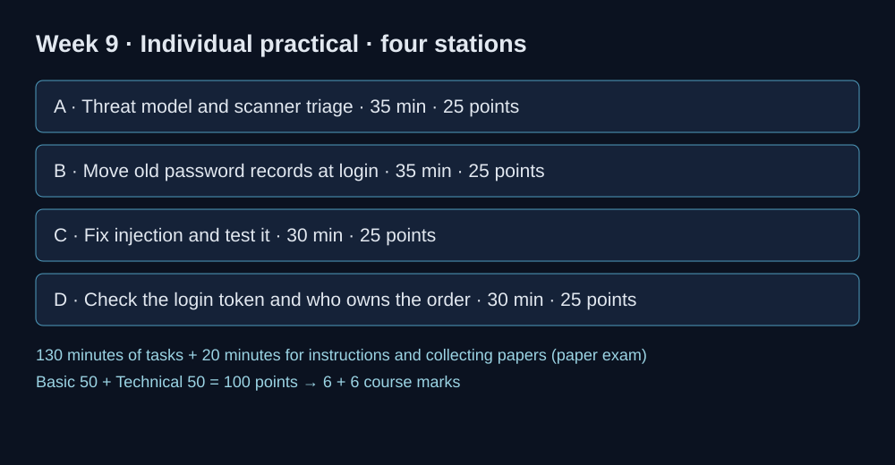

# Week 9 midterm practical — what you will do

**02005094 · Week 9 · individual work · 150 minutes:** 10 minutes briefing, 130 minutes on the four stations, 10 minutes to check your upload.

**Points:** four stations × 25 points = 100 points, which count as 12% of your course grade. Only the four stations below are marked. Leaderboards, "first blood", prizes and House XP give no course marks. A flag on its own cannot earn full marks: you also need your own fix, your test results and your explanation.

**On the day:** your instructor hands out a small exam pack with the starter files and tells you how to run them. Work only on the files in that pack, on your own machine. Never attack any other system. You do not need a CTF account, and there are no personal flags. If your instructor does give you a hosted practice server, use only the one assigned to you.

## Words you will see

| Word | Meaning |
| --- | --- |
| **Point (raw point)** | A mark on this practical, out of 100. |
| **Positive test** | A normal, allowed request that must still work after your fix (for example, the owner reading their own order). |
| **Negative test** | A bad or attacking request that your fix must refuse (for example, another user reading that order). |
| **False positive** | A scanner warning that turns out not to be a real problem. |
| **Parameterized SQL** | Sending user input to the database as a separate value (`?`), never pasted into the SQL text. |
| **argv list** | Running a program as a list such as `["ping", "-c", "1", host]`, so no shell reads the input. |
| **JWT** | A signed login token. **sub** = which user, **aud** = which app it is for, **exp** = when it expires. |
| **Pinned algorithm** | The server accepts only the one signing method it expects (here HS256), and refuses unsigned tokens. |

## Station A — Threat model and scanner triage: 25 points, 35 minutes

**Revise:** Weeks 1 and 2.

You get a short description of an app (browser → server → database) and some scanner results.

1. Draw the data flow and mark where the trust boundaries are.
2. Decide which finding is a real problem and which is a false positive.
3. One scan failed with a tool error. Say clearly that this scan did not succeed; it is not a clean result.
4. Propose the fix, plus one positive test and one negative test for it.

**Hand in:** your diagram and triage notes, what the failed scan showed, your fix (code or design) and both tests.

## Station B — Moving old password records: 25 points, 35 minutes

**Revise:** Week 3.

You get a starter file, `migrate.py`. When a user logs in with the correct password, replace their old hash with an Argon2id hash. Show three results:

1. A wrong password is refused, and the stored record does not change.
2. A correct password logs in, and the record is now Argon2id.
3. The next login with the same password still works.

Then explain in one or two sentences why you cannot upgrade every old hash at once without the users' passwords.

**Hand in:** your change (diff) and the three results you saw.

## Station C — Stop injection: 25 points, 30 minutes

**Revise:** Week 4.

Finish the two functions in the starter: a login query that uses parameterized SQL, and a ping helper that checks the address is one real IPv4 address and returns an argv list. Show:

- a normal login and a normal IPv4 address such as `127.0.0.1` still work (positive tests);
- an SQL injection string does not log in, and a host containing shell characters such as `;` or `|` is refused without running a shell (negative tests).

**Hand in:** your change and the test output you saw.

## Station D — Check the token and who owns the object: 25 points, 30 minutes

**Revise:** Week 6.

Finish the starter so the server checks the JWT properly (pinned algorithm, and **sub**, **aud** and **exp** are all required), then checks on the server that the order belongs to the logged-in user. Show:

- the owner can read their own order (positive test);
- another user cannot read it (negative test);
- a broken or unsigned token is refused (negative test).

**Hand in:** your change and the test output you saw.

## How each station is marked

Each station has **25 points**, split in two halves:

| Half | Points | What earns them |
| --- | ---: | --- |
| **Basic** | 12.5 | Correct finding or root cause 5 · explaining how it works and where the boundary is 5 · reading your results and stating their limits 2.5 |
| **Technical** | 12.5 | Your own fix 5 · positive and negative tests 5 · results someone else could repeat 2.5 |

Four stations give Basic 50 + Technical 50 = 100 points. Your course mark is (Basic ÷ 50 × 6) + (Technical ÷ 50 × 6), so at most 12. You get partial marks for each part you show. A flag, or a copied reference fix, is not enough on its own.

## What to hand in

Upload **one evidence file per student** to the assignment your instructor announces for the exam. For each station include:

- the station letter (A, B, C or D)
- the file you changed, or a diff
- the exact command you ran
- what you saw when you ran it
- one positive test and one negative test
- why the problem happened and why your fix works
- one limit of your test (something it does not prove)

Use the final 10 minutes only to check that your upload worked and can be opened. There is no extra task time.

The older challenge sheet from earlier versions of this course (hash cracking, ECB, flag-only scoring) is not part of this exam.
