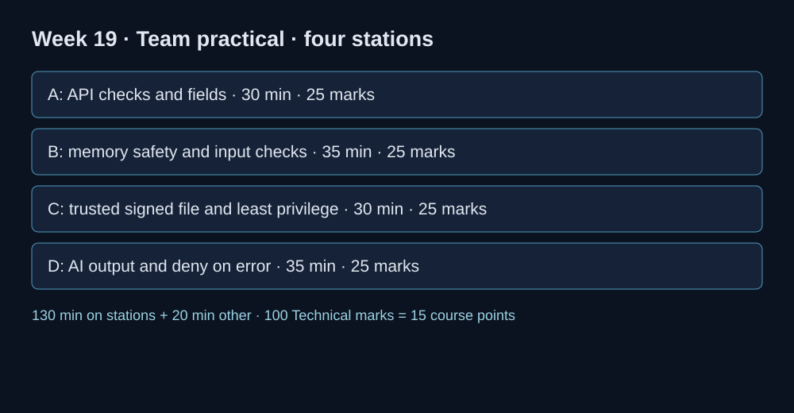

# Final team practical — the four stations

**02005094 · Week 19 · 150-minute exam: 10 minutes instructions + 130 minutes on the stations + 10 minutes to check your submission.**

**100 marks, all Technical · counts 15% of the course · your existing project team of 2–3.** Only the four stations below are required. Marks come from the fixed marking scheme at the bottom of this page, not from scoreboard points, bonuses for solving first, prizes or House points. A flag alone does not show that you fixed anything, so it cannot earn full marks.

Your instructor gives you a starter pack on the day, already tested, with the starter code, data and instructions to run it offline. The weekly labs are for practice; your exam evidence must come from the exam pack. If your instructor gives you an online exam instance, take your proof from that instance; the fix and check evidence below still applies. Never attack any system outside the exam pack.

**How to prepare:** redo the weekly student task that matches each station (listed under each station below).

## Station A — Who may read what, and which fields a client may set: 25 marks, 30 minutes

**Practice:** Week 10 (plus Weeks 4–6).

Write the owner/admin check for reading orders, and a list of fields a client may set when creating an account. Show that the owner and an admin can read the orders, that another user is refused, and that a privilege field such as `is_admin` is ignored or rejected. Explain why the lab's identity header is not real login.

**Submit:** your code, the checks that pass and fail as expected, and your explanation of where the trust boundary is.

## Station B — Memory safety and input checks: 25 marks, 35 minutes

**Practice:** Week 11.

Use the starter that matches your computer. Using the crash information you are given, explain the unsafe C copy and why the ret2win offset only works on that one build. Then finish the Rust function that counts Unicode characters, and check that it handles the invalid UTF-8 input you are given. Run one valid and one invalid input. You do not have to write an exploit or fuzz anything yourself.

**Submit:** your explanation of the crash information, your Rust code, and the output of both input checks. The C crash trace is given to you; it is not proof that you ran an exploit.

## Station C — Trusting a signed file, and least privilege: 25 marks, 30 minutes

**Practice:** Weeks 12 and 13.

In the prepared local signature example, finish the code that accepts a signature only if the public key's fingerprint is the trusted one. Run three checks: valid signature with the trusted key, tampered file, and valid signature with the wrong key. Then, in a small S3 policy you are given, point out the separate permission decisions and fix the marked `*` wildcard. Explain what this local test cannot prove about a real system.

**Submit:** your key-check code, the three results, one policy diff, and a short statement of what your test covers. You do not need a registry, an OIDC login or an AWS account.

## Station D — Untrusted AI output, and deny on error: 25 marks, 35 minutes

**Practice:** Weeks 14 and 15.

Finish two things: remove the secret from the AI output and HTML-escape it, and make the permission check deny access when the lookup throws an error. Keep a normal request working; refuse the secret, the script markup and the error case. Write a safe log line that never contains the token or the error text.

**Submit:** your code changes, the checks that pass and fail as expected, and the safe log output. You do not need an online AI account.

## Marking scheme

Each station (25 marks): root cause and trust boundary 5 + your fix 10 + one allowed and one refused example 7 + evidence that someone else can repeat, and the limits 3 = 25. Four stations = 100 marks, all Technical. Course points = marks ÷ 100 × 15. Write down what each team member did. Partial marks come from your evidence and reasoning, not from how many flags you found. Leaderboard points give no marks.

Your project report, code and a video of at most 5 minutes are due **Sunday 28 February 2027, 23:59** (before this exam) and are marked separately (15% of the course). There are no project questions during the 130 minutes; ask them in Weeks 16 and 20. Each member's project mark is adjusted by peer contribution and can be at most 100 before it is converted to 15%.

## Submission

Submit **one evidence pack per team**. For each station include: the station letter, your changed code or diff, the exact command, what it printed, one example that should work, one that should be refused, how the problem works, and what your fix still cannot prove. Submit where your instructor announces. Use the last 10 minutes to check that your upload arrived; there is no extra station work in that time.
