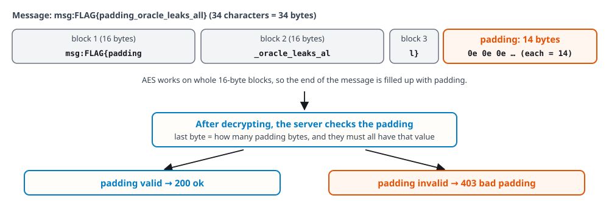
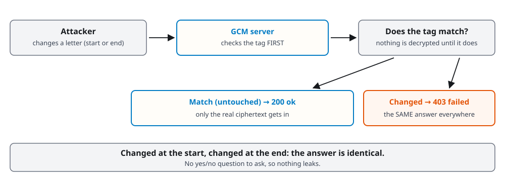

# Worksheet 6 — AEAD: the CBC Padding Oracle vs AES-GCM

> **Course:** Cryptography and Network Security (KOSEN69) · **{{ slot_label }}**
> **Kind:** Docker lab, step by step. No programming and no maths.

> **Ethics note:** Only work on the 2 containers on your own computer that this lab starts (ports 8098 and 8099).
> Padding oracle attacks happen in real life (for example POODLE and Lucky Thirteen). Trying them on a system that is not yours, without permission, is illegal. Keep the flag inside this lab only.

## Read this first

**What you will do today:** One server keeps a secret message encrypted with AES-CBC. It **never tells you the secret**. It only gives a short answer: "ok" or "bad padding". But that short answer leaks information, so a script can read the whole secret without the key. Then you will see how a **GCM** server answers, so that it leaks nothing. Remember this: **"does not tell the secret" is not the same as "leaks nothing".**

**Every step is written the same way:**

| Heading | Meaning |
|---|---|
| **What to do** | Says what this step does |
| **Type** | Copy the whole line, paste it into the Terminal, and press Enter |
| **You should see** | The screen should look roughly like this |
| **Means** | What the result means |
| **Write in the answer sheet** | What to copy or write in your answer sheet |

**Marks**

- Everyone does **Part A (60 marks)**, which is the same for both forms.
- Then do **only your own form (40 marks)**. Look at the last digit of your student ID: **odd = Conventional (Part 2)**, **even = AIR-Sec (Parts 3–4)** (0 counts as even). Write your form in the Group box.
- You may answer in English or Thai. Short and clear is enough.
- **Answer sheet:** in Classroom → Week 06, open the file for your form (`Wk06_Answer_Sheet_Conventional_odd_ID` or `Wk06_Answer_Sheet_AIR-Sec_even_ID`), choose Open with → Google Docs, type in the grey boxes, then choose File → Download → PDF.
- Submit one file named with your student ID, for example `Wk06_66990000.pdf` (do not type the `<` `>` signs), at `learn.zcr.ai/submit` with your Week 6 submission code from your KMITL email, by **Sunday 13 Dec, 23:59**.
- Items marked *optional* have no marks. You can skip them.

| Part A | Marks | Steps to write in the answer sheet |
|---|---:|---|
| A1 — What the CBC server leaks without meaning to | 20 | Steps 2, 3 |
| A2 — A script reads the secret without the key | 20 | Steps 5, 6 |
| A3 — GCM leaks nothing | 20 | Steps 7, 8, 9, 10 |

**Words you need to know**

| Word | Simple meaning |
|---|---|
| Terminal | A window where you type commands |
| Docker / container | A program that starts a small "pretend computer" on your computer. If you break it, delete it and start again |
| AES | A standard way to encrypt that is very strong. In this lab AES is not broken. The problem is *how it is used* |
| block | AES encrypts one chunk at a time, 16 bytes per chunk (about 16 letters) |
| CBC | A mode that chains many blocks together, but **has nothing that checks whether the data was changed** (learned in Week 4) |
| padding | Extra data added to the end of a message to fill the last 16-byte block. A 34-letter message needs 14 more bytes to make 3 full blocks |
| PKCS#7 | A common way to add padding: add the number "how many were added", repeated that many times (14 bytes of padding means the number 14 repeated 14 times) |
| oracle | Means "something that answers questions". Here it is a server that answers yes/no without meaning to, and that answer leaks information |
| padding oracle | An oracle that says whether the padding is right or wrong after decrypting |
| HTTP 200 / 403 | Codes the server answers with. 200 = accepted (ok) · 403 = refused |
| GCM | An encryption mode that attaches a **tag** to check whether the data was changed (learned in Week 4) |
| AEAD | Authenticated Encryption with Associated Data: encrypts and checks that the data was not changed in one step (GCM is one AEAD) |
| flag | A prize message in the form `FLAG{...}`, which is proof that you succeeded |

**Questions people often ask**

- *Do I need to be good at maths?* No. There is no calculation today.
- *Do I need to write programs?* No. Copy the commands and paste them.
- *If I make a mistake, will my computer break?* No. Everything is inside containers. If you get confused, type `docker compose down` and start again from Prep step 5.
- *Can I skip understanding every character on the screen?* Yes. Only look at the lines the worksheet tells you to.
- *My secret message is not the same as my friend's. Is that wrong?* In this lab everyone gets the same secret message and flag (it is set up the same way). That is fine, but you must always copy from your own computer.
- *How do I paste a command into the Terminal?* Copy the command from the worksheet, then Windows: press Ctrl+V or right-click · Mac: press Cmd+V, then press Enter.
- *How do I copy results from the Terminal?* Select the text with the mouse first, then Windows: press Ctrl+Shift+C · Mac: press Cmd+C. Or take a screenshot.

**If you see a message like this**

| Message on screen | Cause | Fix |
|---|---|---|
| `Cannot connect to the Docker daemon` or `error during connect` | Docker is not open | Open Docker Desktop and wait until it says Engine running |
| `no configuration file provided: not found` | The Terminal is not in the lab folder | Repeat Prep step 4 |
| `service "vulnerable" is not running` | The lab is not started | Do Prep steps 5 and 6 |
| `Failed to connect` or `Connection reset by peer` | The server is not ready yet | Wait a moment, then repeat Prep step 6 |
| `Cannot reach the vuln server` or `Cannot reach the fixed server` | The lab has not finished starting | Wait a moment, then repeat Prep step 6 |
| `can't open file '/lab/ask.py'` | The ZIP you downloaded is old and has no `ask.py` | Download a new ZIP as in Prep step 2 |
| Windows asks for `Uri` or shows red text when you use `curl` | Windows has a different `curl` command | Change the first word to `curl.exe` |
| `FAIL: fixed app never came up` (after about 1 minute) | You left out `-e FIXED_HOST=fixed` | Copy the Step 5 command again, the whole line |

If you still cannot do it, ask a friend or your instructor.

---

## Before you start: set up your computer (at home, once)

If you already did Week 2, 3 or 4, you have Docker and the ZIP file. Start at **Prep step 4**. But the ZIP must be a recent one that has the file `ask.py`. If you cannot find the `week06-aead` folder, or it has no `ask.py`, download the ZIP again as in Prep step 2.

**If you turned your computer off and came back:** repeat Prep steps 1, 4, 5 and 6.

#### Prep step 1 — Open Docker Desktop

**What to do:** If you do not have it yet, install it from <https://www.docker.com/products/docker-desktop/> and leave the program open.

**You should see:** the Docker Desktop window says **Engine running**.

#### Prep step 2 — Download the lab files

**What to do:** Open <https://github.com/nutthakorn7/security-cryptography>, click the green **Code** button, and choose **Download ZIP**.

You do not need a GitHub account and you do not need to fork.

#### Prep step 3 — Unzip the ZIP file

**What to do:** Windows: right-click the ZIP file and choose **Extract All** · Mac: double-click the ZIP file. Put it somewhere easy to find, such as the Desktop.

**You should see:** a folder called `security-cryptography-master`. Some computers make a folder with the same name inside it; open it until you can see the `labs` folder.

#### Prep step 4 — Open a Terminal inside the lab folder

**What to do:** Open the `labs` folder, then open `week06-aead`.

- **Windows:** open the `week06-aead` folder in File Explorer, right-click an empty spot, and choose **Open in Terminal** (if you do not see it, hold Shift, right-click, and choose **Open PowerShell window here**)
- **Mac:** open the Terminal app, type `cd` and one space, drag the `week06-aead` folder into the window, then press Enter

Check that you are in the right place with this command:

```bash
ls
```

**You should see:** `docker-compose.yml`, `exploit.py` and `ask.py` in the list.

#### Prep step 5 — Start the lab

**Type:**

```bash
docker compose up -d
```

**You should see:** two lines ending in `Started` (if the lab was already running you may see `Running`). **You need the internet every time you start this lab**, because the containers install packages each time they start. The first time it may take several minutes. Do not close the window while you wait.

#### Prep step 6 — Check that the lab is ready

**Type** (Mac):

```bash
docker compose logs | grep "Running on"
```

**Type** (Windows):

```powershell
docker compose logs | findstr /C:"Running on"
```

**You should see:** about 6 lines, each starting with the container name; that is normal. Find these two lines. You must see **both of them** (you must see both 8098 and 8099):

```
vulnerable-1  |  * Running on http://127.0.0.1:8098
fixed-1       |  * Running on http://127.0.0.1:8099
```

Other `Running on` lines can be ignored. If you see nothing, or only one, wait a moment and type the command again. If it still fails after 2 minutes, type `docker compose ps -a` and `docker compose logs` (no filter), take a screenshot, and send it to your instructor. Do not just keep waiting. A common cause is the internet dropping while the packages install.

---

## Part A — The lab (both forms, 60 points)

There are two servers. They keep the same secret message. They differ only in how they encrypt and how they answer:

| Server | Port | Encryption | Does it say whether the padding is right? |
|---|---|---|---|
| `vulnerable_app.py` | `:8098` | AES-256-**CBC** (no tag) | **Yes** (200 ok / 403 bad padding), so it is a padding oracle |
| `fixed_app.py` | `:8099` | AES-256-**GCM** (tag) | **No.** It gives the same 403 every time the ciphertext is wrong |

> **If you really cannot use Docker:** tell your instructor, then open **<https://learn.zcr.ai/sim/padding-oracle>** (a small pretend encryptor, not real AES), press the buttons on that page, and take a screenshot of the result instead of Step 5. For Steps 2, 7 and 9, copy the examples in the worksheet and write "from the worksheet example" next to them. You can answer the other steps by reading the worksheet.

### A1 — What the CBC server leaks without meaning to (20 points)

#### Step 1 — Read the picture: what padding is

**What to do:** Just read and look at the picture. You do not need to type anything.



AES encrypts one block at a time, 16 bytes per block. Our secret message is 34 letters long, so it needs **padding** of 14 more bytes to make 3 full blocks. The bytes added are the number 14, repeated 14 times. When the server decrypts, it **checks the padding at the end** to see whether it follows the rule. If it does, it answers `200 ok`. If not, it answers `403 bad padding`.

#### Step 2 — Change the first letter and a letter near the end, then ask the CBC server

**What to do:** The file `ask.py` changes one letter of the already-encrypted message and sends it to the CBC server (port 8098) to ask "after decrypting, is the padding okay?". We ask twice: once changing the first letter, and once changing letter number 83 of 88, near the end.

**Type** one line at a time:

```bash
docker compose exec vulnerable python ask.py vuln start
docker compose exec vulnerable python ask.py vuln end
```

**You should see:** two lines each time

```
server: vuln (port 8098)   asked about: start   (letter number 1 of 88 changed from D to A)
answer: HTTP 200 {"status":"ok"}
server: vuln (port 8098)   asked about: end   (letter number 83 of 88 changed from 2 to A)
answer: HTTP 403 {"error":"bad padding"}
```

**Means:** When the first letter is changed, the server answers `ok`, because CBC has nothing that checks whether the data was changed (like Week 4), and the first letter does not touch the padding at the end. When a letter near the end is changed, it answers `403 bad padding`, because the end is the block that holds the padding. **Where we change a letter changes the answer.** That is the information that leaks.

**✍️ Write in the answer sheet (Step 2):** copy the four lines above from your own screen.

#### Step 3 — Summarise in your own words

**What to do:** Fill in the blanks.

> If the first letter is changed, the server answers ________, but if a letter near the end is changed, the server answers ________ (choose words: `200` / `403`). This difference in answers tells an attacker, without meaning to, whether the ________ is correct (choose a word: `padding` / `key`).

**✍️ Write in the answer sheet (Step 3):** write the full sentence.

### A2 — A script reads the secret without the key (20 points)

#### Step 4 — Read the picture: guessing one byte at a time

**What to do:** Just read and look at the picture. You do not need to type anything.


The script `exploit.py` **does not know the key**. It just asks the server again and again, like a number-guessing game: change the data in one position, try the values 0 to 255 one at a time, and when the server answers `200` it knows the value of the hidden byte. Then it repeats for the next byte, for all 16 bytes in a block, for all 3 blocks. That is a few thousand questions in total (you do not need to calculate this yourself; the detailed idea is in the optional item at the end of Part 2).

#### Step 5 — Run the script (against the CBC server and the GCM server)

**What to do:** Let the script ask the CBC server one byte at a time to read the secret message, then do the same against the GCM server. The script runs inside a container, so you do not need to install Python on your computer.

**Type** (copy the whole line; do not cut off `-e FIXED_HOST=fixed`):

```bash
docker compose exec -e FIXED_HOST=fixed vulnerable python exploit.py
```

**You should see:** it takes a few seconds (up to half a minute on a slow computer). The output is several lines long. Find **these seven lines** (the real text appears on your screen; in the example it is shortened to `...`). The first five lines are from CBC and the last two are from GCM:

```
    [oracle] block 0 recovered: b'...'
    [oracle] block 1 recovered: b'...'
    [oracle] block 2 recovered: b'...\x0e\x0e\x0e\x0e...'
[*] Recovered plaintext: b'msg:FLAG{...}'
PASS: padding oracle recovered the plaintext WITHOUT the key on vulnerable app (:8098) -- flag = FLAG{...}
    [oracle] block 0: no usable padding signal -- nothing recovered
PASS: padding-oracle attack got NO usable signal from the AEAD app (:8099) -- plaintext NOT recovered (uniform 403, tag checked first)
```

**Means:** The script read the whole secret from the CBC server, all 3 blocks, without the key. It had only the answers `200` / `403`. Against the GCM server the script could not even guess the first byte, because every question got the same 403 answer. Both `PASS` lines mean the result is what it should be. If you cannot find the lines, you can type the command again (the result is the same).

**✍️ Write in the answer sheet (Step 5):** copy the seven lines above (the three `[oracle] block` lines, `Recovered plaintext`, the `PASS` line with the flag, then the two GCM lines).

> **If you cannot use Docker:** see the box "If you really cannot use Docker" at the start of Part A.

#### Step 6 — Answer two questions

**What to do:** Fill in the blanks in both items (hint: Step 4 and the last block line in Step 5).

> a) The script (knows / does not know) the AES key, but it can still read the secret because the server tells it about the ________ every time it asks (choose a word: `padding` / `key`).
>
> b) The secret message is 34 letters long, the ciphertext has 3 blocks (48 bytes), and the 14 `\x0e` characters you see at the end are the ________ added to fill the block (choose a word: `padding` / `flag`).

**✍️ Write in the answer sheet (Step 6):** write both sentences in full.

### A3 — GCM leaks nothing (20 points)



#### Step 7 — Ask the GCM server three ways

**What to do:** Ask the GCM server (port 8099) with the original message unchanged, then with the first letter changed, then with a letter near the end changed, the same way as in Step 2.

**Type** one line at a time:

```bash
docker compose exec vulnerable python ask.py fixed original
docker compose exec vulnerable python ask.py fixed start
docker compose exec vulnerable python ask.py fixed end
```

**You should see:** two lines each time. Look at the `answer:` line of each one

```
answer: HTTP 200 {"status":"ok"}                          (original)
answer: HTTP 403 {"error":"decryption failed"}            (start)
answer: HTTP 403 {"error":"decryption failed"}            (end)
```

**Means:** The unchanged message works as normal (200). But GCM checks the tag first, finds that the tag does not match, and refuses (403). **Wherever you change a letter, the answer is the same.** This is different from CBC in Step 2, where the answer depended on the position, so the attacker has nothing to use for guessing.

**✍️ Write in the answer sheet (Step 7):** copy the `answer:` line of all three runs.

#### Step 8 — Summarise in your own words

**What to do:** Look at the result of Step 7 and fill in the blank.

> GCM answers ________ (choose a word: `the same` / `differently`) wherever we change a letter.

**✍️ Write in the answer sheet (Step 8):** write the full sentence.

#### Step 9 — Find the lines that differ in the code

**What to do:** Look at the key line in each of the two files.

**Type:**

```bash
docker compose exec vulnerable grep -n -E "pkcs7_valid\(plaintext\)|_aesgcm.decrypt" vulnerable_app.py fixed_app.py
```

**You should see:**

```
vulnerable_app.py:117:    if pkcs7_valid(plaintext):
fixed_app.py:83:        _aesgcm.decrypt(nonce, ct_and_tag, None)
```

**Means:** The vulnerable file decrypts, then **checks the padding** (`pkcs7_valid`) and answers differently depending on the result. The fixed file uses `_aesgcm.decrypt`, which **checks the tag first**. If it does not match, it raises an error and the code answers the same 403 in every case.

**✍️ Write in the answer sheet (Step 9):** copy the two lines that appear on your screen.

#### Step 10 — Why the byte-guessing method does not work on GCM

**What to do:** Read, then answer in 1–2 sentences.

GCM attaches a **tag** (a seal made with a MAC) and **checks the tag before** it decrypts anything. If the tag does not match, it refuses with the same answer (wherever the mistake is). But GCM only helps if the program obeys this check (Week 4 Step 11).

> Why can the script that reads the CBC message not read the GCM message at all? (hint: Step 7 and the words "the same answer")

**✍️ Write in the answer sheet (Step 10):** write your answer.

#### Step 11 — Shut down the lab and check your answer sheet

**What to do:** Do this after you have copied all the results.

**Type:**

```bash
docker compose down
```

**You should see:** lines ending in `Removed`. Then check that your answer sheet has everything: Steps 2, 3 (A1), Steps 5, 6 (A2), Steps 7, 8, 9, 10 (A3). Then do the part for your own form: odd IDs do Part 2, even IDs do Part 3 and Part 4.

---

## Part 1 — Student Information
| Name | Student ID | Date | Group (your form) | AI tools used (which, for what) |
|---|---|---|---|---|
| | | | | |

---

## Part 2 — Conventional form (40 points; only if Conventional is your assigned form)

Answer each item in 2–3 sentences. You may answer in English or Thai. In this part **answer by yourself**, without using AI to answer. The question numbers come from the original question bank, so some numbers are skipped.

**Q1 (10). AEAD.** AEAD is the name of a kind of encryption tool, for example AES-GCM.

Answer both of these:

- What does AEAD stand for, and what does it give you in a single step? (hint: look at the word table and the words "checks that it was not changed")
- In today's lab, what does GCM give that CBC does not? (hint: Step 2 and Step 7)

**Q3 (10). Padding oracle.** The CBC server in the lab never tells the secret, but the script could still read all of it.

Answer all three of these (1–2 sentences each):

- What does the server tell you without meaning to? (hint: Step 2)
- Why is an ok / not ok answer enough to read the secret? (hint: Step 4, the number-guessing game)
- A login website answers "user not found" when the username is wrong, but answers "wrong password" when the password is wrong. Do these two answers leak the same kind of information, and how should it be fixed? (hint: compare Step 2 with Step 7)

**Q4 (10). Why GCM does not leak.** The same script reads CBC but cannot read GCM.

Answer all three of these (1–2 sentences each):

- Reason 1, about **order**: what does GCM check before it does anything else? (hint: Step 9)
- Reason 2, about the **answer**: how does GCM answer when the ciphertext is wrong? (hint: Step 7)
- Give one example from the lab where you can see the difference from CBC.

**Q7 (10). Forgetting to check the tag.** A program uses AES-GCM, but the developer wrote it to "ignore the result of the tag check" and carry on using the decrypted data.

Answer both of these:

- What goes wrong? Does GCM lose its "check that it was not changed"? (hint: Week 4 Step 11)
- Compare with CBC in Step 2: is it the same or different, and how?

### Going further (optional — no marks)

- **Q2 — Safe composition.** If you do not use GCM but use CBC with a separate MAC, the order Encrypt-then-MAC is safe when the MAC covers both the IV and the ciphertext, the two keys are different, and the MAC is checked **before** decrypting. Why are MAC-then-Encrypt and Encrypt-and-MAC riskier?
- **Q5 — Associated data.** What is data that you want to "check was not changed, but not encrypt"? Give an example, and say what happens if you do not check it.
- **Q6 — CBC malleability.** Why does changing the previous block change the next block at the same position (learned in Week 4), and how does that relate to the padding oracle?
- **Q8 — Choosing an AEAD.** How do you choose between AES-GCM, ChaCha20-Poly1305 and AES-GCM-SIV, depending on the machine and the risk?
- **Extension — why 200 tells you the byte value (for those who are curious).** When we change the last byte of the forged "previous block" and the server answers 200, the last byte of the decrypted message can be `0x01`, so we can work out the hidden value from `D(C_t)[15] = the guessed value XOR 0x01`. If it answered 200 because the padding happened to be exactly `02 02`, the script changes the neighbouring byte and asks again to rule that case out (see the function `recover_intermediate` in `exploit.py`).

---

## Part 3 — AIR-Sec Arm: Audit the AI (AIR-Sec version only, 20 points)

AI is a power tool you must **distrust** — you are graded on your *critique*, not the AI's answer.

A friend asked an AI to write a "safe decrypt endpoint" for an AES-CBC service. The AI answered with the code below. It looks careful: it checks the padding, checks the message format, and answers each error clearly. But it has a **serious mistake** that turns it back into a padding oracle. Your job is to find it.

> **AI's answer — "a safe CBC decrypt endpoint":**
>
> ```python
> @app.post("/decrypt")
> def decrypt():
>     blob = base64.b64decode(request.json["ciphertext"])
>     iv, ct = blob[:16], blob[16:]
>     plaintext = aes_cbc_decrypt(key, iv, ct)   # raw, padding not yet removed
>     try:
>         unpadded = pkcs7_unpad(plaintext)      # raises ValueError on bad padding
>     except ValueError:
>         return {"error": "invalid padding"}, 400
>     if not unpadded.startswith(b"MSG:"):
>         return {"error": "malformed message"}, 422
>     return {"plaintext": unpadded.decode()}, 200
> ```
>
> "This endpoint is safe: it decrypts the ciphertext, strips PKCS#7 padding, and rejects anything
> whose padding is invalid with a clear `400` error so the client knows to resend. It further
> validates that the message has the expected `MSG:` prefix, returning a distinct `422` if not, so
> callers get precise diagnostics. Because we always validate the padding before using the
> plaintext, tampered ciphertexts are caught early and cannot corrupt downstream logic."
>
> — end of AI answer —


The AI's answer above is in English. You do not need to translate every word. Follow these steps one at a time:

**P3-1 Skim it:** The code has one function, `decrypt()`. It decrypts and strips the padding. If the padding is wrong it answers `400`. If the message does not start with `MSG:` it answers `422`. Otherwise it answers `200`. Then there is one paragraph of explanation.

**P3-2 What is already right (do not criticise it):** Calling AES to decrypt and using PKCS#7 padding are the normal way to do CBC. (PKCS#7, or padding, only fills the data up to a full block. It does not check that the data was not changed.)

**P3-3 Find the mistake:** Count how many different answers a client can get from this endpoint (`400`, `422`, `200`), and ask yourself what each one tells you about the padding of what was decrypted (think of Step 2 of Part A).

1. **Find what's wrong or risky.** Copy the lines that make the answers differ, then write 1–2 sentences on why they are wrong (use what you saw in the lab).
2. **Write the corrected version yourself.** Make it safe by changing to **AES-GCM**, and write what the endpoint must do when the tag does not match (it must refuse with the same answer every time and must not use the data any further). A short explanation is enough; you do not need to write code. Then write 1–2 sentences on why the original code, which answers `400` / `422` / `200`, leaks information even though it never sends the plaintext back.

> Disclose any other AI use in the Part 1 table. This task counts toward the **Audit the AI** row.

---

## Part 4 — Comprehension & Prompt (AIR-Sec version only: EiPE 10 + Prompt 10)

**A. Explain in Plain English (EiPE, 10).** A friend who knows AES but has never heard of padding asks: *"The server never sends the secret message back. It only answers ok or error. So why can someone read the secret?"*

Explain it to your friend in 2–4 sentences **without hard words**, answering both of these (hint: look at the pictures in Step 1 and Step 4 and use your own words):

- What is padding, and which question does the server answer without meaning to?
- Why is asking again and again, a few thousand times, enough to read the secret without the key?

**B. Prompt Problem (10).** Use any AI you like and do this:

1. Write **one** prompt asking the AI to write a `decrypt()` endpoint for an encrypted-message service that resists padding oracle attacks (also tell the AI that the attacker can send any ciphertext and can see the answers).
2. Copy the AI's answer into your answer sheet.
3. Check the AI's answer against what you learned, one item at a time:

- Does the AI choose an AEAD (AES-GCM or ChaCha20-Poly1305), or does it write CBC with its own padding check? (Does it use an AEAD cipher?)
- If it still uses CBC: does the AI check a MAC before decrypting, and answer the same way every time? (If it keeps CBC, does it check a MAC first and answer the same way every time?)
- Does the AI say anything wrong or make anything up? (Does it make anything up?) Watch out for: saying that "answering the same error 500 makes CBC safe"; saying that "PKCS#7 padding already checks that the data was not changed"; or saying that AES-GCM "still needs padding".

4. In the table in your answer sheet, tick **pass / fail** for each item and write a short reason of 1 sentence for each. Finish with 1 sentence saying whether you would trust this AI's answer, and why.

Submit **your prompt + the AI's answer + your check table with your own reasons**.

---

## 🎤 Viva spot-check (formative/authenticity check; no separate points)

An instructor may ask any of these live, at random, to confirm you did the work yourself:

1. "In Step 2 the CBC server answered differently. What did it answer, and when? What does the different answer tell an attacker?"
2. "The script does not know the key, so how can it read the secret? Explain in simple words from the picture in Step 4."
3. "How does the GCM server answer in Step 7, and why does the same script get nothing at all?"

---

## Grading rubric — assigned version totals 100

| Criterion | Conventional | AIR-Sec |
|---|---:|---:|
| A1 — what the CBC server leaks | 20 | 20 |
| A2 — script reads the secret without the key | 20 | 20 |
| A3 — GCM leaks nothing + reasoning | 20 | 20 |
| Conventional written questions (Q1, Q3, Q4, Q7) | 40 | — |
| AIR-Sec Audit the AI | — | 20 |
| AIR-Sec Explain in Plain English (EiPE) | — | 10 |
| AIR-Sec Prompt Problem | — | 10 |
| **Total for the assigned version** | **100** | **100** |

## Evidence & Integrity (required)

- Put your name, student ID and date in the answer sheet, and copy the commands and results from **your own** computer. Your flag may be the same as a friend's. This week there is no personal flag. Do not submit a friend's results as your own.
- **Explain in your own words** (marks are given for the reasoning): for the fill-in-the-blank items that give you a word bank (Steps 3, 6, 8) you may use the words given. The short answer in Step 10 and the written part of your own form must be in your own words (why the CBC server's secret can be read, and why the GCM server leaks nothing). You do not need to write anything more than that.

**Deadline and late submission:** Submit by 23:59 (Thai time) on **Sunday 13 Dec**. A late submission loses 10% of this worksheet's marks for each day late (a part day counts as a day), down to 0. Uploading or replacing a file after the deadline counts the whole submission as late. Submit the common 60 marks and **one** form of your own only; doing both forms gives no extra marks. The viva is used to check understanding and has no separate marks.
