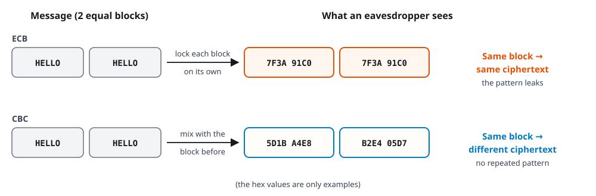

# Worksheet 4 — AES / Block-Cipher Modes: CBC vs GCM

> **Course:** Cryptography and Network Security (KOSEN69) · **{{ slot_label }}**
> **Kind:** Docker lab แบบทำตามทีละขั้น ไม่ต้องเขียนโปรแกรม และไม่ต้องคำนวณเลข

> **Ethics note:** ทำเฉพาะกับ container 2 ตัวในเครื่องของตัวเองที่ lab นี้เปิดขึ้นมา (พอร์ต 8096 และ 8097)
> การแก้โทเค็นหรือข้อมูลที่เข้ารหัสของระบบที่ไม่ใช่ของเราและไม่ได้รับอนุญาตเป็นเรื่องผิดกฎหมาย เก็บ flag ไว้ใน lab นี้เท่านั้น

## อ่านก่อนเริ่ม

**วันนี้จะทำอะไร:** เว็บหนึ่งให้ "โทเค็น" (บัตรผ่าน) ที่เข้ารหัสด้วย AES เรามองไม่ออกว่าข้างในเขียนอะไร เราจะลอง*แก้*โทเค็นนั้นโดยไม่รู้กุญแจ แล้วดูว่าเว็บแบบ **CBC** ไม่รู้เลยว่าถูกแก้ แต่เว็บแบบ **GCM** จับได้ สิ่งที่ต้องจำ: **เข้ารหัสแล้ว ไม่ได้แปลว่าแก้ไม่ได้**

**ทุกขั้นเขียนแบบเดียวกัน:**

| หัวข้อ | ความหมาย |
|---|---|
| **ทำอะไร** | บอกว่าขั้นนี้จะทำอะไร |
| **พิมพ์** | คัดลอกทั้งบรรทัดไปวางใน Terminal แล้วกด Enter |
| **ควรเห็น** | หน้าจอควรขึ้นประมาณนี้ |
| **แปลว่า** | ผลที่เห็นหมายความว่าอะไร |
| **ลงใบตอบ** | สิ่งที่ต้องคัดลอกหรือเขียนลงใบตอบ |

**คะแนน**

- ทุกคนทำ **Part A (60 คะแนน)** ซึ่งเหมือนกันทั้งสองแบบ
- จากนั้นทำ **เฉพาะแบบของตัวเอง (40 คะแนน)** ดูจากเลขตัวสุดท้ายของรหัสนักศึกษา: **เลขคี่ = Conventional (Part 2)**, **เลขคู่ = AIR-Sec (Parts 3–4)** (เลข 0 นับเป็นเลขคู่) แล้วเขียนแบบของตัวเองในช่อง Group
- ตอบเป็นภาษาไทยหรืออังกฤษก็ได้ ตอบสั้น ๆ ให้ชัดก็พอ
- **ใช้ใบตอบ:** ใน Classroom → Week 04 เปิดไฟล์ตามแบบของตัวเอง (`Wk04_Answer_Sheet_Conventional_odd_ID` หรือ `Wk04_Answer_Sheet_AIR-Sec_even_ID`) กด Open with → Google Docs พิมพ์ลงกรอบสีเทา แล้วกด File → Download → PDF
- ส่งไฟล์เดียว ตั้งชื่อตามรหัสนักศึกษา เช่น `Wk04_66990000.pdf` (ไม่ต้องใส่เครื่องหมาย `<` `>`) ที่ `learn.zcr.ai/submit` โดยใช้รหัสส่งงานของ Week 4 ที่ได้ทางอีเมล KMITL ภายใน **อาทิตย์ 29 พ.ย. 23:59 น.**
- ข้อที่เขียนว่า *optional* ไม่มีคะแนน ไม่ต้องทำก็ได้
- **ท้ายคาบวันนี้:** ตั้งทีม CryptoVault ตรวจแผนออกแบบ (KDF + AEAD) กับอาจารย์ แล้วส่งแผนตามที่ project brief กำหนด นั่นเป็นงานโปรเจกต์ ไม่ใช่ส่วนของใบงานนี้ และไม่ต้องใส่ในไฟล์ PDF ของใบงาน

| Part A | คะแนน | ขั้นที่ลงใบตอบ |
|---|---:|---|
| A1 — เข้ารหัสแล้ว ไม่ได้แปลว่าแก้ไม่ได้ | 20 | ขั้นที่ 1, 2, 5, 6 |
| A2 — ให้สคริปต์เปลี่ยนโทเค็นเป็น admin | 20 | ขั้นที่ 8, 9, 10 |
| A3 — GCM จับได้ | 20 | ขั้นที่ 12, 13, 14, 15, 16, 17 |

**คำศัพท์ที่ต้องรู้**

| คำ | ความหมายแบบง่าย |
|---|---|
| Terminal | หน้าต่างสำหรับพิมพ์คำสั่ง |
| Docker / container | โปรแกรมที่เปิด "เครื่องจำลอง" เล็ก ๆ ในเครื่องของเรา ทำพังก็ลบแล้วเริ่มใหม่ได้ |
| AES | วิธีเข้ารหัสมาตรฐานที่แข็งแรงมาก ในงานนี้ AES ไม่ได้พัง ที่มีปัญหาคือ*วิธีใช้* |
| block | AES เข้ารหัสทีละก้อน ก้อนละ 16 ไบต์ (ราว 16 ตัวอักษร) |
| mode (โหมด) | วิธีต่อก้อนหลายก้อนเข้าด้วยกัน เช่น ECB, CBC, GCM |
| ECB | ล็อกทีละก้อนแยกกัน ก้อนที่เหมือนกันจะได้ผลเหมือนกัน (เห็นแบบรูป) |
| CBC | ก่อนล็อกแต่ละก้อน จะผสมกับก้อนก่อนหน้า แต่**ไม่มีตัวตรวจว่าถูกแก้** |
| GCM | เข้ารหัส และแนบ tag ไว้ตรวจว่าถูกแก้หรือไม่ |
| IV (ของ CBC) | ตัวเลขเริ่มต้นของแต่ละข้อความ ไม่ต้องเป็นความลับ แต่ต้องสุ่มใหม่ทุกครั้งและเดาล่วงหน้าไม่ได้ |
| nonce (ของ GCM) | ตัวเลขประจำแต่ละข้อความ ไม่ต้องเป็นความลับ แต่ห้ามซ้ำกับข้อความอื่นที่ใช้กุญแจเดิม |
| tag | "ตราประทับ" ท้ายข้อมูลของ GCM คือ MAC แบบที่เรียนใน Week 3 ใช้ตรวจว่าข้อมูลถูกแก้หรือไม่ |
| โทเค็น (token) | ข้อความที่เว็บฝากไว้ให้เรา เพื่อจำว่าเราเป็นใคร (เก็บในคุกกี้) |
| base64 | วิธีเขียนข้อมูลให้เป็นตัวอักษร ไม่ใช่การเข้ารหัสลับ |
| XOR | การ "ผสม" แบบหนึ่ง ผสมสองรอบด้วยค่าเดิม จะได้ของเดิมกลับมา |
| flag | ข้อความรางวัล รูปแบบ `FLAG{...}` เป็นหลักฐานว่าทำสำเร็จ |
| flipped token | โทเค็นที่ถูกแก้แล้ว (ในผลของสคริปต์) |

**คำถามที่มักสงสัย**

- *ต้องเก่งคณิตศาสตร์ไหม?* ไม่ต้อง วันนี้ไม่มีการคำนวณ
- *ต้องเขียนโปรแกรมไหม?* ไม่ต้อง คัดลอกคำสั่งไปวางได้เลย
- *ถ้าทำผิด เครื่องจะพังไหม?* ไม่พัง ทุกอย่างอยู่ใน container ถ้าสับสนให้พิมพ์ `docker compose down` แล้วเริ่มใหม่จากเตรียมขั้นที่ 5
- *ไม่เข้าใจทุกตัวอักษรที่ขึ้นจอ ได้ไหม?* ได้ ดูเฉพาะบรรทัดที่ใบงานบอก
- *โทเค็นของเราไม่เหมือนของเพื่อน ผิดไหม?* ไม่ผิด โทเค็นสุ่มใหม่ทุกครั้งที่ login ใช้ของตัวเองเสมอ
- *วางคำสั่งใน Terminal ยังไง?* คัดลอกคำสั่งจากใบงาน แล้ว Windows: กด Ctrl+V หรือคลิกขวา · Mac: กด Cmd+V จากนั้นกด Enter
- *คัดลอกผลจาก Terminal ยังไง?* ลากเมาส์คลุมข้อความก่อน แล้ว Windows: กด Ctrl+Shift+C · Mac: กด Cmd+C หรือจะ screenshot ก็ได้
- *คำสั่งที่ต้องแก้คำก่อนพิมพ์ (มี `YOUR_TOKEN` หรือ `EDITED_TOKEN`) ทำยังไง?* ใน Terminal คลิกแก้กลางบรรทัดไม่ได้ ให้แก้ใน Notepad (Windows) หรือ TextEdit (Mac) ก่อน: วางคำสั่งทั้งบรรทัดลงไป แก้ตรงนั้น (Windows: เปลี่ยน `curl` เป็น `curl.exe` ด้วย) แล้วค่อยคัดลอกทั้งบรรทัดไปวางใน Terminal กด Enter
- *คัดลอกโทเค็นยังไงให้ครบ?* ลากเมาส์คลุมตั้งแต่ตัวอักษรแรกถึงตัวสุดท้ายของโทเค็นเท่านั้น (ไม่เอา `token=` และไม่เอา `;`) **อย่าดับเบิลคลิก** เพราะจะหยุดที่เครื่องหมาย `+` และ `/` ซึ่งโทเค็นจริงมักมี (ตัวอย่างในใบงานอาจไม่มี) วางใน Notepad/TextEdit ให้เหลือ**บรรทัดเดียว ไม่มีเว้นวรรค** แล้วนับว่ายาว 64 ตัว (โทเค็น GCM ยาว 80 ตัว) ถ้าข้อความหน้าต่างตัดบรรทัดเอง ให้ขยายหน้าต่าง Terminal ให้กว้างขึ้นก่อน

**ถ้าเจอข้อความแบบนี้**

| ข้อความบนจอ | สาเหตุ | วิธีแก้ |
|---|---|---|
| มีคำว่า `Cannot connect to the Docker daemon` หรือ `error during connect` | ยังไม่ได้เปิด Docker | เปิด Docker Desktop รอจนขึ้น Engine running |
| `no configuration file provided: not found` | Terminal ไม่ได้อยู่ในโฟลเดอร์ lab | ทำเตรียมขั้นที่ 4 อีกครั้ง |
| `service "vulnerable" is not running` | ยังไม่ได้เปิด lab | ทำเตรียมขั้นที่ 5 และ 6 |
| `Failed to connect` หรือ `Connection reset by peer` | เซิร์ฟเวอร์ยังไม่พร้อม | รอสักครู่ แล้วทำเตรียมขั้นที่ 6 อีกครั้ง |
| `{"error":"malformed token"}` ตอนใช้โทเค็นของตัวเองกับเซิร์ฟเวอร์ CBC (8096) | คัดลอกโทเค็นมาไม่ครบ หรือยาวเกิน (เช่น พิมพ์ตัวอักษร "เพิ่ม" แทนที่จะ "เปลี่ยน") | คัดลอกใหม่ ตั้งแต่หลัง `token=` จนถึงก่อนเครื่องหมาย `;` ให้ยาว 64 ตัว (GCM 80 ตัว) |
| ขั้นที่ 12 ขึ้น `invalid or tampered token` แต่ไม่แน่ใจว่าแก้ถูกไหม | GCM ตอบ 403 แบบเดียวกันทุกครั้งที่โทเค็นผิด รวมถึงคัดลอกมาไม่ครบ | ทำขั้นที่ 11 ให้เห็น `guest` ด้วยโทเค็นเดิมก่อน แล้วจดตัวอักษร 4 ตัวแรกก่อนและหลังแก้ และนับให้ได้ 80 ตัว |
| Windows ถามหา `Uri` หรือขึ้นตัวแดงตอนใช้ `curl` | Windows มีคำสั่ง curl คนละตัว | เปลี่ยนคำแรกเป็น `curl.exe` |
| `FAIL: fixed app never came up` (รอประมาณ 1 นาที) | ลืม `-e FIXED_HOST=fixed` | คัดลอกคำสั่งขั้นที่ 8 ใหม่ทั้งบรรทัด |

ลองแล้วยังไม่ได้ ให้ถามเพื่อนหรืออาจารย์ได้เลย

---

## ก่อนเริ่ม: เตรียมเครื่อง (ทำที่บ้าน ทำครั้งเดียว)

ถ้าเคยทำ Week 2 หรือ Week 3 มาแล้ว มี Docker และไฟล์ ZIP อยู่แล้ว เริ่มที่**เตรียมขั้นที่ 4** ได้เลย ไฟล์ ZIP เดิมใช้ต่อได้ ถ้าหาโฟลเดอร์ `week04-aes-modes` ไม่เจอ ให้โหลดใหม่ตามเตรียมขั้นที่ 2

**ถ้าปิดเครื่องไปแล้วกลับมาทำต่อ:** ทำเตรียมขั้นที่ 1, 4, 5, 6 ใหม่

#### เตรียมขั้นที่ 1 — เปิด Docker Desktop

**ทำอะไร:** ถ้ายังไม่มี ให้ติดตั้งจาก <https://www.docker.com/products/docker-desktop/> แล้วเปิดโปรแกรมทิ้งไว้

**ควรเห็น:** ในหน้าต่าง Docker Desktop ขึ้นว่า **Engine running**

#### เตรียมขั้นที่ 2 — โหลดไฟล์ lab

**ทำอะไร:** เปิด <https://github.com/nutthakorn7/security-cryptography> กดปุ่มสีเขียว **Code** แล้วเลือก **Download ZIP**

ไม่ต้องมีบัญชี GitHub และไม่ต้อง fork

#### เตรียมขั้นที่ 3 — แตกไฟล์ ZIP

**ทำอะไร:** Windows: คลิกขวาที่ไฟล์ ZIP เลือก **Extract All** · Mac: ดับเบิลคลิกไฟล์ ZIP วางไว้ในที่ที่หาง่าย เช่น Desktop

**ควรเห็น:** โฟลเดอร์ชื่อ `security-cryptography-master` บางเครื่องจะมีโฟลเดอร์ชื่อเดียวกันซ้อนสองชั้น ให้เปิดเข้าไปจนเห็นโฟลเดอร์ `labs`

#### เตรียมขั้นที่ 4 — เปิด Terminal ในโฟลเดอร์ lab

**ทำอะไร:** ในโฟลเดอร์ `security-cryptography-master` เข้าไปที่ `labs` แล้วเข้า `week04-aes-modes`

- **Windows:** เปิดโฟลเดอร์ `week04-aes-modes` ใน File Explorer คลิกขวาตรงที่ว่าง เลือก **Open in Terminal** (ถ้าไม่มีเมนูนี้ ให้กด Shift ค้างแล้วคลิกขวา เลือก **Open PowerShell window here**)
- **Mac:** เปิดแอป Terminal พิมพ์ `cd` เว้นวรรคหนึ่งครั้ง ลากโฟลเดอร์ `week04-aes-modes` มาวางในหน้าต่าง แล้วกด Enter

เช็กว่าอยู่ถูกที่ด้วยคำสั่งนี้:

```bash
ls
```

**ควรเห็น:** มีชื่อ `docker-compose.yml` และ `exploit.py` อยู่ในรายการ

#### เตรียมขั้นที่ 5 — เปิด lab

**พิมพ์:**

```bash
docker compose up -d
```

**ควรเห็น:** บรรทัดลงท้ายว่า `Started` สองบรรทัด (ถ้าเปิดอยู่แล้วอาจเห็น `Running`) **ทุกครั้งที่เปิด lab ต้องต่ออินเทอร์เน็ต** เพราะ container ติดตั้งแพ็กเกจใหม่ทุกครั้งที่เริ่ม ครั้งแรกอาจรอหลายนาที ระหว่างนั้นอย่าปิดหน้าต่าง

#### เตรียมขั้นที่ 6 — เช็กว่า lab พร้อม

**พิมพ์** (Mac):

```bash
docker compose logs | grep "Running on"
```

**พิมพ์** (Windows):

```powershell
docker compose logs | findstr /C:"Running on"
```

**ควรเห็น:** ประมาณ 6 บรรทัด มีชื่อ container นำหน้าทุกบรรทัด เป็นเรื่องปกติ ให้หาสองบรรทัดนี้ ต้องมี**ครบทั้งสองบรรทัด** (ต้องเห็นทั้ง 8096 และ 8097)

```
vulnerable-1  |  * Running on http://127.0.0.1:8096
fixed-1       |  * Running on http://127.0.0.1:8097
```

บรรทัด `Running on` อื่น ๆ ไม่ต้องสนใจ ถ้าไม่ขึ้นอะไรเลย หรือยังไม่ครบ ให้รอสักครู่แล้วพิมพ์คำสั่งนี้อีกครั้ง ถ้ารอเกิน 2 นาทีแล้วยังไม่ขึ้น ให้พิมพ์ `docker compose ps -a` และ `docker compose logs` (ไม่ต้องกรอง) แล้ว screenshot ส่งให้อาจารย์ดู อย่ารอเฉย ๆ สาเหตุที่พบบ่อยคืออินเทอร์เน็ตหลุดตอนติดตั้งแพ็กเกจ

---

## Part A — The lab (both forms, 60 points)

เว็บนี้ให้โทเค็นที่เข้ารหัสด้วย AES-256 มีสองชุด เหมือนกันทุกอย่าง ต่างกันแค่ "โหมด" ที่ใช้เข้ารหัส:

| ชุด | พอร์ต | วิธีเข้ารหัส | ถ้าโทเค็นถูกแก้ เซิร์ฟเวอร์จะรู้ไหม |
|---|---|---|---|
| `vulnerable_app.py` | `:8096` | AES-256-**CBC** (ไม่มี tag) | **ไม่รู้** |
| `fixed_app.py` | `:8097` | AES-256-**GCM** (มี tag) | **รู้** |

> **ถ้าใช้ Docker ไม่ได้จริง ๆ:** บอกอาจารย์ แล้วเปิด **<https://learn.zcr.ai/sim/cbc-bitflip>** เลือกตัวอย่างแรก (Session role cookie) กดปุ่ม **Compute the forged token** แล้ว screenshot ผลของทั้ง **Verifier A (CBC)** และ **Verifier B (AEAD)** มาแทนขั้นที่ 8, 12 และ 13 (หน้านี้ใช้ตัวเข้ารหัสจำลองขนาดเล็ก ไม่ใช่ AES จริง) ส่วนขั้นที่ 1, 2, 5, 11 และ 14 ให้คัดลอกตัวอย่างในใบงานมา แล้วเขียนกำกับว่า "จากตัวอย่างในใบงาน" ขั้นที่เหลือตอบจากการอ่านใบงานได้

### A1 — เข้ารหัสแล้ว ไม่ได้แปลว่าแก้ไม่ได้ (20 points)

#### ขั้นที่ 1 — เข้าสู่ระบบเพื่อรับโทเค็น

**ทำอะไร:** ขอโทเค็นจากเซิร์ฟเวอร์ชุด CBC (พอร์ต 8096)

**พิมพ์** (Windows: เปลี่ยนคำแรก `curl` เป็น `curl.exe`):

```bash
curl -i "localhost:8096/login"
```

**ควรเห็น:** มีหลายบรรทัด ให้หาสองบรรทัดนี้ (โทเค็นของเราจะเป็นตัวอักษรยาว 64 ตัวและไม่เหมือนตัวอย่าง)

```
Set-Cookie: token=IFliisCSeiehXoA2cL6xYLPFjXPJFKKbje2hpdemQHAYpxtaMVoliq6XR3I5zfJb; Path=/
logged in as guest (role=guest)
```

**แปลว่า:** เราเข้าระบบเป็น `guest` และได้โทเค็นมาหนึ่งอัน คือข้อความยาว ๆ หลัง `token=` จนถึงก่อน `;`

**ก่อนไปขั้นต่อไป ฝึกคัดลอกโทเค็น:** ลากเมาส์คลุมเฉพาะตัวอักษรของโทเค็น ตั้งแต่ตัวแรกถึงตัวสุดท้าย (ไม่เอา `token=` ไม่เอา `;`) แล้วคัดลอก วางใน Notepad (Windows) หรือ TextEdit (Mac) ให้เหลือบรรทัดเดียว ไม่มีเว้นวรรค นับให้ได้ **64 ตัว** อย่าดับเบิลคลิก เพราะจะหยุดที่ `+` และ `/` โทเค็นของจริงมักมีเครื่องหมายสองตัวนี้ (ตัวอย่างข้างบนไม่มี) เก็บ Notepad นี้ไว้ใช้ในขั้นที่ 2, 3 และ 5

**✍️ ลงใบตอบ (ขั้นที่ 1):** คัดลอกบรรทัด `Set-Cookie: token=...` จากหน้าจอของตัวเอง

#### ขั้นที่ 2 — ถามเซิร์ฟเวอร์ว่าเราเป็นใคร

**ทำอะไร:** ส่งโทเค็นกลับไปที่หน้า `/whoami` (เปลี่ยน `YOUR_TOKEN` เป็นโทเค็นของเรา แก้ใน Notepad/TextEdit ก่อน แล้วค่อยคัดลอกทั้งบรรทัดไปวางใน Terminal)

**พิมพ์** (Windows: เปลี่ยนคำแรกเป็น `curl.exe`):

```bash
curl --cookie "token=YOUR_TOKEN" localhost:8096/whoami
```

**ควรเห็น:**

```
{"role":"guest"}
```

**แปลว่า:** เซิร์ฟเวอร์ถอดรหัสโทเค็นแล้วเห็นว่าเราเป็น `guest` (ผู้เยี่ยมชม)

**✍️ ลงใบตอบ (ขั้นที่ 2):** คัดลอกข้อความที่เซิร์ฟเวอร์ตอบ

#### ขั้นที่ 3 — ลองเข้าหน้าของผู้ดูแล

**ทำอะไร:** หน้า `/admin` ให้ flag เฉพาะคนที่เป็น `admin` ลองเข้าด้วยโทเค็น guest ของเรา (เปลี่ยน `YOUR_TOKEN` เป็นโทเค็นของเรา)

**พิมพ์** (Windows: เปลี่ยนคำแรกเป็น `curl.exe`):

```bash
curl --cookie "token=YOUR_TOKEN" localhost:8096/admin
```

**ควรเห็น:**

```
{"error":"not admin","role":"guest"}
```

**แปลว่า:** เราไม่ใช่ admin จึงเข้าไม่ได้ ถูกต้องแล้ว ขั้นนี้ไม่ต้องลงใบตอบ

#### ขั้นที่ 4 — ลองเขียน role เองลงในโทเค็น

**ทำอะไร:** ถ้าเราเขียนข้อความ `role=admin` ใส่เป็นโทเค็นเอง จะได้ไหม คำสั่งนี้ใช้โทเค็นปลอมที่เป็นตัวอักษรธรรมดา (ไม่ต้องเปลี่ยนอะไร)

**พิมพ์** (Windows: เปลี่ยนคำแรกเป็น `curl.exe`):

```bash
curl --cookie "token=cm9sZT1hZG1pbg==" localhost:8096/whoami
```

**ควรเห็น:**

```
{"error":"malformed token"}
```

**แปลว่า:** โทเค็นจริงเป็นข้อมูลที่เข้ารหัสไว้ เขียนเองไม่ได้ เซิร์ฟเวอร์ไม่ยอมรับ ขั้นนี้ไม่ต้องลงใบตอบ

#### ขั้นที่ 5 — แก้โทเค็นของเราเล็กน้อย

**ทำอะไร:** ลองแก้โทเค็นจริงของเราเพียง**ตัวอักษรเดียว** แล้วดูว่าเซิร์ฟเวอร์สังเกตเห็นไหม

1. คัดลอกโทเค็นของเราไปวางใน Notepad (Windows) หรือ TextEdit (Mac)
2. เปลี่ยนตัวอักษร**ตัวแรก**ของโทเค็นเป็น `A` (ถ้าตัวแรกเป็น `A` อยู่แล้ว ให้เปลี่ยนเป็น `B`) ให้ **ลบตัวแรกทิ้งแล้วพิมพ์ใหม่แทน** ไม่ใช่พิมพ์เพิ่มข้างหน้า โทเค็นต้องยังยาว 64 ตัวเท่าเดิม เช่น `IFli...` กลายเป็น `AFli...`
3. จดตัวอักษร 4 ตัวแรกของโทเค็น**ก่อนแก้**และ**หลังแก้** (ใช้ลงใบตอบ)
4. คัดลอกโทเค็นที่แก้แล้ว ใส่แทน `EDITED_TOKEN` ในคำสั่งนี้

**พิมพ์** (Windows: เปลี่ยนคำแรกเป็น `curl.exe`):

```bash
curl --cookie "token=EDITED_TOKEN" localhost:8096/whoami
```

**ควรเห็น:**

```
{"role":"guest"}
```

**แปลว่า:** เซิร์ฟเวอร์ CBC ถอดรหัสโทเค็นที่ถูกแก้แล้วยังตอบ `guest` เหมือนเดิม มัน**ไม่รู้เลยว่าโทเค็นถูกแก้** เพราะ CBC ไม่มีอะไรไว้ตรวจ (ตัวอักษรแรกอยู่ในส่วน IV ซึ่งมีผลกับก้อนแรกเท่านั้น ก้อนแรกในแล็บนี้เป็นแค่ข้อความ comment ไม่ใช่ role จึงไม่กระทบ `guest` ดูรายละเอียดในขั้นที่ 7)

ถ้าได้ `malformed token` แสดงว่าโทเค็นยาวไม่เท่าเดิม หรือคัดลอกมาไม่ครบ ให้ทำขั้นที่ 5 ใหม่

**✍️ ลงใบตอบ (ขั้นที่ 5):** คัดลอกข้อความที่เซิร์ฟเวอร์ตอบ และเขียนตัวอักษร 4 ตัวแรกของโทเค็นก่อนแก้ → หลังแก้ (เช่น `IFli` → `AFli`)

#### ขั้นที่ 6 — สรุปด้วยคำของตัวเอง

**ทำอะไร:** เติมคำในช่องว่าง คำว่า **tag** คือ "ตราประทับ" หรือ MAC แบบที่เรียนใน Week 3 ที่แนบท้ายข้อมูลไว้ตรวจว่าข้อมูลถูกแก้หรือเปล่า

> เซิร์ฟเวอร์ CBC (รู้ / ไม่รู้) ว่าโทเค็นถูกแก้ เพราะ CBC ไม่มี ________ ไว้ตรวจว่าข้อมูลถูกแก้หรือเปล่า (เลือกคำ: `tag` / `กุญแจ`)

**✍️ ลงใบตอบ (ขั้นที่ 6):** เขียนประโยคนี้ให้ครบ

### A2 — ให้สคริปต์เปลี่ยนโทเค็นเป็น admin (20 points)

#### ขั้นที่ 7 — ทำไมแก้โทเค็นได้ทั้งที่อ่านไม่ออก

**ทำอะไร:** แค่อ่านและดูรูป ไม่ต้องพิมพ์อะไร


**โทเค็นข้างในมีอะไรบ้าง:** โทเค็น = **IV** + ก้อนข้อมูล 2 ก้อน IV ทำหน้าที่เป็น "ก้อนก่อนหน้า" ของก้อนแรก ก้อนแรกในแล็บนี้เป็นข้อความ comment ที่ไม่มีใครอ่าน ส่วน**ก้อนที่สอง**เก็บ role (`role=guest`) ดังนั้น "ก้อนก่อนหน้า" ของก้อน role ก็คือก้อนแรกในโทเค็น

CBC อ่านแต่ละก้อนกลับมาเป็นสองขั้น คือ "ปลดล็อกด้วยกุญแจ" แล้ว "ผสมกับก้อนก่อนหน้า" ก้อนก่อนหน้าอยู่ในโทเค็นที่เราถืออยู่ ถ้าเราแก้ก้อนก่อนหน้า ผลที่ได้จะเปลี่ยนตรง**ตำแหน่งเดียวกัน** โดยไม่ต้องรู้กุญแจเลย ส่วนก้อนที่ถูกแก้เองจะกลายเป็นขยะ (ในแล็บนี้เป็นข้อความ comment ที่ไม่มีใครอ่าน)

**เปรียบเทียบด้วยตัวเลข:** สมมติผลลัพธ์ = ค่าลับ + ก้อนก่อนหน้า เราไม่รู้ค่าลับ แต่ถ้าเราเพิ่มก้อนก่อนหน้าอีก 1 ผลลัพธ์ก็เพิ่ม 1 พอดี โดยไม่ต้องรู้ค่าลับเลย (ของจริงใช้ XOR ไม่ใช่การบวก แต่ความคิดเหมือนกัน)

สคริปต์ `exploit.py` ที่อาจารย์เตรียมไว้ทำแบบนี้ให้ โดยเปลี่ยน `guest` เป็น `admin` ในโทเค็นของเรา

#### ขั้นที่ 8 — รันสคริปต์

**ทำอะไร:** ให้สคริปต์ลองแก้โทเค็นกับเว็บทั้งสองชุด สคริปต์รันใน container จึงไม่ต้องลง Python ในเครื่อง

**พิมพ์** (คัดลอกให้ครบทั้งบรรทัด อย่าตัด `-e FIXED_HOST=fixed` ออก):

```bash
docker compose exec -e FIXED_HOST=fixed vulnerable python exploit.py
```

**ควรเห็น:** ผลยาวมาก บรรทัดที่ขึ้นต้นด้วย `[*]` คือสคริปต์เล่าว่ากำลังทำอะไร (โทเค็นยาว ๆ ในตัวอย่างย่อไว้) ให้หา**สี่บรรทัดนี้** (`flipped` แปลว่า "ถูกแก้แล้ว" และ `FLAG{...}` ของจริงจะมีข้อความอยู่ข้างในปีกกา)

```
[*] /whoami on original token -> {'role': 'guest'}
[*] /whoami on flipped token  -> {'role': 'admin'}
PASS: CBC bit-flip accepted by vulnerable app (:8096) -- flag = FLAG{...}
PASS: tampered token correctly REJECTED by fixed/GCM app (:8097) -- status=403, no flag
```

**แปลว่า:** ก่อนแก้เซิร์ฟเวอร์เห็นเราเป็น `guest` หลังสคริปต์แก้โทเค็น เซิร์ฟเวอร์เห็นเป็น `admin` และให้ flag `PASS` แรกแปลว่าเว็บ CBC ยอมรับโทเค็นที่ถูกแก้ ส่วน `PASS` ที่สองเป็นของเว็บ GCM ซึ่งเราจะอ่านความหมายในขั้นที่ 13

**ระวัง:** ถ้าหาบรรทัดไม่เจอ ให้พิมพ์คำสั่งนี้อีกครั้งได้ (ผลเหมือนเดิม)

**✍️ ลงใบตอบ (ขั้นที่ 8):** คัดลอกสี่บรรทัดข้างบน (สองบรรทัด `/whoami` บรรทัด `PASS` แรกที่มี flag และบรรทัด `PASS` ที่สอง)

> **ถ้าใช้ Docker ไม่ได้:** ดูกรอบ "ถ้าใช้ Docker ไม่ได้จริง ๆ" ที่ต้นของ Part A

#### ขั้นที่ 9 — ตอบคำถาม a

**ทำอะไร:** เติมคำในช่องว่าง (คำใบ้: ขั้นที่ 7)

> สคริปต์ (รู้ / ไม่รู้) กุญแจ AES และมันแก้ก้อนที่อยู่ (ก่อนหน้า / หลัง) ก้อนที่เก็บ role

**✍️ ลงใบตอบ (ขั้นที่ 9):** เขียนประโยคนี้ให้ครบ

#### ขั้นที่ 10 — ตอบคำถาม b

**ทำอะไร:** เติมคำในช่องว่าง

> เซิร์ฟเวอร์ยอมรับโทเค็นที่ถูกแก้ เพราะ CBC ไม่มี ________ ให้ตรวจ มันถอดรหัสแล้วเชื่อผลที่ได้เลย (เลือกคำ: `tag` / `กุญแจ`)

**✍️ ลงใบตอบ (ขั้นที่ 10):** เขียนประโยคนี้ให้ครบ

### A3 — GCM จับได้ (20 points)


#### ขั้นที่ 11 — รับโทเค็นจากเว็บชุด GCM

**ทำอะไร:** ขอโทเค็นจากเซิร์ฟเวอร์ชุด GCM (พอร์ต 8097) แล้วดูว่าใช้ได้ตามปกติ

**พิมพ์** (Windows: เปลี่ยนคำแรก `curl` เป็น `curl.exe`):

```bash
curl -i "localhost:8097/login"
```

**ควรเห็น:** โทเค็นของ GCM ยาวกว่า (80 ตัว) เพราะมี tag ต่อท้าย

```
Set-Cookie: token=...; Path=/
logged in as guest (role=guest)
```

จากนั้นถามว่าเราเป็นใคร (เปลี่ยน `YOUR_TOKEN` เป็นโทเค็นของเรา Windows: เปลี่ยนคำแรกเป็น `curl.exe`):

```bash
curl --cookie "token=YOUR_TOKEN" localhost:8097/whoami
```

**ควรเห็น:**

```
{"role":"guest"}
```

**แปลว่า:** โทเค็นที่ไม่ถูกแก้ ใช้ได้ตามปกติ ขั้นนี้ไม่ต้องลงใบตอบ

#### ขั้นที่ 12 — แก้โทเค็น GCM แบบเดียวกับขั้นที่ 5

**ทำอะไร:** ทำเหมือนขั้นที่ 5 เป๊ะ: คัดลอกโทเค็น GCM ของเราไปวางใน Notepad/TextEdit ให้ยาว **80 ตัว** เปลี่ยนตัวอักษร**ตัวแรก**เป็น `A` (ถ้าเป็น `A` อยู่แล้วให้เป็น `B`) โดยลบตัวแรกแล้วพิมพ์ใหม่แทน ไม่ใช่พิมพ์เพิ่ม แล้วใส่แทน `EDITED_TOKEN`

**พิมพ์** (Windows: เปลี่ยนคำแรกเป็น `curl.exe`):

```bash
curl -i --cookie "token=EDITED_TOKEN" localhost:8097/whoami
```

**ควรเห็น:** มีหลายบรรทัด ให้หาสองอย่างนี้

```
HTTP/1.1 403 FORBIDDEN
{"error":"invalid or tampered token"}
```

**แปลว่า:** GCM ตรวจ tag เจอว่าไม่ตรงกับข้อมูล จึงปฏิเสธ (403) และไม่อ่านอะไรจากโทเค็นนั้นเลย ต่างจาก CBC ในขั้นที่ 5 ที่ยอมรับ

ข้อควรระวัง: GCM ตอบ 403 `invalid or tampered token` แบบเดียวกันทุกครั้งที่โทเค็นผิดไม่ว่าเพราะอะไร (รวมถึงคัดลอกมาไม่ครบ) ดังนั้นต้องเห็น `guest` ในขั้นที่ 11 ด้วยโทเค็นเดิมที่คัดลอกมาถูกต้องก่อน แล้วค่อยแก้ตัวแรกตัวเดียว ให้โทเค็นยาว 80 ตัวเท่าเดิม

**✍️ ลงใบตอบ (ขั้นที่ 12):** คัดลอกสองบรรทัดข้างบน และเขียนตัวอักษร 4 ตัวแรกของโทเค็น GCM ก่อนแก้ → หลังแก้

#### ขั้นที่ 13 — ดูผลของสคริปต์กับ GCM

**ทำอะไร:** ไม่ต้องพิมพ์คำสั่งใหม่ และไม่ต้องย้อนหาในหน้าจอ บรรทัด `PASS` **ที่สอง** คือบรรทัดสุดท้ายที่เราคัดลอกไว้แล้วในขั้นที่ 8

**แปลว่า:** สคริปต์เดิมทุกอย่าง แต่เว็บชุด GCM ตอบ `403` คือไม่ยอมรับ และไม่ให้ flag

**✍️ ลงใบตอบ (ขั้นที่ 13):** คัดลอกบรรทัด `PASS` ที่สองมาใส่อีกครั้ง (ถ้าใช้ Docker ไม่ได้: ใส่ screenshot ของ Verifier B จากหน้า sim)

#### ขั้นที่ 14 — หาบรรทัดที่ต่างกันในโค้ด

**ทำอะไร:** ดูบรรทัดที่เข้ารหัส/ถอดรหัสของทั้งสองไฟล์

**พิมพ์:**

```bash
docker compose exec vulnerable grep -n -E "modes.CBC|AESGCM\(KEY\)" vulnerable_app.py fixed_app.py
```

**ควรเห็น:**

```
vulnerable_app.py:54:    enc = Cipher(algorithms.AES(KEY), modes.CBC(iv)).encryptor()
vulnerable_app.py:59:    dec = Cipher(algorithms.AES(KEY), modes.CBC(iv)).decryptor()
fixed_app.py:42:    ct_and_tag = AESGCM(KEY).encrypt(nonce, PLAINTEXT, None)
fixed_app.py:50:    pt = AESGCM(KEY).decrypt(nonce, ct_and_tag, None)   # raises InvalidTag if tampered
```

**แปลว่า:** ไฟล์ vulnerable ใช้ `modes.CBC` ส่วนไฟล์ fixed ใช้ `AESGCM` และตอนถอดรหัส `AESGCM` จะ "ส่งข้อผิดพลาด" ถ้า tag ไม่ตรง (`InvalidTag`)

**✍️ ลงใบตอบ (ขั้นที่ 14):** คัดลอกทั้งสี่บรรทัด

#### ขั้นที่ 15 — ตอบคำถาม a

**ทำอะไร:** ดูสี่บรรทัดจากขั้นที่ 14 แล้วเติมคำ

> ไฟล์ vulnerable เข้ารหัสด้วยโหมด ________ ส่วนไฟล์ fixed ใช้โหมด ________ (เลือกคำ: `CBC` / `GCM`)

**✍️ ลงใบตอบ (ขั้นที่ 15):** เขียนประโยคนี้ให้ครบ

#### ขั้นที่ 16 — ทำไม GCM จึงจับได้ (ตอบคำถาม b)

**ทำอะไร:** อ่านแล้วเติมคำ

GCM แนบ **tag** (ตราประทับแบบ MAC) ไว้ท้ายข้อมูล ตอนถอดรหัสเซิร์ฟเวอร์จะคำนวณ tag ใหม่จากข้อมูลที่ได้รับ แล้วเทียบกับ tag ที่มากับโทเค็น ถ้ามีใครแก้ข้อมูลแม้ตัวเดียว tag จะ**ไม่ตรง** และคนที่ไม่มีกุญแจก็ทำ tag ใหม่ที่ถูกต้องไม่ได้ (tag ที่ตรงแปลว่าข้อมูลไม่ถูกแก้ แต่การส่งโทเค็นเดิมที่ถูกต้องซ้ำยังผ่าน ซึ่งต้องป้องกันด้วยวิธีอื่น วันนี้ยังไม่เรียน)

> GCM จับได้เพราะมันตรวจ ________ ถ้า ________ ไม่ตรงกับข้อมูล จะปฏิเสธโทเค็น (เลือกคำ: `tag` / `กุญแจ` ใช้คำเดิมซ้ำในสองช่องได้)

**✍️ ลงใบตอบ (ขั้นที่ 16):** เขียนประโยคนี้ให้ครบ

#### ขั้นที่ 17 — ถ้านักพัฒนาไม่สนใจ error ล่ะ

**ทำอะไร:** อ่านแล้วตอบ 1–2 ประโยค

GCM จะช่วยได้ก็ต่อเมื่อโปรแกรม**ทำตาม**ผลการตรวจ tag ลองนึกว่านักพัฒนาเขียนโปรแกรมผิด ให้**ยอมรับโทเค็นต่อทั้งที่ tag ไม่ตรง** (ไม่ปฏิเสธ) ในแล็บนี้ไลบรารีจะส่ง error `InvalidTag` ออกมาเมื่อ tag ไม่ตรง และโปรแกรมที่ถูกต้องต้องปฏิเสธโทเค็นนั้น

> ถ้าโปรแกรมยอมรับโทเค็นทั้งที่ tag ไม่ตรง มัน**ต่าง**จากเซิร์ฟเวอร์ CBC ในขั้นที่ 5 (ที่ยอมรับโทเค็นที่ถูกแก้) หรือ**ไม่ต่าง** เพราะอะไร? เขียน 1–2 ประโยค (คำใบ้: ถ้าไม่มีใครทำตามผลตรวจ การตรวจก็ไม่มีประโยชน์)

**✍️ ลงใบตอบ (ขั้นที่ 17):** เขียนคำตอบ

#### ขั้นที่ 18 — ปิด lab

**ทำอะไร:** ทำหลังจากคัดลอกผลครบแล้ว

**พิมพ์:**

```bash
docker compose down
```

**ควรเห็น:** บรรทัดลงท้ายว่า `Removed`

#### ขั้นที่ 19 — เช็กก่อนไปต่อ

**ทำอะไร:** ดูว่าในใบตอบมีครบไหม

- ขั้นที่ 1, 2, 5, 6 (A1)
- ขั้นที่ 8, 9, 10 (A2)
- ขั้นที่ 12, 13, 14, 15, 16, 17 (A3)

จากนั้นไปทำส่วนของแบบตัวเอง: เลขคี่ทำ Part 2 เลขคู่ทำ Part 3 และ Part 4

---

## Part 1 — Student Information
| Name | Student ID | Date | Group (your form) | AI tools used (which, for what) |
|---|---|---|---|---|
| | | | | |

---

## Part 2 — Conventional form (40 points; only if Conventional is your assigned form)

ตอบข้อละ 2–3 ประโยค ภาษาไทยได้ ส่วนนี้ให้**ตอบด้วยตัวเอง** ไม่ใช้ AI ตอบ เลขข้อมาจากคลังข้อสอบเดิม จึงข้ามเลขบ้าง

**Q1 (10). ECB.** AES เองแข็งแรง แต่ทำไมไม่ควรใช้โหมด **ECB** กับข้อมูลจริง



ตอบให้ครบสองอย่างนี้:

- ถ้ามีสองก้อนที่เหมือนกัน ECB ให้ผลเข้ารหัสของสองก้อนนั้นเหมือนหรือต่างกัน
- ทำไมเรื่องนี้ทำให้ข้อมูลรั่ว (คำใบ้: ดูรูป ผู้ดักฟังเห็น "แบบรูป" โดยไม่ต้องรู้กุญแจ)

**Q3 (10). เข้ารหัสแต่ไม่ตรวจว่าถูกแก้.** ระบบเข้ารหัสข้อมูลด้วยกุญแจ แต่ไม่มี tag หรือ MAC ไว้ตรวจว่าข้อมูลถูกแก้หรือไม่

ตอบให้ครบสามอย่างนี้ (ข้อละ 1–2 ประโยค):

- คนร้ายที่ไม่รู้กุญแจ ทำอะไรกับข้อมูลที่เข้ารหัสได้บ้าง (คำใบ้: ขั้นที่ 5 และ 8)
- ยกตัวอย่างจากแล็บวันนี้ 1 อย่างว่าเกิดอะไรขึ้นกับ `guest`
- ระบบอื่นเก็บ `plan=free` ในโทเค็นที่เข้ารหัสด้วย CBC แบบไม่มี tag เหมือนในแล็บ (`free` กับ `paid` ยาวเท่ากัน 4 ตัวอักษร) สมมติว่าคนร้ายรู้ว่าค่านี้อยู่ตรงไหน เขาแก้เป็น `plan=paid` แบบเดียวกับที่สคริปต์ทำได้ไหม และเจ้าของระบบควรแก้อย่างไร (คำใบ้: ขั้นที่ 7 และ 12)

**Q4 (10). ทำไมใช้ GCM แทน CBC.** ระบบสมัยใหม่ เช่น HTTPS รุ่นใหม่ (TLS 1.3) เลิกใช้ AES-**CBC** และใช้เฉพาะโหมดที่มี tag เช่น AES-**GCM**

ตอบให้ครบสองอย่างนี้:

- เหตุผลหลักคืออะไร (คำใบ้: ขั้นที่ 12 และ 16 ว่า GCM ทำอะไรเพิ่มที่ CBC ไม่ทำ)
- ยกตัวอย่างจากแล็บ 1 อย่างที่เห็นความต่างนี้ (คำใบ้: ขั้นที่ 5 กับขั้นที่ 12)

**Q5 (10). nonce.** ใน GCM มีค่าที่เรียกว่า **nonce** (ตัวเลขที่ใช้ครั้งเดียว) ต่อหนึ่งข้อความ

ตอบให้ครบสองอย่างนี้:

- nonce ต้องเป็นความลับไหม และต้องมีคุณสมบัติอะไร (คำใบ้: "ใช้ครั้งเดียว")
- ถ้า nonce ซ้ำกับข้อความอื่นที่ใช้กุญแจเดิม จะเสียหายอย่างไร (เลือกจากรายการนี้ได้ตั้งแต่ 1 อย่างขึ้นไป แล้วอธิบายสั้น ๆ: ข้อมูลรั่ว / tag ถูกปลอมได้ / ไม่เสียหายอะไร)

### Going further (optional — no marks)

- **Q2 — Reused IV.** What does an observer learn if two CBC messages use the same key and the same IV?
- **Q6 — Reused GCM nonce.** What does the attacker gain, and what happens to GCM's authentication?
- **Q7 — GCM or ChaCha20-Poly1305?** Which would you pick for a phone or an IoT device, and why?
- **Q8 — Disk encryption.** Why do LUKS and BitLocker use AES-XTS and not AES-GCM?
- **Q9 — HTTPS.** Why does HTTPS need authenticated encryption and not encryption alone?
- **Q10 — Tag not checked.** What goes wrong if a developer uses AES-GCM but never checks the tag?

---

## Part 3 — AIR-Sec Arm: Audit the AI (AIR-Sec version only, 20 points)

AI is a power tool you must **distrust** — you are graded on your *critique*, not the AI's answer.

เพื่อนคนหนึ่งขอให้ AI ช่วย: *"Write me a Python helper that encrypts a session token so clients can't read or change the role field."* AI ตอบโค้ดด้านล่าง โค้ดรันได้ ใช้ไลบรารี AES จริง และดูเป็นมืออาชีพ แต่มี**ข้อผิดพลาดร้ายแรงอย่างน้อยหนึ่งข้อ** ซึ่งเป็นหัวข้อของสัปดาห์นี้พอดี งานของเราคือหาให้เจอ

> **AI's answer:**
> ```python
> import os, base64
> from cryptography.hazmat.primitives.ciphers import Cipher, algorithms, modes
> from cryptography.hazmat.primitives import padding
>
> KEY = bytes.fromhex(os.environ["TOKEN_KEY"])  # 64 hex chars -> 32 bytes, AES-256
>
> def make_token(role: str) -> str:
>     data = f"role={role}".encode()
>     iv = os.urandom(16)
>     padder = padding.PKCS7(128).padder()
>     data = padder.update(data) + padder.finalize()
>     enc = Cipher(algorithms.AES(KEY), modes.CBC(iv)).encryptor()
>     ct = enc.update(data) + enc.finalize()
>     return base64.b64encode(iv + ct).decode()   # clients get IV || ciphertext
>
> def read_role(token: str) -> str:
>     raw = base64.b64decode(token)
>     iv, ct = raw[:16], raw[16:]
>     dec = Cipher(algorithms.AES(KEY), modes.CBC(iv)).decryptor()
>     data = dec.update(ct) + dec.finalize()
>     unpadder = padding.PKCS7(128).unpadder()
>     data = unpadder.update(data) + unpadder.finalize()
>     return data.decode().split("role=")[1]   # trust the decrypted role
> ```
> "This uses AES-256 in CBC mode with a random IV per token and standard PKCS7 padding, so the
> ciphertext is confidential and the client cannot read the role. Because the data is encrypted
> with a key only the server knows, the client also cannot change the role — they'd have to break
> AES to produce a valid token."
>
> — end of AI answer —


คำตอบของ AI ด้านบนเป็นภาษาอังกฤษ ไม่ต้องแปลทุกคำ ทำตามนี้ทีละขั้น:

**P3-1 อ่านคร่าว ๆ:** โค้ดมีสองฟังก์ชัน คือ `make_token` (เข้ารหัสโทเค็น) กับ `read_role` (ถอดรหัสแล้วอ่าน role) ตามด้วยคำอธิบายสองประโยค

**P3-2 สิ่งที่ถูกแล้ว (ไม่ต้องไปวิจารณ์):** ใช้ AES-256, สุ่ม IV ใหม่ทุกครั้ง และใช้ PKCS7 ทั้งสามอย่างนี้ถูกต้อง (PKCS7 หรือ padding แค่เติมข้อมูลให้ครบก้อนละ 16 ไบต์ ไม่ได้ทำหน้าที่ตรวจว่าโทเค็นถูกแก้)

**P3-3 หาจุดผิด:** อ่านประโยคสุดท้ายของคำอธิบาย ("the client also cannot change the role...") แล้วถามตัวเองว่า ถ้าโทเค็นถูกแก้ระหว่างทาง `read_role` มีขั้นตอนไหนที่ตรวจว่าถูกแก้หรือเปล่า (ลองนึกถึงขั้นที่ 5 และ 8 ของ Part A)

1. **Find what's wrong or risky.** คัดลอกประโยคที่ผิด แล้วเขียน 1–2 ประโยคว่าทำไมผิด (ใช้สิ่งที่เห็นในแล็บ)
2. **Write the corrected version yourself.** แก้ให้ปลอดภัย โดยเปลี่ยนไปใช้ **AES-GCM** แล้วเขียนว่า `read_role` ต้องทำอะไรเมื่อ tag ไม่ตรง (ต้องปฏิเสธ และไม่ใช้ข้อมูลต่อ) เขียนเป็นคำอธิบายสั้น ๆ ก็พอ ไม่ต้องเขียนโค้ด จากนั้นเขียน 1–2 ประโยคว่า ทำไม `read_role` เดิมจึงเชื่อโทเค็นที่ถูกแก้ ทั้งที่ไม่มีการตรวจ tag เลย

> Disclose any other AI use in the Part 1 table. This task counts toward the **Audit the AI** row.

---

## Part 4 — Comprehension & Prompt (AIR-Sec version only: EiPE 10 + Prompt 10)

**A. Explain in Plain English (EiPE, 10).** เพื่อนนักพัฒนาบอกว่า *"โทเค็นนี้เข้ารหัสด้วยกุญแจที่มีแต่เซิร์ฟเวอร์รู้ ผู้ใช้อ่านไม่ออก ก็แก้ role ไม่ได้หรอก"*

อธิบายให้เพื่อนฟัง 2–4 ประโยค **ไม่ใช้ศัพท์ยาก** โดยตอบให้ครบสองอย่างนี้ (คำใบ้: ดูรูปในขั้นที่ 7 แล้วใช้คำพูดของตัวเอง):

- คนร้ายทำอะไรกับโทเค็นได้ ทั้งที่อ่านไม่ออก
- ทำไมความคิดที่ว่า "เข้ารหัสแล้วปลอดภัย" ถึงใช้ไม่ได้ที่นี่ (อธิบายด้วยแนวคิดที่ว่า "แต่ละก้อนถูกผสมกับก้อนก่อนหน้า และคนร้ายแก้ก้อนก่อนหน้าได้")

**B. Prompt Problem (10).** ใช้ AI ตัวไหนก็ได้ แล้วทำตามนี้:

1. เขียน prompt **หนึ่งอัน** ถาม AI ว่า *ทำไม AES-CBC ที่ไม่มี MAC ถูกแก้ได้ แต่ AES-GCM แก้ไม่ได้* ขอให้ AI อธิบายแบบง่าย ๆ
2. คัดลอกคำตอบของ AI ลงใบตอบ
3. ตรวจคำตอบของ AI กับสิ่งที่เรียนมาทีละข้อ:

- AI อธิบายไหมว่าใน CBC แต่ละก้อนถูกผสมกับก้อนก่อนหน้า ดังนั้นแก้ก้อนก่อนหน้าแล้วก้อนถัดไปเปลี่ยนตรงตำแหน่งเดียวกัน (Does it explain the "block before" idea?)
- AI บอกไหมว่า **tag** ของ GCM (ไม่ใช่ตัวเข้ารหัส) คือสิ่งที่ปฏิเสธโทเค็นที่ถูกแก้ (Does it say the tag rejects a changed token?)
- AI แต่งเรื่องหรือพูดผิดไหม (Does it make anything up?) ระวัง: บอกว่า CBC "เข้ารหัสทีละก้อนแยกกัน" (นั่นคือ **ECB**); บอกว่า IV สุ่มอย่างเดียวก็กันการแก้ได้; บอกว่า GCM คือ "CBC ที่เพิ่ม checksum"; หรืออ้างเลขเอกสาร NIST/RFC ผิด (NIST และ RFC คือเอกสารมาตรฐานที่ใช้อ้างอิงกัน ถ้า AI อ้างเลขเอกสาร ให้ค้นดูว่ามีจริงและตรงเรื่องไหม)

4. ในตารางของใบตอบ ติ๊ก **ผ่าน / ไม่ผ่าน** ทีละข้อ และเขียนเหตุผลสั้น ๆ 1 ประโยคต่อข้อ แล้วจบด้วย 1 ประโยคว่า เราจะเชื่อคำตอบของ AI นี้ไหม เพราะอะไร

ส่ง **prompt + คำตอบของ AI + ตารางตรวจพร้อมเหตุผลของตัวเอง**

---

## 🎤 Viva spot-check (formative/authenticity check; no separate points)

An instructor may ask any of these live, at random, to confirm you did the work yourself:

1. "ในขั้นที่ 5 เราแก้โทเค็น CBC แล้วเซิร์ฟเวอร์ยังตอบ guest แต่ในขั้นที่ 12 โทเค็น GCM ที่แก้แบบเดียวกันถูกปฏิเสธ ต่างกันตรงไหน"
2. "สคริปต์ไม่รู้กุญแจ แล้วทำให้ guest เป็น admin ได้อย่างไร เล่าด้วยคำง่าย ๆ จากรูปในขั้นที่ 7"
3. "ชี้บรรทัดในขั้นที่ 14 ที่ต่างกันระหว่าง CBC กับ GCM แล้วบอกว่า GCM ตรวจอะไรที่ CBC ไม่ตรวจ"

---

## Grading rubric — assigned version totals 100

| Criterion | Conventional | AIR-Sec |
|---|---:|---:|
| A1 — encrypted is not tamper-proof | 20 | 20 |
| A2 — script changes the token to admin | 20 | 20 |
| A3 — GCM notices + reasoning | 20 | 20 |
| Conventional written questions (Q1, Q3, Q4, Q5) | 40 | — |
| AIR-Sec Audit the AI | — | 20 |
| AIR-Sec Explain in Plain English (EiPE) | — | 10 |
| AIR-Sec Prompt Problem | — | 10 |
| **Total for the assigned version** | **100** | **100** |

## Evidence & Integrity (required)

- ใส่ชื่อ รหัสนักศึกษา และวันที่ในใบตอบ และคัดลอกคำสั่งกับผลจากเครื่อง**ของตัวเอง** ค่า flag เหมือนเพื่อนได้ สัปดาห์นี้ไม่มี flag เฉพาะคน แต่โทเค็นของแต่ละคนสุ่มใหม่ทุกครั้ง และห้ามเอาผลของเพื่อนมาส่งเป็นของตัวเอง
- **อธิบายด้วยคำของตัวเอง** (ให้คะแนนจากเหตุผล): ข้อที่ให้เติมคำจากคลังคำ (ขั้นที่ 6, 9, 10, 15, 16) ใช้คำที่ให้ไว้ได้เลย ส่วนคำตอบสั้น ๆ ของขั้นที่ 17 และข้อเขียนของฟอร์มตัวเองต้องเขียนด้วยคำของตัวเอง (ทำไมเซิร์ฟเวอร์ CBC จึงยอมรับโทเค็นที่ถูกแก้ และทำไมเซิร์ฟเวอร์ GCM จึงปฏิเสธ) ไม่ต้องเขียนเพิ่มนอกจากนี้

**กำหนดส่งและการส่งช้า:** ส่งภายใน 23:59 น. (เวลาไทย) ของ **อาทิตย์ 29 พ.ย.** ส่งช้าหักวันละ 10% ของคะแนนใบงานนี้ (ไม่เต็มวันนับเป็นหนึ่งวัน) จนเหลือ 0 การอัปโหลดหรือเปลี่ยนไฟล์หลังกำหนดส่งนับว่าส่งช้าทั้งชิ้น ส่งงานร่วม 60 คะแนน และแบบของตัวเอง**หนึ่งแบบ**เท่านั้น ทำทั้งสองแบบไม่ได้คะแนนเพิ่ม Viva ใช้ตรวจความเข้าใจ ไม่มีคะแนนแยก
