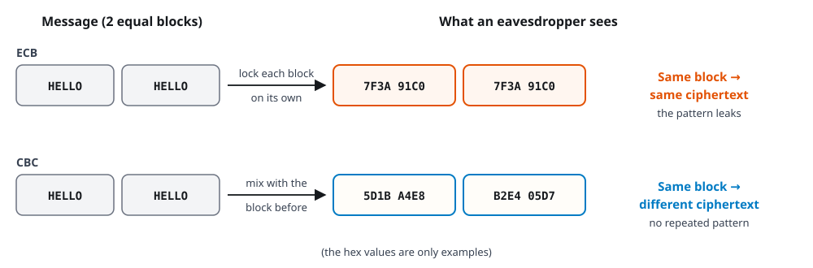

# Worksheet 4 — AES / Block-Cipher Modes: CBC vs GCM

> **Course:** Cryptography and Network Security (KOSEN69) · **{{ slot_label }}**
> **Kind:** Docker lab, step by step. No programming and no maths.

> **Ethics note:** Only work on the 2 containers on your own computer that this lab starts (ports 8096 and 8097).
> Changing a token or encrypted data of a system that is not yours, without permission, is illegal. Keep the flag inside this lab.

## Read this first

**What you will do today:** a website gives you a "token" (a pass) that is encrypted with AES. You cannot see what is inside. You will try to *change* that token without knowing the key, and see that the **CBC** website has no idea it was changed, but the **GCM** website catches it. Remember this: **encrypted does not mean it cannot be changed.**

**Every step is written the same way:**

| Heading | Meaning |
|---|---|
| **What to do** | Says what this step does |
| **Type** | Copy the whole line, paste it into the Terminal, and press Enter |
| **You should see** | The screen should look roughly like this |
| **Means** | What the result means |
| **Write in the answer sheet** | What to copy or write in your answer sheet |

**Marks**

- Everyone does **Part A (60 marks)**, which is the same for both forms.
- Then do **only your own form (40 marks)**. Look at the last digit of your student ID: **odd = Conventional (Part 2)**, **even = AIR-Sec (Parts 3–4)** (0 counts as even). Write your form in the Group box.
- You may answer in English or Thai. Short and clear is enough.
- **Answer sheet:** in Classroom → Week 04, open the file for your form (`Wk04_Answer_Sheet_Conventional` or `Wk04_Answer_Sheet_AIR-Sec`), choose Open with → Google Docs, type in the grey boxes, then choose File → Download → PDF.
- Submit one file named with your student ID, for example `Wk04_66990000.pdf` (do not type the `<` `>` signs), at `learn.zcr.ai/submit` with your Week 4 submission code from your KMITL email, by **Sunday 29 Nov, 23:59**.
- Items marked *optional* have no marks. You can skip them.
- **At the end of today's class:** your CryptoVault team reviews its design plan (KDF + AEAD) with the instructor, then hands in the plan as the project brief says. That is project work, not part of this worksheet, and it does not go in your worksheet PDF.

| Part A | Marks | Steps to write in the answer sheet |
|---|---:|---|
| A1 — Encrypted does not mean tamper-proof | 20 | Steps 1, 2, 3 |
| A2 — Let the script change the token to admin | 20 | Steps 5, 6 |
| A3 — GCM notices | 20 | Steps 8, 9, 10, 11 |

**Words you need to know**

| Word | Simple meaning |
|---|---|
| Terminal | A window where you type commands |
| Docker / container | A program that starts a small "pretend computer" on your computer. If you break it, delete it and start again |
| AES | The standard way to encrypt, and it is very strong. In this work AES is not broken; the problem is *how it is used* |
| block | AES encrypts one block at a time, 16 bytes per block (about 16 characters) |
| mode | The way several blocks are joined together, for example ECB, CBC, GCM |
| ECB | Locks each block separately. Identical blocks give identical results (you can see patterns) |
| CBC | Before locking each block, mixes it with the block before. But it has **nothing to check whether the data was changed** |
| GCM | Encrypts, and attaches a tag to check whether the data was changed |
| IV (of CBC) | A starting number for each message. It does not have to be secret, but it must be random every time and impossible to guess in advance |
| nonce (of GCM) | A number for each message. It does not have to be secret, but it must never repeat for another message under the same key |
| tag | A "seal" at the end of GCM data. It is a MAC, like the one in Week 3, used to check whether the data was changed |
| token | Text a website leaves with you to remember who you are (kept in a cookie) |
| base64 | A way of writing data as text. It is not secret encryption |
| XOR | A kind of "mixing". Mixing twice with the same value gives you the original back |
| flag | A reward text of the form `FLAG{...}`, proof that you succeeded |
| flipped token | A token that has been changed (in the script's output) |

**Questions people often ask**

- *Do I need to be good at maths?* No. There is no calculation today.
- *Do I need to write programs?* No. Copy the commands and paste them.
- *If I make a mistake, will my computer break?* No. Everything is inside containers. If you get confused, type `docker compose down` and start again from Prep step 5.
- *Do I need to understand every character on the screen?* No. Look only at the lines the worksheet tells you to.
- *My token is not the same as my friend's. Is that wrong?* No. The token is random every time you log in. Always use your own.
- *How do I paste a command into the Terminal?* Copy the command from the worksheet, then Windows: press Ctrl+V or right-click · Mac: press Cmd+V, then press Enter.
- *How do I copy results from the Terminal?* Select the text with the mouse first, then Windows: press Ctrl+Shift+C · Mac: press Cmd+C. Or take a screenshot.
- *What do I do with a command that needs a word changed before I type it (it has `YOUR_TOKEN` or `EDITED_TOKEN`)?* You cannot click to edit the middle of a line in the Terminal. Edit it in Notepad (Windows) or TextEdit (Mac) first: paste the whole command there, change the word (Windows: also change `curl` to `curl.exe`), then copy the whole line and paste it into the Terminal and press Enter.
- *How do I copy the token completely?* Select with the mouse from the first character to the last character of the token only (not `token=` and not `;`). **Do not double-click**, because that stops at the characters `+` and `/`, which real tokens often contain (the example in the worksheet may not have them). Paste it into Notepad/TextEdit so that it is **one line with no spaces**, and count that it is 64 characters long (a GCM token is 80 characters). If the Terminal window wraps the line by itself, make the window wider first.

**If you see a message like this**

| Message on screen | Cause | Fix |
|---|---|---|
| `Cannot connect to the Docker daemon` or `error during connect` | Docker is not open | Open Docker Desktop and wait until it says Engine running |
| `no configuration file provided: not found` | The Terminal is not in the lab folder | Repeat Prep step 4 |
| `service "vulnerable" is not running` | The lab is not started | Do Prep steps 5 and 6 |
| `Failed to connect` or `Connection reset by peer` | The server is not ready yet | Wait a moment, then repeat Prep step 6 |
| `{"error":"malformed token"}` when you use your own token with the CBC server (8096) | You copied the token incompletely, or it is too long (for example you typed an extra character instead of replacing one) | Copy it again, from just after `token=` to just before `;`, so it is 64 characters (GCM: 80) |
| Step 8 shows `invalid or tampered token`, but you are not sure you changed it correctly | GCM gives the same 403 every time a token is wrong, including when you copied it incompletely | Do Step 7 first and see `guest` with the original token, then write down the first 4 characters before and after the change, and count 80 |
| Windows asks for `Uri`, or red text appears when you use `curl` | Windows has a different `curl` command | Change the first word to `curl.exe` |
| `FAIL: fixed app never came up` (after waiting about 1 minute) | You forgot `-e FIXED_HOST=fixed` | Copy the Step 5 command again, the whole line |

If you still cannot do it, ask a friend or your instructor.

---

## Before you start: set up your computer (at home, once)

If you already did Week 2 or Week 3, you have Docker and the ZIP file. Start at **Prep step 4**. The old ZIP file can be reused. If you cannot find the `week04-aes-modes` folder, download the ZIP again as in Prep step 2.

**If you turned your computer off and came back:** repeat Prep steps 1, 4, 5 and 6.

#### Prep step 1 — Open Docker Desktop

**What to do:** If you do not have it yet, install it from <https://www.docker.com/products/docker-desktop/> and leave the program open.

**You should see:** the Docker Desktop window says **Engine running**.

#### Prep step 2 — Download the lab files

**What to do:** Open <https://github.com/nutthakorn7/security-cryptography>, click the green **Code** button, and choose **Download ZIP**.

You do not need a GitHub account and you do not need to fork.

#### Prep step 3 — Unzip the ZIP file

**What to do:** Windows: right-click the ZIP file and choose **Extract All** · Mac: double-click the ZIP file. Put it somewhere easy to find, such as the Desktop.

**You should see:** a folder called `security-cryptography-master`. Some computers make a folder with the same name inside it; open it until you can see the `labs` folder.

#### Prep step 4 — Open a Terminal inside the lab folder

**What to do:** In `security-cryptography-master`, go to `labs`, then `week04-aes-modes`.

- **Windows:** open the `week04-aes-modes` folder in File Explorer, right-click an empty spot, and choose **Open in Terminal** (if you do not see it, hold Shift, right-click, and choose **Open PowerShell window here**).
- **Mac:** open the Terminal app, type `cd` and one space, drag the `week04-aes-modes` folder into the window, then press Enter.

Check that you are in the right place with this command:

```bash
ls
```

**You should see:** `docker-compose.yml` and `exploit.py` in the list.

#### Prep step 5 — Start the lab

**Type:**

```bash
docker compose up -d
```

**You should see:** two lines ending in `Started` (if it was already running you may see `Running`). **You need the internet every time you start this lab**, because the containers install packages each time they start. The first time it may take several minutes. Do not close the window while you wait.

#### Prep step 6 — Check that the lab is ready

**Type** (Mac):

```bash
docker compose logs | grep "Running on"
```

**Type** (Windows):

```powershell
docker compose logs | findstr /C:"Running on"
```

**You should see:** about 6 lines, each with the container name at the start. That is normal. Find these two lines. You must see **both lines** (you must see both 8096 and 8097):

```
vulnerable-1  |  * Running on http://127.0.0.1:8096
fixed-1       |  * Running on http://127.0.0.1:8097
```

Other `Running on` lines can be ignored. If nothing appears, or it is not complete yet, wait a moment and type the command again. If it still does not appear after 2 minutes, type `docker compose ps -a` and `docker compose logs` (no filter), take a screenshot, and send it to your instructor. Do not just keep waiting. A common cause is the internet dropping while the packages install.

---

## Part A — The lab (both forms, 60 marks)

This website gives a token that is encrypted with AES-256. It comes in two versions that are the same in every way except the "mode" used to encrypt:

| Version | Port | How it encrypts | If the token is changed, does the server notice? |
|---|---|---|---|
| `vulnerable_app.py` | `:8096` | AES-256-**CBC** (no tag) | **No** |
| `fixed_app.py` | `:8097` | AES-256-**GCM** (with a tag) | **Yes** |

> **If you really cannot use Docker:** tell your instructor, then open **<https://learn.zcr.ai/sim/cbc-bitflip>**, choose the first example (Session role cookie), click **Compute the forged token**, and take a screenshot of the results for both **Verifier A (CBC)** and **Verifier B (AEAD)** instead of Steps 5 and 8 (this page uses a small pretend cipher, not real AES). For Steps 1, 2, 7 and 9, copy the examples in the worksheet and write "from the worksheet example" next to them. The other steps can be answered by reading the worksheet.

### A1 — Encrypted does not mean tamper-proof (20 marks)

#### Step 1 — Log in to get a token

**What to do:** Ask the CBC server (port 8096) for a token.

**Type** (Windows: change the first word `curl` to `curl.exe`):

```bash
curl -i "localhost:8096/login"
```

**You should see:** several lines. Find these two lines (your token is 64 characters long and will not look like the example):

```
Set-Cookie: token=IFliisCSeiehXoA2cL6xYLPFjXPJFKKbje2hpdemQHAYpxtaMVoliq6XR3I5zfJb; Path=/
logged in as guest (role=guest)
```

**Means:** you are logged in as `guest` and you got a token. The token is the long text after `token=` up to the `;`. It is encrypted data, so you cannot write `role=admin` into it yourself.

**Practice copying the token:** the way to copy it completely is in "Questions people often ask" above. Copy it and paste it into Notepad (Windows) or TextEdit (Mac) so that it is one line with no spaces and **64 characters** long. Keep it for Step 2.

**✍️ Write in the answer sheet (Step 1):** copy the `Set-Cookie: token=...` line from your own screen.

#### Step 2 — Change your token a little

**What to do:** Change your real token by just **one character** and see whether the server notices.

1. Paste your token into Notepad/TextEdit.
2. **Delete the first character and type a new one in its place**: type `A` (if the first character is already `A`, type `B`). Do not add a character. The token must still be 64 characters. For example `IFli...` becomes `AFli...`.
3. Write down the first 4 characters **before the change** and **after the change**.
4. Put the edited token in place of `EDITED_TOKEN`.

**Type** (Windows: change the first word to `curl.exe`):

```bash
curl --cookie "token=EDITED_TOKEN" localhost:8096/whoami
```

**You should see:**

```
{"role":"guest"}
```

**Means:** the CBC server decrypted the changed token and still answered `guest`. It **does not know the token was changed**, because CBC has nothing to check it with. (The first character belongs to the IV, which only affects the first block. In this lab the first block is just a comment, not the role, so `guest` is not affected. See Step 4 for more.)

If you get `malformed token`, your token is not the same length as before, or you copied it incompletely. Redo Step 2.

**✍️ Write in the answer sheet (Step 2):** copy the answer the server gave, and write the first 4 characters of the token before → after the change (for example `IFli` → `AFli`).

#### Step 3 — Summarise in your own words

**What to do:** Fill in the blanks. The word **tag** means a "seal" or MAC, like the one in Week 3, attached to the data to check whether it was changed.

> The CBC server (knows / does not know) that the token was changed, because CBC has no ________ to check whether the data was changed. (Choose: `tag` / `key`)

**✍️ Write in the answer sheet (Step 3):** write the full sentence.

### A2 — Let the script change the token to admin (20 marks)

#### Step 4 — Why can a token be changed when you cannot read it?

**What to do:** Just read and look at the picture. You do not need to type anything.


**What is inside the token:** token = **IV** + 2 blocks of data. The IV acts as the "block before" the first block. The first block is a comment that nobody reads. The **second block** holds the role (`role=guest`). So the "block before" the role block is the first block in the token.

CBC reads each block back in two steps: it "unlocks it with the key", then "mixes it with the block before". The block before is inside the token that you hold. If you change the block before, the result changes at the **same position**, without knowing the key at all. The block that you changed turns into garbage (in this lab it is the comment, which nobody reads). The `exploit.py` script prepared by the instructor does exactly this. It changes `guest` into `admin` in your token.

#### Step 5 — Run the script

**What to do:** Let the script try to change the token against both websites. The script runs inside a container, so you do not need to install Python on your computer.

**Type** (copy the whole line; do not cut off `-e FIXED_HOST=fixed`):

```bash
docker compose exec -e FIXED_HOST=fixed vulnerable python exploit.py
```

**You should see:** a very long output. Lines that start with `[*]` are the script telling you what it is doing. Find **these four lines** (`flipped` means "changed", and the real `FLAG{...}` has text inside the curly brackets):

```
[*] /whoami on original token -> {'role': 'guest'}
[*] /whoami on flipped token  -> {'role': 'admin'}
PASS: CBC bit-flip accepted by vulnerable app (:8096) -- flag = FLAG{...}
PASS: tampered token correctly REJECTED by fixed/GCM app (:8097) -- status=403, no flag
```

**Means:** before the change the server sees us as `guest`. After the script changes the token the server sees `admin` and gives the flag. The first `PASS` means the CBC website accepted the changed token. The second `PASS` is the GCM website, which answered `403`: it did not accept the token and gave no flag. We will look at this again in Steps 7 and 8. If you cannot find the lines, type the command again (the result is the same).

**✍️ Write in the answer sheet (Step 5):** copy the four lines above.

> **If you cannot use Docker:** see the box "If you really cannot use Docker" at the top of Part A.

#### Step 6 — Answer the two questions

**What to do:** Fill in the blanks in both questions (hint: Step 4).

> a) The script (knows / does not know) the AES key, and it changes the block that comes (before / after) the block that holds the role.
>
> b) The server accepts the changed token because CBC has no ________ to check. It decrypts the token and simply trusts the result. (Choose: `tag` / `key`)

**✍️ Write in the answer sheet (Step 6):** write both sentences in full.

### A3 — GCM notices (20 marks)


#### Step 7 — Get a token from the GCM website

**What to do:** Ask the GCM server (port 8097) for a token and check that it works normally.

**Type** (Windows: change the first word `curl` to `curl.exe`):

```bash
curl -i "localhost:8097/login"
```

**You should see:** the GCM token is longer (80 characters) because it has a tag at the end.

```
Set-Cookie: token=...; Path=/
logged in as guest (role=guest)
```

Then ask who you are (replace `YOUR_TOKEN` with your own token; Windows: change the first word to `curl.exe`):

```bash
curl --cookie "token=YOUR_TOKEN" localhost:8097/whoami
```

**You should see:** `{"role":"guest"}`

**Means:** a token that is not changed works normally. This step has nothing to write in the answer sheet.

#### Step 8 — Change the GCM token the same way as Step 2

**What to do:** Do exactly the same as Step 2: your GCM token in Notepad/TextEdit is **80 characters** long. Delete the **first** character and type `A` in its place (if it is already `A`, type `B`). Do not add a character. Then put it in place of `EDITED_TOKEN`.

**Type** (Windows: change the first word to `curl.exe`):

```bash
curl -i --cookie "token=EDITED_TOKEN" localhost:8097/whoami
```

**You should see:** several lines. Find these two things:

```
HTTP/1.1 403 FORBIDDEN
{"error":"invalid or tampered token"}
```

**Means:** GCM checked the tag, found that it does not match the data, and refused (403). It did not read anything from that token. This is different from CBC in Step 2, which accepted. Careful: GCM gives the same 403 every time a token is wrong for any reason (including when you copied it incompletely). So you must first see `guest` in Step 7 with the original token, then change just the first character.

**✍️ Write in the answer sheet (Step 8):** copy the two lines above, and write the first 4 characters of your GCM token before → after the change.

#### Step 9 — Find the lines that differ in the code

**What to do:** Look at the lines that encrypt and decrypt in both files.

**Type:**

```bash
docker compose exec vulnerable grep -n -E "modes.CBC|AESGCM\(KEY\)" vulnerable_app.py fixed_app.py
```

**You should see:**

```
vulnerable_app.py:54:    enc = Cipher(algorithms.AES(KEY), modes.CBC(iv)).encryptor()
vulnerable_app.py:59:    dec = Cipher(algorithms.AES(KEY), modes.CBC(iv)).decryptor()
fixed_app.py:42:    ct_and_tag = AESGCM(KEY).encrypt(nonce, PLAINTEXT, None)
fixed_app.py:50:    pt = AESGCM(KEY).decrypt(nonce, ct_and_tag, None)   # raises InvalidTag if tampered
```

**Means:** the vulnerable file uses `modes.CBC`, and the fixed file uses `AESGCM`. When decrypting, `AESGCM` "raises an error" if the tag does not match (`InvalidTag`).

> The vulnerable file encrypts with the ________ mode, and the fixed file uses the ________ mode. (Choose: `CBC` / `GCM`)

**✍️ Write in the answer sheet (Step 9):** copy all four lines, and write the sentence above in full.

#### Step 10 — Why does GCM catch it?

**What to do:** Read, then fill in the blanks.

GCM attaches a **tag** (a MAC-style seal) at the end of the data. When decrypting, the server works out the tag again from the data it received and compares it with the tag that came with the token. If anyone changes even one character of the data, the tag will **not match**, and someone without the key cannot make a new correct tag. (Sending the same valid token again still passes. That needs another defence, which we have not learned yet.)

> GCM catches it because it checks the ________. If the ________ does not match the data, it rejects the token. (Choose: `tag` / `key`; you may use the same word in both blanks)

**✍️ Write in the answer sheet (Step 10):** write the full sentence.

#### Step 11 — What if the developer ignores the error?

**What to do:** Read, then answer in 1–2 sentences.

GCM only helps if the program **obeys** the result of the tag check. Imagine a developer writes the program wrongly so that it **keeps accepting the token even though the tag does not match**. In this lab the library raises an `InvalidTag` error when the tag does not match, and a correct program must reject that token.

> If a program accepts the token even though the tag does not match, is that **different** from the CBC server in Step 2, or **not different**? Why? Write 1–2 sentences (hint: if nobody obeys the check result, the check is useless).

**✍️ Write in the answer sheet (Step 11):** write your answer.

#### Step 12 — Shut down the lab and check your answer sheet

**What to do:** Do this after you have copied all your results.

**Type:**

```bash
docker compose down
```

**You should see:** a line ending in `Removed`. Then check that your answer sheet has everything: Steps 1, 2, 3 (A1), Steps 5, 6 (A2), Steps 8, 9, 10, 11 (A3). Then do your own form: odd IDs do Part 2; even IDs do Parts 3 and 4.

---

## Part 1 — Student Information
| Name | Student ID | Date | Group (your form) | AI tools used (which, for what) |
|---|---|---|---|---|
| | | | | |

---

## Part 2 — Conventional form (40 marks; only if Conventional is your assigned form)

Answer each in 2–3 sentences. You may answer in Thai. In this part you must **answer yourself** and not use AI. The question numbers come from the original question bank, so some numbers are skipped.

**Q1 (10). ECB.** AES itself is strong, but why should the **ECB** mode not be used with real data?



Answer both of these:

- If two blocks are identical, does ECB give the same or a different ciphertext for those two blocks?
- Why does this make data leak? (Hint: look at the picture. An eavesdropper sees a "pattern" without knowing the key)

**Q3 (10). Encrypted but not checked for changes.** A system encrypts data with a key, but it has no tag or MAC to check whether the data was changed.

Answer all three of these (1–2 sentences each):

- What can an attacker who does not know the key do to the encrypted data? (Hint: Steps 2 and 5)
- Give one example from today's lab of what happened to `guest`.
- Another system stores `plan=free` in a token encrypted with CBC and no tag, as in the lab (`free` and `paid` are both 4 characters). Suppose the attacker knows where this value is. Can they change it to `plan=paid` the same way the script did, and how should the owner fix it? (Hint: Steps 4 and 8)

**Q4 (10). Why GCM instead of CBC.** Modern systems, such as recent HTTPS (TLS 1.3), stopped using AES-**CBC** and only use modes that have a tag, such as AES-**GCM**.

Answer both of these:

- What is the main reason? (Hint: Steps 8 and 10: what does GCM do that CBC does not?)
- Give one example from the lab that shows this difference. (Hint: Step 2 and Step 8)

**Q5 (10). Nonce.** In GCM there is a value called a **nonce** (a number used once) for each message.

Answer both of these:

- Does the nonce have to be secret, and what property must it have? (Hint: "used once")
- If a nonce is repeated for another message under the same key, what goes wrong? (Choose one or more from this list and explain briefly: data leaks / the tag can be forged / nothing goes wrong)

### Going further (optional — no marks)

- **Q2 — Reused IV.** What does an observer learn if two CBC messages use the same key and the same IV?
- **Q6 — Reused GCM nonce.** What does the attacker gain, and what happens to GCM's authentication?
- **Q7 — GCM or ChaCha20-Poly1305?** Which would you pick for a phone or an IoT device, and why?
- **Q8 — Disk encryption.** Why do LUKS and BitLocker use AES-XTS and not AES-GCM?
- **Q9 — HTTPS.** Why does HTTPS need authenticated encryption and not encryption alone?
- **Q10 — Tag not checked.** What goes wrong if a developer uses AES-GCM but never checks the tag?

---

## Part 3 — AIR-Sec Arm: Audit the AI (AIR-Sec version only, 20 points)

AI is a power tool you must **distrust** — you are graded on your *critique*, not the AI's answer.

A friend asked an AI for help: *"Write me a Python helper that encrypts a session token so clients can't read or change the role field."* The AI gave the code below. The code runs, uses a real AES library, and looks professional, but it has **at least one serious mistake**, and it is exactly this week's topic. Your job is to find it.

> **AI's answer:**
> ```python
> import os, base64
> from cryptography.hazmat.primitives.ciphers import Cipher, algorithms, modes
> from cryptography.hazmat.primitives import padding
>
> KEY = bytes.fromhex(os.environ["TOKEN_KEY"])  # 64 hex chars -> 32 bytes, AES-256
>
> def make_token(role: str) -> str:
>     data = f"role={role}".encode()
>     iv = os.urandom(16)
>     padder = padding.PKCS7(128).padder()
>     data = padder.update(data) + padder.finalize()
>     enc = Cipher(algorithms.AES(KEY), modes.CBC(iv)).encryptor()
>     ct = enc.update(data) + enc.finalize()
>     return base64.b64encode(iv + ct).decode()   # clients get IV || ciphertext
>
> def read_role(token: str) -> str:
>     raw = base64.b64decode(token)
>     iv, ct = raw[:16], raw[16:]
>     dec = Cipher(algorithms.AES(KEY), modes.CBC(iv)).decryptor()
>     data = dec.update(ct) + dec.finalize()
>     unpadder = padding.PKCS7(128).unpadder()
>     data = unpadder.update(data) + unpadder.finalize()
>     return data.decode().split("role=")[1]   # trust the decrypted role
> ```
> "This uses AES-256 in CBC mode with a random IV per token and standard PKCS7 padding, so the
> ciphertext is confidential and the client cannot read the role. Because the data is encrypted
> with a key only the server knows, the client also cannot change the role — they'd have to break
> AES to produce a valid token."
>
> — end of AI answer —


The AI's answer above is in English, so you do not need to translate every word. Follow these steps one at a time:

**P3-1 Skim it:** the code has two functions, `make_token` (encrypts the token) and `read_role` (decrypts it and reads the role), followed by an explanation of two sentences.

**P3-2 What is already correct (do not criticise it):** it uses AES-256, a new random IV every time, and PKCS7. All three are fine. (PKCS7, or padding, only fills the data up to blocks of 16 bytes. It does not check whether the token was changed.)

**P3-3 Find the mistake:** read the last sentence of the explanation ("the client also cannot change the role...") and ask yourself: if the token is changed on the way, is there any step in `read_role` that checks whether it was changed? (Think back to Steps 2 and 5 in Part A.)

1. **Find what's wrong or risky.** Copy the sentence that is wrong, then write 1–2 sentences on why it is wrong (use what you saw in the lab).
2. **Write the corrected version yourself.** Make it safe by changing to **AES-GCM**, and write what `read_role` must do when the tag does not match (it must reject, and not use the data any further). A short written explanation is enough. You do not need to write code. Then write 1–2 sentences on why the original `read_role` trusts a changed token even though it never checks a tag.

> Disclose any other AI use in the Part 1 table. This task counts toward the **Audit the AI** row.

---

## Part 4 — Comprehension & Prompt (AIR-Sec version only: EiPE 10 + Prompt 10)

**A. Explain in Plain English (EiPE, 10).** A developer friend says *"This token is encrypted with a key that only the server knows. The user cannot read it, so they cannot change the role."*

Explain to your friend in 2–4 sentences, **without difficult words**. Answer both of these (hint: look at the picture in Step 4 and use your own words):

- What can an attacker do to the token even though they cannot read it?
- Why does the idea "it is encrypted, so it is safe" not work here? (Explain with the idea that "each block is mixed with the block before, and the attacker can change the block before")

**B. Prompt Problem (10).** Use any AI you like and follow these steps:

1. Write **one** prompt that asks the AI *why AES-CBC without a MAC can be changed but AES-GCM cannot*. Ask the AI to explain it simply.
2. Copy the AI's answer into your answer sheet.
3. Check the AI's answer against what you learned, one point at a time:

- Does it explain that in CBC each block is mixed with the block before, so changing the block before changes the next block at the same position? (Does it explain the "block before" idea?)
- Does it say that the **tag** of GCM (not the cipher itself) is what rejects a changed token? (Does it say the tag rejects a changed token?)
- Does it make anything up or say something wrong? (Does it make anything up?) Watch for: saying CBC "encrypts each block separately" (that is **ECB**); saying a random IV alone stops tampering; saying GCM is "CBC plus a checksum"; or quoting a wrong NIST/RFC document number (NIST and RFC documents are standards that people refer to. If the AI quotes a document number, look it up to see that it exists and is on topic).

4. In the table in your answer sheet, tick **Pass / Fail** for each point and write one short sentence of reason for each. End with 1 sentence on whether you would trust this AI answer, and why.

Hand in the **prompt + the AI's answer + the check table with your own reasons**.

---

## 🎤 Viva spot-check (formative/authenticity check; no separate points)

An instructor may ask any of these live, at random, to confirm you did the work yourself:

1. "In Step 2 we changed the CBC token and the server still answered guest, but in Step 8 the GCM token changed the same way was refused. What is the difference?"
2. "The script does not know the key. How did it turn guest into admin? Tell it in simple words, using the picture in Step 4."
3. "Point to the lines in Step 9 that differ between CBC and GCM, and say what GCM checks that CBC does not."

---

## Grading rubric — assigned version totals 100

| Criterion | Conventional | AIR-Sec |
|---|---:|---:|
| A1 — encrypted is not tamper-proof | 20 | 20 |
| A2 — script changes the token to admin | 20 | 20 |
| A3 — GCM notices + reasoning | 20 | 20 |
| Conventional written questions (Q1, Q3, Q4, Q5) | 40 | — |
| AIR-Sec Audit the AI | — | 20 |
| AIR-Sec Explain in Plain English (EiPE) | — | 10 |
| AIR-Sec Prompt Problem | — | 10 |
| **Total for the assigned version** | **100** | **100** |

## Evidence & Integrity (required)

- Put your name, student ID and the date in the answer sheet, and copy the commands and results from **your own** computer. The flag may be the same as your friends'. There is no per-student flag this week, but each person's token is random every time, and you must not submit a friend's results as your own.
- **Explain in your own words** (marks are given for the reasoning): for the fill-in-the-blank steps from a word list (Steps 3, 6, 9, 10) you can use the words given. The short answer in Step 11 and the written parts of your own form must be in your own words (why the CBC server accepts a changed token, and why the GCM server rejects it). You do not need to write anything beyond that.

**Deadline and late work:** submit by 23:59 (Thai time) on **Sunday 29 Nov**. Late work loses 10% of this worksheet's marks per day (a part day counts as a day), down to 0. Uploading or replacing a file after the deadline counts as late for the whole submission. Submit the common 60 marks and **one** form of your own only; doing both forms gives no extra marks. The viva checks your understanding and has no separate marks.
