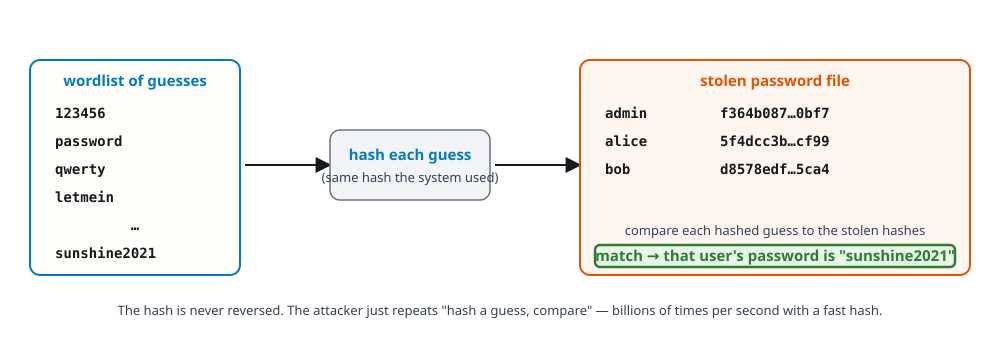

# Worksheet 2 — Hash Functions: Cracking a Leaked Password Database

> **Course:** Cryptography and Network Security (KOSEN69) · **{{ slot_label }}**
> **Kind:** Docker lab, step by step. No programming and no maths. You crack a leaked (sandbox) password file, get a flag, then watch the same attack fail against a properly stored file.

> **Ethics note:** Crack only the hashes shipped in this lab (`users_vulnerable.csv`, `wordlist.txt`) on the two local containers it starts (ports 8094 and 8095). Cracking password hashes for accounts or systems you do not own and are not authorized to test is illegal. Keep the recovered passwords and your flag inside this lab.

## Read this first

**What you will do today:** a company's password file has leaked. We will look at it, crack the passwords in a fraction of a second, and use the admin's password to get a flag. Then we will run the same attack against a second copy of the site that stores its passwords the correct way (with a salt and a slow hash) and see that the attack fails.

**Every step is written the same way:**

| Heading | Meaning |
|---|---|
| **What to do** | Says what this step does |
| **Type** | Copy the whole line, paste it into the Terminal, and press Enter |
| **You should see** | The screen should look roughly like this |
| **Means** | What the result means |
| **Write in the answer sheet** | What to copy or write in your answer sheet |

**Marks**

- Everyone does **Part A (60 points)**, which is the same for both forms.
- Then do **only your own form (40 points)**. Look at the last digit of your student ID: **odd = Conventional (Part 2)**, **even = AIR-Sec (Parts 3–4)**. Write your form in the Group field.
- You may answer in English or Thai. Short and clear is enough.
- **Answer sheet:** in Classroom → Week 02, open the file for your form (`Wk02_Answer_Sheet_Conventional` or `Wk02_Answer_Sheet_AIR-Sec`), choose Open with → Google Docs, type in the grey boxes, then choose File → Download → PDF.
- Submit one file named with your student ID, for example `Wk02_66990000.pdf` (do not type the `<` `>` signs), at `learn.zcr.ai/submit` with your Week 2 submission code from your KMITL email, by **Sun 15 Nov 23:59** (ICT).
- Items marked *optional* have no marks. You can skip them.

| Part A | Points | Steps to write in the answer sheet |
|---|---:|---|
| A1 — Crack the leaked file | 20 | Steps 2, 3 |
| A2 — Log in and get the flag | 20 | Steps 5, 6 |
| A3 — Show the fix works | 20 | Steps 8, 9, 10 |

**Words you need to know**

| Word | Simple meaning |
|---|---|
| Terminal | A window where you type commands |
| Docker / container | A program that starts a small "pretend computer" on your computer. If you break it, delete it and start again |
| hash | Turning data into a short fixed-size fingerprint. The same input always gives the same fingerprint, and you cannot go from the fingerprint back to the input |
| MD5 | An old, very fast hash. It is a bad choice for passwords |
| leak / dump | A stolen copy of a database |
| wordlist | A file of common passwords that an attacker tries |
| guess and hash | The real attack: hash every word in a wordlist and compare it with the leaked hashes. Nobody "reverses" a hash |
| salt | A random value, different for each user, stored next to the hash. It is not secret |
| bcrypt | A password hash that is deliberately slow and has a salt built in |
| session cookie | A small piece of data the server gives you when you log in, so it remembers who you are |
| flag | A reward text of the form `FLAG{...}`, proof that you succeeded |

**Questions people often ask**

- *Do I need to be good at maths?* No. There is no calculation today.
- *Do I need to write programs?* No. Copy the commands and paste them. The scripts run inside the containers, so you do **not** need Python on your own computer.
- *If I make a mistake, will my computer break?* No. Everything is inside containers. If you get confused, type `docker compose down` and start again from Prep step 5.
- *Do I need to understand every character on the screen?* No. Look only at the lines the worksheet tells you to.
- *Is it wrong if my numbers are not exactly the same as in the example?* No. The time (in milliseconds) is different on every computer.
- *How do I paste a command into the Terminal?* Copy the command from the worksheet, then Windows: press Ctrl+V or right-click · Mac: press Cmd+V, then press Enter.
- *How do I copy results from the Terminal?* Select the text with the mouse first, then Windows: press Ctrl+Shift+C · Mac: press Cmd+C. Or take a screenshot.

**If you see a message like this**

| Message on screen | Cause | Fix |
|---|---|---|
| `Cannot connect to the Docker daemon` or `error during connect` | Docker is not open | Open Docker Desktop and wait until it says Engine running |
| `no configuration file provided: not found` | The Terminal is not in the lab folder | Repeat Prep step 4 |
| `service "vulnerable" is not running` | The lab is not started | Do Prep steps 5 and 6 |
| `Bind for 0.0.0.0:8094 failed: port is already allocated` | Another program (or the lab from last time) is already using that port | Type `docker compose down`, then repeat Prep step 5 |
| `Connection refused` from `login.py` | The servers are not ready yet | Wait a moment, then repeat Prep step 6 and run the step again |

If you still cannot do it, ask a friend or your instructor.

---

## Before you start: set up your computer (at home, once)

This is the first lab that uses Docker, so start at **Prep step 1**. **If you turned your computer off and came back:** repeat Prep steps 1, 4, 5 and 6.

#### Prep step 1 — Open Docker Desktop

**What to do:** If you do not have it yet, install it from <https://www.docker.com/products/docker-desktop/> and leave the program open.

**You should see:** the Docker Desktop window says **Engine running**.

#### Prep step 2 — Download the lab files

**What to do:** Open <https://github.com/nutthakorn7/security-cryptography>, click the green **Code** button, and choose **Download ZIP**.

You do not need a GitHub account and you do not need to fork.

#### Prep step 3 — Unzip the ZIP file

**What to do:** Windows: right-click the ZIP file and choose **Extract All** · Mac: double-click the ZIP file. Put it somewhere easy to find, such as the Desktop.

**You should see:** a folder called `security-cryptography-master`. Some computers make a folder with the same name inside it; open it until you can see the `labs` folder.

#### Prep step 4 — Open a Terminal inside the lab folder

**What to do:** In `security-cryptography-master`, go to `labs`, then `week02-hash`.

- **Windows:** open the `week02-hash` folder in File Explorer, right-click an empty spot, and choose **Open in Terminal** (if you do not see it, hold Shift, right-click, and choose **Open PowerShell window here**).
- **Mac:** open the Terminal app, type `cd` and one space, drag the `week02-hash` folder into the window, then press Enter.

Check that you are in the right place with this command:

```bash
ls
```

**You should see:** `docker-compose.yml` and `crack.py` in the list.

#### Prep step 5 — Start the lab

**Type:**

```bash
docker compose up -d
```

**You should see:** lines ending in `Started`. The first time you need the internet, the computer downloads a base image and installs a few packages, and it may take several minutes. Do not close the window while you wait.

#### Prep step 6 — Check that the lab is ready

**What to do:** Wait about 30 seconds (the first time it can take a few minutes). Mac: copy the first command below. Windows: copy the second command below. Paste it into the Terminal and press Enter.

**Type (Mac):**

```bash
docker compose logs | grep "Running on"
```

**Type (Windows):**

```bash
docker compose logs | findstr /C:"Running on"
```

**You should see:** you must see **both** of these lines (other `Running on` lines may appear between them; ignore those):

```
vulnerable-1  |  * Running on http://127.0.0.1:8094
fixed-1       |  * Running on http://127.0.0.1:8095
```

If you do not see both, wait a moment and type the command again. If it still fails after 2 minutes, type `docker compose ps -a`, take a screenshot, and send it to your instructor.

---

## Part A — The lab (both forms, 60 points)

A user database leaked. There are two copies of the same login service, with the **same** users and passwords but **different** password storage:

| Service | Port | Stores passwords as | Should it fall to a fast wordlist? |
|---|---|---|---|
| `vulnerable_app.py` | `:8094` | **MD5, no salt** (`users_vulnerable.csv`) | **Yes** |
| `fixed_app.py` | `:8095` | **bcrypt** with a per-user salt, and slow (`users_fixed.csv`) | **No** |

> **If you really cannot use Docker:** tell your instructor, then open **<https://learn.zcr.ai/sim/hash-crack>**, crack Store A, and take a screenshot of the recovered password and the time. Use that screenshot in place of Step 2. The other steps need Docker.

### A1 — Crack the leaked file (20 points)



#### Step 1 — Look at the leaked file

**What to do:** The attacker already has the leaked file `users_vulnerable.csv`. It is a stolen copy of the database. Look at its first rows. (The file is inside the container, so you do not need Python on your computer.)

**Type:**

```bash
docker compose exec vulnerable head -4 users_vulnerable.csv
```

**You should see:**

```
username,md5hex
admin,f364b087df0401706d6b1c8f68a50bf7
alice,5f4dcc3b5aa765d61d8327deb882cf99
bob,d8578edf8458ce06fbc5bb76a58c5ca4
```

**Means:** each row is a user name and the **MD5 hash** of that user's password. There is no password in the file, only a hash. Nothing to write for this step.

#### Step 2 — Run the cracking script

**What to do:** `crack.py` does the attack. It hashes every word in `wordlist.txt` with MD5 and looks for a match in the leaked file. Run it:

**Type:**

```bash
docker compose exec vulnerable python crack.py
```

**You should see:** your time will be different, but the other lines should be the same:

```
Hashed 101 guesses with MD5 and checked 8 leaked rows in 0.04 ms
  admin  -> sunshine2021
  alice  -> password
  bob    -> qwerty
  carol  -> letmein
  dave   -> dragon
  eve    -> monkey
  frank  -> iloveyou
  grace  -> football
Cracked 8 of 8 users with ONE list (no salt, so every row is checked at once)
```

**Means:** all 8 passwords were found in a fraction of a millisecond. Keep this window open: you need the password of `admin` in Step 5.

**✍️ Write in the answer sheet (Step 2):** copy the whole output from your own screen.

#### Step 3 — Summarise in your own words

**What to do:** Fill in the blanks (hint: the last line of the output in Step 2).

> The attack was so fast because MD5 is ________ and the file has no ________, so one list of hashed guesses checks every row at once. (Choose: `fast` / `slow` and `salt` / `flag`)

**✍️ Write in the answer sheet (Step 3):** write the full sentence.

### A2 — Log in as admin and get the flag (20 points)

#### Step 4 — Read: what the login script does

**What to do:** Just read. You do not need to type anything.

`login.py` turns the cracked password into the flag. It sends three requests to the vulnerable site:

1. It logs in as `admin` with the password you give it. The server answers with a **session cookie** (a small piece of data that says "this visitor logged in"), and the script keeps it.
2. It asks for the flag at `/admin` **with that cookie**.
3. It asks for the flag again at `/admin` with **no cookie**, as a stranger would.

#### Step 5 — Log in as admin and get the flag

**What to do:** Run the script. Give it the password of `admin` that you found in Step 2.

**Type:**

```bash
docker compose exec vulnerable python login.py sunshine2021
```

**You should see:**

```
1) POST /login as admin               -> 200 {'ok': True, 'user': 'admin'}
2) GET /admin, same session           -> 200 {'flag': 'FLAG{hash_crack_me}'}
3) GET /admin, new session, no cookie -> 403 {'error': 'forbidden -- log in as admin first'}
```

**Means:** the cracked password logged us in as admin (`200`), the flag came back on the same session, and the request with no cookie was refused (`403`).

**✍️ Write in the answer sheet (Step 5):** copy the three lines from your own screen.

#### Step 6 — Summarise in your own words

**What to do:** Fill in the blanks (hint: Step 4 and the third line in Step 5).

> The third request was refused because it did not carry the ________ from the login, so the server did not know we were admin. That cookie is only given after the ________ is correct. (Choose: `session cookie` / `flag` and `password` / `port`)

**✍️ Write in the answer sheet (Step 6):** write the full sentence.

### A3 — Show the fix stops the same attack (20 points)

#### Step 7 — Look at the bcrypt file

**What to do:** Here is the same list of users on the fixed site, stored with bcrypt. Look at its first rows.

**Type:**

```bash
docker compose exec vulnerable head -4 users_fixed.csv
```

**You should see:** the letters after `$2b$12$` are different on every machine that generated the file, so yours should look similar, not identical:

```
username,bcrypthash
admin,$2b$12$h9A87kgATKhnWMuYRq8JI.bgOVeHB62tu5slmkpT69lm7iQcD1Ppe
alice,$2b$12$L7NJ8J7mCLeVGRB8v.YgxO/8uBYSRJcbbZkG0HiH5qu0JYh4MlnUe
bob,$2b$12$Y4jR9OE8dLtBxie9Dpz8TuLZBH1ccHxlEnTAc0PmDehW1vmuVGbG.
```

**Means:** each row starts with `$2b$12$`, which says "bcrypt, cost 12". The next 22 letters are that user's own **salt**, and the rest is the hash. Every user has a different salt, and bcrypt is deliberately slow. Nothing to write for this step.

#### Step 8 — Run the whole attack against both sites

**What to do:** `exploit.py` runs the attack from end to end. It cracks the MD5 store and gets the flag, and then it runs the **same** fast method against the bcrypt store.

**Type:**

```bash
docker compose exec vulnerable python exploit.py
```

**You should see:** lines that start with `[*]` are the script telling you what it is doing. You do not need to read them all. Look only at the last two lines:

```
PASS: cracked admin login accepted by vulnerable app (:8094) -- flag = FLAG{hash_crack_me}
PASS: fixed store not crackable by the fast-dictionary technique (:8095) -- md5-precompute over 101 words matched 0/8 bcrypt rows; admin stored as bcrypt ($2b$12$...)
```

**Means:** `PASS` means the result is what it should be. The first line means the cracked password worked on the vulnerable site. The second line means the same list of guesses matched **0 of 8** rows of the bcrypt file.

**✍️ Write in the answer sheet (Step 8):** copy the two `PASS` lines.

#### Step 9 — Find the one line that differs in the code

**What to do:** The two sites are the same except for how they check the password at login. Show the line that checks the password in each file.

**Type:**

```bash
docker compose exec vulnerable grep -n -E "md5\(password.encode|checkpw\(password.encode" vulnerable_app.py fixed_app.py
```

**You should see:** two lines. The line numbers may differ a little if the files change.

```
vulnerable_app.py:64:    if hashlib.md5(password.encode()).hexdigest() == stored:
fixed_app.py:71:        ok = bcrypt.checkpw(password.encode(), stored.encode())
```

**Means:** in the first line the site hashes the password with fast, unsalted MD5 and compares. In the second line the site uses bcrypt, which re-derives the hash with that user's own salt and is slow. The rest of the two sites is the same.

**✍️ Write in the answer sheet (Step 9):** copy the two lines that show on your screen.

#### Step 10 — Answer the three questions (a, b and c)

**What to do:** Fill in the blanks in all three items (hint: Steps 7, 8 and 9, and the picture in A1).

> a) One list of hashed guesses cracked the whole MD5 file at once because there was no ________, so the same password always gives the same ________. (Choose: `salt` / `flag` and `hash` / `port`)
>
> b) bcrypt adds a per-user ________, so one list no longer fits every row, and it is ________, so each guess costs the attacker much more time. (Choose: `salt` / `cookie` and `slow` / `fast`)
>
> c) The admin's password `sunshine2021` is still in the wordlist. A patient attacker ________ still recover it from the bcrypt file, but it is expensive because every guess is ________ and the work must be repeated for each ________. (Choose: `could` / `could not`, `slow` / `fast` and `user` / `port`)

**✍️ Write in the answer sheet (Step 10):** write all three sentences in full.

#### Step 11 — Shut down the lab and check your answer sheet

**What to do:** Do this after you have copied all your results.

**Type:**

```bash
docker compose down
```

**You should see:** lines ending in `Removed`. Nothing to write for this step.

Then check that every box is filled in: Steps 2, 3 (A1), Steps 5, 6 (A2), Steps 8, 9, 10 (A3). All done? Go on to your own form: **odd ID → Part 2 · even ID (including 0) → Parts 3 and 4**.

---

## Part 1 — Student Information

| Name | Student ID | Date | Group (your form) | AI tools used (which, for what) |
|---|---|---|---|---|
| | | | | |

---

## Part 2 — Conventional form (40 points; only if Conventional is your assigned form)

Answer each item in 2–3 sentences. You may answer in English or Thai. In this part **answer by yourself**, without using AI to answer.

**Q1 (10). What a hash promises.** Answer both of these:

- Name three things a good hash function gives you. (Think: fixed-size output, one-way, same input → same output, a tiny change → a very different output.)
- Which one of them is the reason we store the *hash* of a password instead of the password itself?

**Q2 (10). Why a fast hash is a poor way to store passwords.** An attacker steals a file of `SHA-256(password)` values. Answer both of these:

- They do **not** reverse the hash. What do they do instead? (hint: Step 2)
- Why does a *fast* hash like MD5 or SHA-256 make that cheap? (hint: Step 3)

**Q3 (10). Salt.** Answer all three of these:

- What is a **salt**? (hint: Step 7)
- Why must it be **different for each user**, and why is it OK to store it right next to the hash (it is not secret)?
- What goes wrong if everyone shares the same salt?

**Q4 (10). Slow password hash.** bcrypt and Argon2 are built to be **slow**, with a tunable *cost*. Answer both of these:

- Who does raising the cost hurt more: the real user logging in once, or the attacker making billions of guesses?
- Explain why. (hint: Step 10 b and c)

### Going further (optional — no marks)

- **Rainbow tables.** What is a rainbow table, and why does a per-user salt make a *precomputed* one useless?
- **Hash vs MAC vs encryption.** In one sentence each, what does a plain hash, a MAC and encryption give you?
- **Pepper.** What is a pepper, where is it kept (and how is that different from a salt), and what does it protect against that a salt does not?
- **Broken hashes.** MD5 and SHA-1 have practical *collision* attacks. Why does that matter a lot for digital signatures but hardly at all for the password cracking you did today?

---

## Part 3 — AIR-Sec Arm: Audit the AI (AIR-Sec version only, 20 points)

AI is a power tool you must **distrust** — you are graded on your *critique*, not the AI's answer.

Below is an AI assistant's answer to *"Write a secure `store_password` / `verify_password` for a web app."* It looks professional, imports a real crypto library, and even mentions salting — but it has **at least one subtly serious flaw**. Your job: find it.

> **AI's answer:**
>
> "Here's a secure password storage helper. We use SHA-256 (a strong, modern cryptographic hash)
> together with a salt so that identical passwords don't produce identical hashes.
>
> ```python
> import hashlib
>
> # A random-looking salt so rainbow tables don't work.
> SALT = "s3cr3t_salt_v1"
>
> def store_password(password: str) -> str:
>     # SHA-256 is collision-resistant and fast, so verification is efficient.
>     return hashlib.sha256((SALT + password).encode()).hexdigest()
>
> def verify_password(password: str, stored: str) -> bool:
>     return store_password(password) == stored
> ```
>
> This is secure because SHA-256 is a cryptographically strong hash, the salt defeats rainbow
> tables, and because SHA-256 is fast, login checks stay quick even under heavy load. To make it
> even stronger you could switch to SHA-512."
>
> — end of AI answer —

1. **Find what's wrong (10).** There is more than one problem: quote the exact line(s) for each. (Hints, so you do not waste the critique on the wrong thing: yes, *some* hash is used and *a* salt is present — the question is whether this is the *right kind* of hash for passwords, and whether this is a *real* salt in the sense of Q3. Also look hard at the sentence that treats "SHA-256 is fast" as a *benefit*.) (hint: Steps 3 and 10)
2. **Fix it (10).** Rewrite `store_password` / `verify_password` using a proper password hash (bcrypt or argon2id) with a **per-user random** salt, and explain in 2–3 sentences why the AI's version was insufficient *even though it hashes and even though it has "a salt."* (hint: Steps 7 and 9)

> Disclose any other AI use in the Part 1 table. This task counts toward the **Audit the AI** row.

---

## Part 4 — Comprehension & Prompt (AIR-Sec version only: EiPE 10 + Prompt 10)

**A. Explain in Plain English (EiPE, 10).** A web developer says: *"I don't store plaintext — I store `SHA-256(password)`, and SHA-256 has never been broken. So I'm fine, right?"* Explain in 2–4 sentences, **without difficult words**, why this is not enough: what an attacker with the leaked file actually does (they *guess and hash*, they do not "reverse" it), and what a slow, salted password hash changes about that.

**B. Prompt Problem (10).** Use any AI you like and do this:

1. Write **one** prompt asking the AI *how to securely store user passwords in a web app*.
2. Copy the AI's answer into your answer sheet.
3. Check: (a) does it recommend a **password hash** (argon2id, bcrypt or scrypt) or a bare SHA-256 or MD5? (b) does it use a **per-user random salt** (and know that the salt can sit next to the hash)? (c) does it mention a **cost / work factor**, and does it make anything up (a wrong function, a "SHA-256 with salt is fine" claim)?
4. In the table in your answer sheet, write **pass / fail** for each item with a one-sentence reason, then finish with one sentence saying whether you would trust this AI's answer, and why.

Submit **your prompt + the AI's answer + your check table with your own reasons**.

---

## 🎤 Viva spot-check (formative/authenticity check; no separate points)

An instructor may ask any of these live, at random, to confirm you did the work yourself:

1. "You cracked `admin` in milliseconds. If every user got a **unique random salt** (same MD5, same wordlist), what would change about your attack, and would you still crack `admin` eventually? What changes is the *cost*: explain."
2. "Two users in `users_fixed.csv` might have chosen the same password. Can you tell from their stored bcrypt hashes? Why or why not?"
3. "Point to the one line that differs between `vulnerable_app.py` and `fixed_app.py` in the `/login` password check, and say in one sentence why that line defeats the *fast* attack but does **not** by itself make a weak password safe." (hint: Step 9)

---

## Grading rubric — assigned version totals 100

| Criterion | Conventional | AIR-Sec |
|---|---:|---:|
| A1 — crack the leaked file | 20 | 20 |
| A2 — log in and get the flag | 20 | 20 |
| A3 — show the fix works + reasoning | 20 | 20 |
| Conventional written questions (Q1–Q4) | 40 | — |
| AIR-Sec Audit the AI | — | 20 |
| AIR-Sec Explain in Plain English (EiPE) | — | 10 |
| AIR-Sec Prompt Problem | — | 10 |
| **Total for the assigned version** | **100** | **100** |

## Evidence & Integrity (required)

- Put your name, student ID and date in the answer sheet, and copy the commands and results from **your own** computer. The shared demo flag is fine: no personal flag is needed this week. It is normal that your time in milliseconds is not the same as a friend's. Do not submit a friend's results as your own.
- **Explain in your own words** (marks are given for the reasoning): for the fill-in-the-blank items that give you a word bank (Steps 3, 6 and 10) you may use the words given. The written part of your own form must be in your own words (why the MD5 store fell in milliseconds, and why the bcrypt store resisted the same attack).

**Deadline and late work:** submit by 23:59 Thai time (ICT) on **Sun 15 Nov** (the Sunday before the next class). Late work loses 10% of this worksheet's score per day (a part day counts as a day), down to 0. Uploading or replacing a file after the deadline makes the whole hand-in late. Submit the common work plus **one** assigned format; do not complete both for extra marks. The viva is a formative/authenticity check with no separate points.
