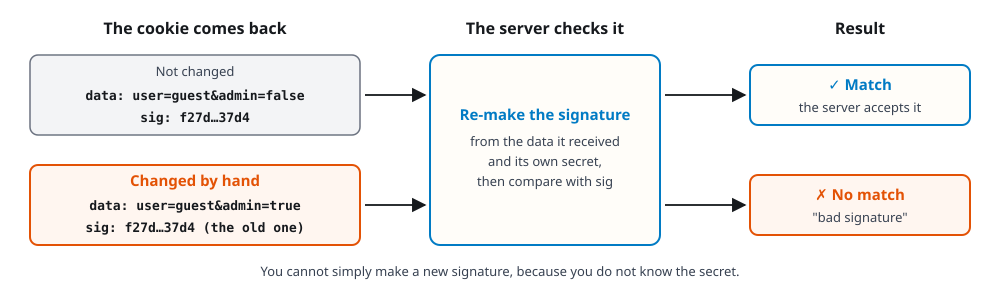
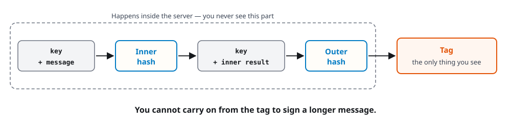

# Worksheet 3 — MACs: Hash-Only Cookies and Length-Extension

> **Course:** Cryptography and Network Security (KOSEN69) · **{{ slot_label }}**
> **Kind:** Docker lab แบบทำตามทีละขั้น ไม่ต้องเขียนโปรแกรม และไม่ต้องคำนวณเลข

> **Ethics note:** ทำเฉพาะกับ container 2 ตัวในเครื่องของตัวเองที่ lab นี้เปิดขึ้นมา (พอร์ต 8092 และ 8093)
> การปลอมคุกกี้หรือ token ของระบบที่ไม่ใช่ของเราและไม่ได้รับอนุญาตเป็นเรื่องผิดกฎหมาย เก็บ flag ไว้ใน lab นี้เท่านั้น

## อ่านก่อนเริ่ม

**วันนี้จะทำอะไร:** เว็บไซต์หนึ่ง "เซ็นชื่อ" กำกับคุกกี้ไว้เพื่อกันคนแก้ เราจะลองแก้เองแล้วดูว่าถูกจับได้ จากนั้นรันสคริปต์ที่อาจารย์เตรียมไว้เพื่อดูว่าวิธีเซ็นแบบนี้ยังถูกปลอมได้ และดูว่าวิธีเซ็นที่ถูกต้อง (HMAC) ป้องกันได้

**ทุกขั้นเขียนแบบเดียวกัน:**

| หัวข้อ | ความหมาย |
|---|---|
| **ทำอะไร** | บอกว่าขั้นนี้จะทำอะไร |
| **พิมพ์** | คัดลอกทั้งบรรทัดไปวางใน Terminal แล้วกด Enter |
| **ควรเห็น** | หน้าจอควรขึ้นประมาณนี้ |
| **แปลว่า** | ผลที่เห็นหมายความว่าอะไร |
| **ลงใบตอบ** | สิ่งที่ต้องคัดลอกหรือเขียนลงใบตอบ |

**คะแนน**

- ทุกคนทำ **Part A (60 คะแนน)** ซึ่งเหมือนกันทั้งสองแบบ
- จากนั้นทำ **เฉพาะแบบของตัวเอง (40 คะแนน)** ดูจากเลขตัวสุดท้ายของรหัสนักศึกษา: **เลขคี่ = Conventional (Part 2)**, **เลขคู่ = AIR-Sec (Parts 3–4)** แล้วเขียนแบบของตัวเองในช่อง Group
- ตอบเป็นภาษาไทยหรืออังกฤษก็ได้ ตอบสั้น ๆ ให้ชัดก็พอ
- **ใช้ใบตอบ:** ใน Classroom → Week 03 เปิดไฟล์ตามแบบของตัวเอง (`Wk03_Answer_Sheet_Conventional_odd_ID` หรือ `Wk03_Answer_Sheet_AIR-Sec_even_ID`) กด Open with → Google Docs พิมพ์ลงกรอบสีเทา แล้วกด File → Download → PDF
- ส่งไฟล์เดียว ตั้งชื่อตามรหัสนักศึกษา เช่น `Wk03_66990000.pdf` (ไม่ต้องใส่เครื่องหมาย `<` `>`) ที่ `learn.zcr.ai/submit` โดยใช้รหัสส่งงานของ Week 3 ที่ได้ทางอีเมล KMITL ภายใน **อาทิตย์ 22 พ.ย. 23:59 น.**
- ข้อที่เขียนว่า *optional* ไม่มีคะแนน ไม่ต้องทำก็ได้

| Part A | คะแนน | ขั้นที่ลงใบตอบ |
|---|---:|---|
| A1 — ลองแก้คุกกี้ด้วยมือ | 20 | ขั้นที่ 1, 3, 5, 6 |
| A2 — รันการปลอม แล้วรับ flag | 20 | ขั้นที่ 8, 10, 11 |
| A3 — ดูว่า HMAC ป้องกันได้ | 20 | ขั้นที่ 12, 13, 14, 15, 16 |

**คำศัพท์ที่ต้องรู้**

| คำ | ความหมายแบบง่าย |
|---|---|
| Terminal | หน้าต่างสำหรับพิมพ์คำสั่ง |
| Docker / container | โปรแกรมที่เปิด "เครื่องจำลอง" เล็ก ๆ ในเครื่องของเรา ทำพังก็ลบแล้วเริ่มใหม่ได้ |
| คุกกี้ (cookie) | ข้อมูลที่เว็บฝากไว้ในเครื่องเรา เพื่อจำว่าเราเป็นใคร |
| hash | การแปลงข้อมูลเป็นลายนิ้วมือขนาดคงที่ (เรียนแล้วใน Week 2) |
| secret | รหัสลับที่มีแต่เซิร์ฟเวอร์รู้ |
| ลายเซ็น (`sig`) | ค่าที่เซิร์ฟเวอร์สร้างจาก secret เพื่อดูว่าข้อมูลถูกแก้หรือเปล่า |
| hex | การเขียนข้อมูลด้วยตัวเลข 0–9 และตัวอักษร a–f |
| flag | ข้อความรางวัล รูปแบบ `FLAG{...}` เป็นหลักฐานว่าทำสำเร็จ |
| key | รหัสลับ ความหมายเดียวกับ secret |
| MAC | ค่ายืนยันว่าข้อมูลไม่ถูกแก้ สร้างจาก key |
| tag | ผลลัพธ์ของ MAC ความหมายเดียวกับลายเซ็น `sig` ในงานนี้ |
| HMAC | วิธีสร้าง MAC ที่ถูกต้องและใช้กันทั่วไป |
| SHA-256, SHA-3 | ชื่อของ hash คนละแบบ |
| `\|\|` | เอาข้อมูลมาต่อกัน เช่น `A \|\| B` คือ A ตามด้วย B |
| replay | การเอาข้อมูลชุดเดิมมาส่งซ้ำ |
| counter, timestamp, nonce | ตัวนับ, เวลา, ค่าสุ่มที่ใช้ครั้งเดียว ใช้บอกว่าข้อมูลนี้ใหม่หรือเก่า |
| length-extension | การเขียนต่อจากค่า hash เดิม เพื่อให้ได้ค่าใหม่ของข้อมูลที่ยาวขึ้น |

**คำถามที่มักสงสัย**

- *ต้องเก่งคณิตศาสตร์ไหม?* ไม่ต้อง วันนี้ไม่มีการคำนวณ
- *ต้องเขียนโปรแกรมไหม?* ไม่ต้อง คัดลอกคำสั่งไปวางได้เลย
- *ถ้าทำผิด เครื่องจะพังไหม?* ไม่พัง ทุกอย่างอยู่ใน container ถ้าสับสนให้พิมพ์ `docker compose down` แล้วเริ่มใหม่จากเตรียมขั้นที่ 5
- *ไม่เข้าใจทุกตัวอักษรที่ขึ้นจอ ได้ไหม?* ได้ ดูเฉพาะบรรทัดที่ใบงานบอก
- *ค่าที่ได้เหมือนเพื่อนทุกตัว ผิดไหม?* ไม่ผิด lab นี้ใช้ secret ชุดเดียวกัน แต่ต้องรันในเครื่องตัวเอง
- *วางคำสั่งใน Terminal ยังไง?* คัดลอกคำสั่งจากใบงาน แล้ว Windows: กด Ctrl+V หรือคลิกขวา · Mac: กด Cmd+V จากนั้นกด Enter
- *คัดลอกผลจาก Terminal ยังไง?* ลากเมาส์คลุมข้อความก่อน แล้ว Windows: กด Ctrl+Shift+C · Mac: กด Cmd+C หรือจะ screenshot ก็ได้

**ถ้าเจอข้อความแบบนี้**

| ข้อความบนจอ | สาเหตุ | วิธีแก้ |
|---|---|---|
| มีคำว่า `Cannot connect to the Docker daemon` หรือ `error during connect` | ยังไม่ได้เปิด Docker | เปิด Docker Desktop รอจนขึ้น Engine running |
| `no configuration file provided: not found` | Terminal ไม่ได้อยู่ในโฟลเดอร์ lab | ทำเตรียมขั้นที่ 4 อีกครั้ง |
| `service "vulnerable" is not running` | ยังไม่ได้เปิด lab | ทำเตรียมขั้นที่ 5 และ 6 |
| `Failed to connect` หรือ `Connection reset by peer` | เซิร์ฟเวอร์ยังไม่พร้อม | รอสักครู่ แล้วทำเตรียมขั้นที่ 6 อีกครั้ง |
| Windows ถามหา `Uri` หรือขึ้นตัวแดงตอนใช้ `curl` | Windows มีคำสั่ง curl คนละตัว | เปลี่ยนคำแรกเป็น `curl.exe` |
| `FAIL: fixed app never came up` (รอประมาณ 30 วินาที) | ลืม `-e FIXED_HOST=fixed` | คัดลอกคำสั่งขั้นที่ 8 ใหม่ทั้งบรรทัด |

ลองแล้วยังไม่ได้ ให้ถามเพื่อนหรืออาจารย์ได้เลย

---

## ก่อนเริ่ม: เตรียมเครื่อง (ทำที่บ้าน ทำครั้งเดียว)

ถ้าเคยทำ Week 2 มาแล้ว มี Docker และไฟล์ ZIP อยู่แล้ว เริ่มที่**เตรียมขั้นที่ 4** ได้เลย ไฟล์ ZIP เดิมใช้ต่อได้ ถ้าหาโฟลเดอร์ `week03-macs` ไม่เจอ ให้โหลดใหม่ตามเตรียมขั้นที่ 2

**ถ้าปิดเครื่องไปแล้วกลับมาทำต่อ:** ทำเตรียมขั้นที่ 1, 4, 5, 6 ใหม่

#### เตรียมขั้นที่ 1 — เปิด Docker Desktop

**ทำอะไร:** ถ้ายังไม่มี ให้ติดตั้งจาก <https://www.docker.com/products/docker-desktop/> แล้วเปิดโปรแกรมทิ้งไว้

**ควรเห็น:** ในหน้าต่าง Docker Desktop ขึ้นว่า **Engine running**

#### เตรียมขั้นที่ 2 — โหลดไฟล์ lab

**ทำอะไร:** เปิด <https://github.com/nutthakorn7/security-cryptography> กดปุ่มสีเขียว **Code** แล้วเลือก **Download ZIP**

ไม่ต้องมีบัญชี GitHub และไม่ต้อง fork

#### เตรียมขั้นที่ 3 — แตกไฟล์ ZIP

**ทำอะไร:** Windows: คลิกขวาที่ไฟล์ ZIP เลือก **Extract All** · Mac: ดับเบิลคลิกไฟล์ ZIP วางไว้ในที่ที่หาง่าย เช่น Desktop

**ควรเห็น:** โฟลเดอร์ชื่อ `security-cryptography-master` บางเครื่องจะมีโฟลเดอร์ชื่อเดียวกันซ้อนสองชั้น ให้เปิดเข้าไปจนเห็นโฟลเดอร์ `labs`

#### เตรียมขั้นที่ 4 — เปิด Terminal ในโฟลเดอร์ lab

**ทำอะไร:** ในโฟลเดอร์ `security-cryptography-master` เข้าไปที่ `labs` แล้วเข้า `week03-macs`

- **Windows:** เปิดโฟลเดอร์ `week03-macs` ใน File Explorer คลิกขวาตรงที่ว่าง เลือก **Open in Terminal** (ถ้าไม่มีเมนูนี้ ให้กด Shift ค้างแล้วคลิกขวา เลือก **Open PowerShell window here**)
- **Mac:** เปิดแอป Terminal พิมพ์ `cd` เว้นวรรคหนึ่งครั้ง ลากโฟลเดอร์ `week03-macs` มาวางในหน้าต่าง แล้วกด Enter

เช็กว่าอยู่ถูกที่ด้วยคำสั่งนี้:

```bash
ls
```

**ควรเห็น:** มีชื่อ `docker-compose.yml` และ `exploit.py` อยู่ในรายการ

#### เตรียมขั้นที่ 5 — เปิด lab

**พิมพ์:**

```bash
docker compose up -d
```

**ควรเห็น:** บรรทัดลงท้ายว่า `Started` สองบรรทัด ครั้งแรกต้องต่ออินเทอร์เน็ตและอาจรอหลายนาที ระหว่างนั้นอย่าปิดหน้าต่าง

#### เตรียมขั้นที่ 6 — เช็กว่า lab พร้อม

**พิมพ์:**

```bash
docker compose logs
```

**ควรเห็น:** ข้อความจะยาวมาก และมีชื่อ container นำหน้าทุกบรรทัด เป็นเรื่องปกติ ให้เลื่อนหาสองบรรทัดนี้ ต้องมี**ครบทั้งสองบรรทัด**

```
vulnerable-1  |  * Running on http://127.0.0.1:8092
fixed-1       |  * Running on http://127.0.0.1:8093
```

จะมีบรรทัด `Running on` อื่น ๆ แทรกอยู่ด้วย ไม่ต้องสนใจ ขอแค่เห็น `127.0.0.1:8092` และ `127.0.0.1:8093` ถ้ายังไม่ครบ ให้รอสักครู่แล้วพิมพ์คำสั่งนี้อีกครั้ง

---

## Part A — The lab (both forms, 60 points)

เว็บไซต์จำเราได้ด้วย **คุกกี้** แต่คุกกี้อยู่ใน*เครื่องของเรา* เราจึงแก้เองได้ เซิร์ฟเวอร์เลยใส่ลายเซ็น `sig` ซึ่งสร้างจาก secret ที่มีแต่เซิร์ฟเวอร์รู้ เว็บนี้มีสองชุด เหมือนกันทุกอย่าง ต่างกันแค่วิธีเซ็น:

| ชุด | พอร์ต | วิธีสร้าง `sig` | ปลอมได้ไหม |
|---|---|---|---|
| `vulnerable_app.py` | `:8092` | `SHA256(secret + data)` | **ได้** |
| `fixed_app.py` | `:8093` | `HMAC-SHA256(secret, data)` | **ไม่ได้** |

> **ถ้าใช้ Docker ไม่ได้จริง ๆ:** บอกอาจารย์ แล้วเปิด **<https://learn.zcr.ai/sim/mac-extend>** เลือก *Admin cookie* กดปุ่ม **Compute the forged cookie** แล้ว screenshot ผลทั้งสองช่องมาแทนขั้นที่ 8 และ 12 โดย Verifier A คือแบบพอร์ต 8092 ส่วน Verifier B คือแบบ hash ซ้อนกัน คล้าย HMAC บนพอร์ต 8093 (หน้านี้ใช้ hash จำลองขนาดเล็ก ไม่ใช่ SHA-256 จริง) ส่วนขั้นที่ 1, 3, 5 และ 13 ให้คัดลอกตัวอย่างในใบงานมา แล้วเขียนกำกับว่า "จากตัวอย่างในใบงาน" ขั้นที่เหลือตอบจากการอ่านใบงานได้

### A1 — ลองแก้คุกกี้ด้วยมือ (20 points)



#### ขั้นที่ 1 — เข้าสู่ระบบเป็น guest

**ทำอะไร:** ขอคุกกี้จากเซิร์ฟเวอร์ในฐานะผู้ใช้ชื่อ `guest`

**พิมพ์** (Windows: เปลี่ยนคำแรก `curl` เป็น `curl.exe`):

```bash
curl -i "localhost:8092/login?user=guest"
```

**ควรเห็น:** มีหลายบรรทัด ให้หาสามบรรทัดนี้

```
Set-Cookie: data=757365723d67756573742661646d696e3d66616c7365; Path=/
Set-Cookie: sig=f27d2af10d667e1a70cc928912fd7494c3e29c575af355df66083faf890637d4; Path=/
logged in as guest
```

**แปลว่า:** เซิร์ฟเวอร์ให้คุกกี้เรามาสองค่า คือ `data` กับ `sig`

**✍️ ลงใบตอบ (ขั้นที่ 1):** คัดลอกบรรทัด `data` และ `sig` จากหน้าจอของตัวเอง

#### ขั้นที่ 2 — รู้จักสองค่านี้

**ทำอะไร:** แค่อ่าน ไม่ต้องพิมพ์อะไร

- `data` คือข้อมูลของเรา เขียนเป็น hex จึงยังอ่านไม่ออก
- `sig` คือลายเซ็นของเซิร์ฟเวอร์ที่ใช้ตรวจว่า `data` ถูกแก้หรือเปล่า

#### ขั้นที่ 3 — แปลง hex ให้อ่านออก

**ทำอะไร:** แปลง `data` กลับเป็นข้อความ

**พิมพ์:**

```bash
docker compose exec vulnerable python -c "print(bytes.fromhex('757365723d67756573742661646d696e3d66616c7365'))"
```

**ควรเห็น:**

```
b'user=guest&admin=false'
```

**แปลว่า:** คุกกี้เขียนว่าเราชื่อ `guest` และ `admin=false` คือไม่ใช่ผู้ดูแล ส่วนตัว `b` กับเครื่องหมาย `'` เป็นแค่วิธีแสดงผลของ Python ไม่ต้องสนใจ

**✍️ ลงใบตอบ (ขั้นที่ 3):** คัดลอกข้อความที่ได้

#### ขั้นที่ 4 — ลองเข้าหน้า admin ด้วยคุกกี้จริง

**ทำอะไร:** ส่งคุกกี้จริงไปที่หน้า `/admin` ซึ่งเป็นหน้าสำหรับผู้ดูแล

**พิมพ์** (Windows: เปลี่ยนคำแรกเป็น `curl.exe`):

```bash
curl --cookie "data=757365723d67756573742661646d696e3d66616c7365;sig=f27d2af10d667e1a70cc928912fd7494c3e29c575af355df66083faf890637d4" localhost:8092/admin
```

**ควรเห็น:**

```
{"error":"not admin"}
```

**แปลว่า:** ลายเซ็นถูกต้อง แต่คุกกี้บอกว่าเราไม่ใช่ admin จึงเข้าไม่ได้ ถูกต้องแล้ว

#### ขั้นที่ 5 — ลองโกงด้วยการแก้ `false` เป็น `true`

**ทำอะไร:** ค่า hex ยาว ๆ ในคำสั่งนี้คือข้อความ `user=guest&admin=true` เราแก้เป็น `true` แต่ยังใช้ `sig` อันเดิม

**พิมพ์** (Windows: เปลี่ยนคำแรกเป็น `curl.exe`):

```bash
curl --cookie "data=757365723d67756573742661646d696e3d74727565;sig=f27d2af10d667e1a70cc928912fd7494c3e29c575af355df66083faf890637d4" localhost:8092/admin
```

**ควรเห็น:**

```
{"error":"bad signature"}
```

**แปลว่า:** เซิร์ฟเวอร์จับได้ว่าข้อมูลถูกแก้

**✍️ ลงใบตอบ (ขั้นที่ 5):** คัดลอกข้อความที่เซิร์ฟเวอร์ตอบ

#### ขั้นที่ 6 — สรุปด้วยคำของตัวเอง

**ทำอะไร:** เติมคำในช่องว่าง

> เซิร์ฟเวอร์ไม่ยอมรับ เพราะ `sig` เดิมไม่ตรงกับ ________ ที่เราแก้ และเราสร้าง `sig` ใหม่เองไม่ได้ เพราะเราไม่รู้ ________ (เลือกคำ: `data` / `secret`)

**✍️ ลงใบตอบ (ขั้นที่ 6):** เขียนประโยคนี้ให้ครบ

### A2 — รันการปลอม แล้วรับ flag (20 points)

#### ขั้นที่ 7 — ทำไมวิธีเซ็นนี้มีปัญหา

**ทำอะไร:** แค่อ่าน ไม่ต้องพิมพ์อะไร

SHA-256 แบ่งข้อมูลเป็นก้อนเท่า ๆ กัน แล้วอ่านทีละก้อน พร้อมจำไว้ว่าอ่านถึงไหนแล้ว ใน Week 2 เราเรียกผลของ hash ว่าลายนิ้วมือ ซึ่งถูกต้อง แต่ลายนิ้วมือนั้นก็คือสิ่งที่มันจำไว้ตอนอ่านก้อนสุดท้ายจบ ดังนั้นค่า `sig` ที่เราเห็นจึงเป็น "จุดที่มันอ่านค้างไว้" นั่นเอง

ลองนึกถึงสมุดที่เจ้าของเซ็นชื่อไว้ท้ายหน้าสุดท้าย คนอื่นอาจเขียนต่อจากตรงนั้นได้ โดยไม่ต้องรู้เลยว่าหน้าแรก ๆ เขียนอะไร สำหรับ `SHA256(secret + data)` หน้าแรก ๆ ก็คือ secret นั่นเอง การโจมตีแบบนี้เรียกว่า **length-extension**

สคริปต์ `exploit.py` ที่อาจารย์เตรียมไว้ทำแบบนี้ โดยเริ่มจากคุกกี้ธรรมดาหนึ่งชุด และรู้แค่ว่า secret **ยาวกี่ตัว** แต่ไม่รู้ว่า secret คืออะไร

#### ขั้นที่ 8 — รันสคริปต์

**ทำอะไร:** ให้สคริปต์ลองปลอมคุกกี้กับเว็บทั้งสองชุด สคริปต์รันใน container จึงไม่ต้องลง Python ในเครื่อง

**พิมพ์** (คัดลอกให้ครบทั้งบรรทัด อย่าตัด `-e FIXED_HOST=fixed` ออก):

```bash
docker compose exec -e FIXED_HOST=fixed vulnerable python exploit.py
```

**ควรเห็น:** บรรทัดที่ขึ้นต้นด้วย `[*]` คือสคริปต์เล่าว่ากำลังทำอะไร ไม่ต้องอ่านทั้งหมด ดูแค่สองบรรทัดสุดท้าย

```
PASS: forged cookie accepted by vulnerable app (:8092) -- flag = FLAG{...}
PASS: forged cookie correctly REJECTED by fixed/HMAC app (:8093) -- status=403, no flag
```

**แปลว่า:** `PASS` แปลว่าผลเป็นไปตามที่ควรเป็น บรรทัดแรกคือปลอมคุกกี้ผ่านและได้ flag บรรทัดที่สองคือเว็บที่ใช้ HMAC ไม่ยอมรับ

**ระวัง:** อย่าปิดหรือล้าง Terminal จนกว่าจะทำขั้นที่ 12 เสร็จ ถ้าหาบรรทัดไม่เจอ ให้พิมพ์คำสั่งขั้นที่ 8 อีกครั้งได้

**✍️ ลงใบตอบ (ขั้นที่ 8):** คัดลอก**บรรทัด PASS แรก** ที่มี flag

#### ขั้นที่ 9 — หา flag

**ทำอะไร:** ในบรรทัด PASS แรก มองหาข้อความที่อยู่หลัง `flag =` รูปแบบ `FLAG{...}`

**แปลว่า:** เราเข้าหน้า admin ได้สำเร็จโดยไม่รู้ secret เลย

#### ขั้นที่ 10 — ตอบคำถาม a

**ทำอะไร:** เติมคำในช่องว่าง (คำใบ้: อ่านขั้นที่ 7)

> สคริปต์ (รู้ / ไม่รู้) ค่าของ secret สิ่งที่มันมีตอนเริ่มคือ คุกกี้ธรรมดาหนึ่งชุด และ ________ ของ secret (เลือกคำ: `ค่า` / `ความยาว`)

**✍️ ลงใบตอบ (ขั้นที่ 10):** เขียนประโยคนี้ให้ครบ

#### ขั้นที่ 11 — ตอบคำถาม b

**ทำอะไร:** เติมคำในช่องว่าง สคริปต์ไม่ได้เดา secret ถูก แต่สร้าง `sig` ใหม่ด้วยวิธีเขียนต่อในขั้นที่ 7

> ในขั้นที่ 5 เซิร์ฟเวอร์ไม่ยอมรับ เพราะ `sig` ไม่ตรงกับ `data` ที่แก้ แต่ครั้งนี้ยอมรับ เพราะ `sig` ที่สคริปต์สร้าง ________ กับ `data` ใหม่ (เลือกคำ: `ตรงกัน` / `ไม่ตรงกัน`)

**✍️ ลงใบตอบ (ขั้นที่ 11):** เขียนประโยคนี้ให้ครบ

### A3 — ดูว่า HMAC ป้องกันได้ (20 points)

#### ขั้นที่ 12 — ดูผลของเว็บที่ใช้ HMAC

**ทำอะไร:** กลับไปดู**บรรทัด PASS ที่สอง** จากขั้นที่ 8 ไม่ต้องพิมพ์คำสั่งใหม่

**แปลว่า:** สคริปต์เดิมทุกอย่าง แต่เว็บที่ใช้ HMAC ตอบ `403` คือไม่ยอมรับ และไม่ให้ flag

**✍️ ลงใบตอบ (ขั้นที่ 12):** คัดลอกบรรทัด PASS ที่สอง

#### ขั้นที่ 13 — หาบรรทัดที่ต่างกัน

**ทำอะไร:** ดูโค้ดส่วนที่สร้าง `sig` ของทั้งสองไฟล์

**พิมพ์:**

```bash
docker compose exec vulnerable grep -A1 "def make_cookie" vulnerable_app.py fixed_app.py
```

**ควรเห็น:**

```
vulnerable_app.py:def make_cookie(data: bytes) -> dict:
vulnerable_app.py-    sig = hashlib.sha256(MAC_SECRET.encode() + data).hexdigest()
--
fixed_app.py:def make_cookie(data: bytes) -> dict:
fixed_app.py-    sig = hmac_module.new(MAC_SECRET.encode(), data, hashlib.sha256).hexdigest()
```

**แปลว่า:** บรรทัดที่มี `sig =` คือบรรทัดที่สร้างลายเซ็น ไฟล์ vulnerable ใช้ SHA-256 ธรรมดา ส่วนไฟล์ fixed ใช้ HMAC (สังเกตคำว่า `hmac`) เครื่องหมาย `--` เป็นแค่เส้นคั่นระหว่างสองไฟล์

**✍️ ลงใบตอบ (ขั้นที่ 13):** คัดลอกบรรทัด `sig =` ทั้งสองบรรทัด

#### ขั้นที่ 14 — ตอบคำถาม a

**ทำอะไร:** ดูสองบรรทัดจากขั้นที่ 13 แล้วเติมคำ (คำใบ้: บรรทัดไหนมีคำว่า `hmac`)

> ไฟล์ vulnerable สร้าง `sig` ด้วย ________ ส่วนไฟล์ fixed สร้าง `sig` ด้วย ________ (เลือกคำ: `SHA-256 ธรรมดา` / `HMAC`)

**✍️ ลงใบตอบ (ขั้นที่ 14):** เขียนประโยคนี้ให้ครบ

#### ขั้นที่ 15 — ทำไม HMAC จึงป้องกันได้ (ตอบคำถาม b)

**ทำอะไร:** อ่านแล้วตอบ



HMAC ทำ hash **สองรอบ** และผสม secret เข้าไปทั้งสองรอบ รอบแรกเรียกว่า inner รอบสองเรียกว่า outer เราเห็นแค่ผลของรอบสุดท้าย (ในภาพคือ Tag) ส่วนรอบแรกอยู่ในเซิร์ฟเวอร์ เราไม่เห็นเลย ถ้าจะเขียนต่อข้อความให้ยาวขึ้น ต้องเขียนต่อจากรอบแรก ซึ่งเราไม่เห็น

> เติมคำ แล้วเขียนต่ออีก 1 ประโยคด้วยคำของตัวเอง: `sig` ที่เราเห็นเป็นผลของรอบ ________ แต่การเขียนต่อข้อความต้องใช้ผลของรอบ ________ ซึ่งเราไม่เห็น (เลือกคำ: `แรก` / `สุดท้าย`)

**✍️ ลงใบตอบ (ขั้นที่ 15):** เขียนคำตอบ

#### ขั้นที่ 16 — สิ่งที่ HMAC ยังไม่ได้แก้ (ตอบคำถาม c)

**ทำอะไร:** อ่านแล้วตอบ

ทั้งสองไฟล์ตรวจลายเซ็นด้วย `if sig != expected` คำสั่ง `!=` เทียบทีละตัว พอเจอตัวแรกที่ต่างก็หยุดทันที เวลาที่ใช้จึงอาจบอกเป็นนัยได้ว่าถูกไปกี่ตัวแล้ว ส่วน `hmac.compare_digest()` ใช้เวลาเท่ากันเสมอ คำสั่ง `==` ก็มีปัญหาแบบเดียวกับ `!=`

> เติมคำ: ควรตรวจลายเซ็นด้วย ________ เพราะใช้เวลา ________ จึงไม่บอกใบ้ว่าถูกไปกี่ตัว (เลือกคำ: `!=` / `hmac.compare_digest()` และ `เท่ากันเสมอ` / `ไม่เท่ากัน`)

**✍️ ลงใบตอบ (ขั้นที่ 16):** เขียนคำตอบ

#### ขั้นที่ 17 — ปิด lab

**ทำอะไร:** ทำหลังจากคัดลอกผลครบแล้ว

**พิมพ์:**

```bash
docker compose down
```

**ควรเห็น:** บรรทัดลงท้ายว่า `Removed`

#### ขั้นที่ 18 — เช็กก่อนไปต่อ

**ทำอะไร:** ดูว่าในใบตอบมีครบไหม

- ขั้นที่ 1, 3, 5, 6 (A1)
- ขั้นที่ 8, 10, 11 (A2)
- ขั้นที่ 12, 13, 14, 15, 16 (A3)

จากนั้นไปทำส่วนของแบบตัวเอง: เลขคี่ทำ Part 2 เลขคู่ทำ Part 3 และ Part 4

---

## Part 1 — Student Information
| Name | Student ID | Date | Group (your form) | AI tools used (which, for what) |
|---|---|---|---|---|
| | | | | |

---

## Part 2 — Conventional form (40 points; only if Conventional is your assigned form)

ตอบข้อละ 2–3 ประโยค ภาษาไทยได้ ส่วนนี้ให้**ตอบด้วยตัวเอง** ไม่ใช้ AI ตอบ เลขข้อมาจากคลังข้อสอบเดิม จึงข้ามเลขบ้าง

**Q1 (10). A cookie with no secret.** เซิร์ฟเวอร์เก็บคุกกี้เป็น `cookie = username || SHA-3(username)` คือชื่อผู้ใช้ ตามด้วย hash ของชื่อนั้น

ตอบให้ครบสองอย่างนี้:

- ถ้าคนร้ายเปลี่ยน `bob` เป็น `admin` แล้วคำนวณ hash ใหม่เอง เซิร์ฟเวอร์จะรู้ไหม เพราะอะไร
- การออกแบบนี้ขาดอะไรไป (คำใบ้: สิ่งที่มีแต่เซิร์ฟเวอร์รู้)

**Q3 (10). Replay.** ระบบส่ง `tag = MAC(k, message)` โดยไม่มี counter, timestamp หรือ nonce คนร้ายแอบบันทึกข้อความ "Transfer 1000 THB" พร้อม tag ไว้ แล้วส่งชุดเดิมซ้ำอีกครั้งในภายหลัง

ตอบให้ครบสองอย่างนี้:

- ทำไมเซิร์ฟเวอร์ยังยอมรับ (คำใบ้: ข้อความและ tag ถูกแก้ไหม)
- ถ้าจะป้องกัน ควรเพิ่มอะไร เลือกมา 1 อย่าง

**Q5 (10). Secret in front is not enough.** นักพัฒนาใช้ `MAC = SHA-256(key || message)` และ `message = "user=bob"`

ตอบให้ครบสองอย่างนี้ (ไม่ต้องลงรายละเอียดลึก):

- คนร้ายที่ไม่รู้ key ทำอะไรได้ (คำใบ้: สิ่งที่เห็นในขั้นที่ 8)
- ทำไม HMAC จึงไม่มีปัญหานี้ (คำใบ้: ขั้นที่ 15)

**Q6 (10). Design a safe cookie.** ออกแบบคุกกี้ที่ปลอดภัย ตอบเป็นข้อ ๆ สั้น ๆ ได้:

- เก็บอะไรในคุกกี้บ้าง (คำใบ้: ชื่อผู้ใช้ สิทธิ์ และเวลาหมดอายุ)
- สร้าง tag ด้วยอะไร (คำใบ้: ขั้นที่ 14) และ key ควรเป็นแบบไหน (คำใบ้: มีแต่เซิร์ฟเวอร์รู้ และเดายาก)
- ตรวจ tag ด้วยคำสั่งอะไร (คำใบ้: ขั้นที่ 16)
- ป้องกันการส่งซ้ำอย่างไร (คำใบ้: Q3)

### Going further (optional — no marks)

- **Q2 — Short tags.** Why is a 64-bit tag on an IoT device riskier than a 256-bit one?
- **Q4 — Timing.** A server checks `if received_tag == computed_tag`. Why can a comparison that stops
  at the first wrong byte leak information?
- **Q7 — HMAC or KMAC?** Which would you pick for an old SHA-2 system, and which if you want
  variable-length output?
- **Q8 — Key rotation.** What are the trade-offs of rotating a MAC key every hour, every 1000
  messages, or never?
- **Q9 — A messaging protocol.** How would you use a MAC so A can send B messages that can't be
  changed or replayed, even when B is offline for a while?
- **Q10 — MACs and hash tables.** How does storing a MAC next to each value protect it from
  tampering, and can a hash collision get past that check?

---

## Part 3 — AIR-Sec Arm: Audit the AI (AIR-Sec version only, 20 points)

AI is a power tool you must **distrust** — you are graded on your *critique*, not the AI's answer.

Below is an AI assistant's answer to **Q6** (design a secure cookie using a MAC). It looks
professional and uses correct terminology, but it has **at least one subtly serious flaw**.
Your job: find it.

> **AI's answer to Q6:**
>
> "Design: the cookie stores three fields, joined with `|`: `user_id`, `issued_at` (Unix
> timestamp), and `role`. The server computes
> `tag = HMAC-SHA256(server_key, f"{user_id}|{issued_at}|{role}")` and sends the client
> `cookie = f"{user_id}|{issued_at}|{role}|{tag}"`.
>
> Verification: on each request, the server splits the cookie on `|`, recomputes
> `HMAC-SHA256(server_key, f"{user_id}|{issued_at}|{role}")`, and compares it to the received
> `tag` using Python's `==` operator. If they match, the request is accepted as authentic and
> the timestamp is logged for audit purposes.
>
> Replay prevention: because `issued_at` is embedded in the MAC'd data, any attempt to change
> it invalidates the tag, so an attacker cannot forge a *new* timestamp. This closes the replay
> window described in Q3, since old cookies are cryptographically bound to their original
> issue time.
>
> Why this is safer than hashing `key || message`: HMAC's nested construction means the
> internal hash state is never directly exposed to the attacker the way a naive
> `SHA256(key || message)` construction is, so length-extension does not apply. Additionally,
> since `issued_at` is part of the signed data, the server can always tell precisely when a
> cookie was issued."
>
> — end of AI answer —

คำตอบของ AI ด้านบนเป็นภาษาอังกฤษ ไม่ต้องแปลทุกคำ ทำตามนี้ทีละขั้น:

ในงานนี้ให้หา **2 จุด**

**P3-1 อ่านคร่าว ๆ:** มีทั้งหมดสี่ย่อหน้า ขึ้นต้นด้วย Design, Verification, Replay prevention และ Why this is safer

**P3-2 หาปัญหาแรก:** อ่านย่อหน้า *Verification* แล้วมองหาเครื่องหมายที่ใช้เทียบ tag ลองนึกถึงขั้นที่ 16 ใน Part A

**P3-3 หาปัญหาที่สอง:** อ่านย่อหน้า *Replay prevention* แล้วถามตัวเองว่า เซิร์ฟเวอร์เอา `issued_at` ไปตรวจว่าคุกกี้เก่าเกินไปหรือเปล่าไหม ถ้าคนร้ายส่งคุกกี้เดิมซ้ำ จะถูกจับได้ไหม

ส่วน HMAC ในคำตอบนี้ถูกต้องแล้ว ไม่ต้องไปหาที่ผิดตรงนั้น

1. **Find what's wrong or risky.** คัดลอกประโยคที่มีปัญหาทั้ง **2 จุด** แล้วเขียนสั้น ๆ ว่าแต่ละจุดผิดตรงไหน
2. **Write the corrected version yourself.** แก้เฉพาะ 2 จุดนั้น ไม่ต้องเขียนใหม่ทั้งหมด บอกว่าควรใช้คำสั่งอะไรเทียบ tag และเซิร์ฟเวอร์ควรตรวจอะไรเพิ่ม แล้วเขียน 2 ประโยคว่า ทำไมคำตอบนี้ดูถูกต้องถ้าตรวจแค่ว่า tag ตรงกัน แต่ยังถูกโจมตีได้

> Disclose any other AI use in the Part 1 table. This task counts toward the **Audit the AI** row.

---

## Part 4 — Comprehension & Prompt (AIR-Sec version only: EiPE 10 + Prompt 10)

**A. Explain in Plain English (EiPE, 10).** เพื่อนนักพัฒนาบอกว่า *"เราเอา secret ไว้ข้างหน้าข้อความก่อนทำ hash ไม่มีใครแก้ข้อความได้หรอก"*

อธิบายให้เพื่อนฟัง 2–4 ประโยค **ไม่ใช้ศัพท์ยาก** (ใช้คำว่า hash ได้) โดยตอบให้ครบสองอย่างนี้ (คำใบ้: อ่านขั้นที่ 7 แล้วใช้คำพูดของตัวเอง):

- คนร้ายทำอะไรได้
- ทำไมการเอา secret ไว้ข้างหน้าจึงป้องกันไม่ได้ อธิบายด้วยแนวคิดที่ว่า "hash อ่านข้อมูลทีละก้อนและจำว่าอ่านถึงไหนแล้ว"

**B. Prompt Problem (10).** ใช้ AI ตัวไหนก็ได้ แล้วทำตามนี้:

1. เขียน prompt **หนึ่งอัน** ถาม AI ว่า *ทำไม HMAC ป้องกันการโจมตีนี้ได้ แต่ `SHA256(key||message)` ป้องกันไม่ได้* ขอให้ AI อธิบายแบบง่าย ๆ
2. คัดลอกคำตอบของ AI ลงใบตอบ
3. ตรวจคำตอบของ AI กับสิ่งที่เรียนมาทีละข้อ:

- Does it explain that HMAC hashes **twice** with the key mixed in (an *inner* and an *outer* hash)?
- Does it say the real problem is *how the secret is used*, not that SHA-256 is "broken"?
- Does it make anything up (a wrong RFC number — HMAC is RFC 2104 — or a claim that SHA-3 has this
  same weakness; it does not)?

4. เขียนวิจารณ์ 3–5 ประโยค ว่าข้อไหนผ่าน ข้อไหนไม่ผ่าน

ส่ง **prompt + คำตอบของ AI + คำวิจารณ์ของตัวเอง**

---

## 🎤 Viva spot-check (formative/authenticity check; no separate points)

An instructor may ask any of these live, at random, to confirm you did the work yourself:

1. "ในขั้นที่ 5 เซิร์ฟเวอร์ไม่ยอมรับคุกกี้ที่เราแก้เอง แต่ในขั้นที่ 8 กลับยอมรับคุกกี้จากสคริปต์ ต่างกันตรงไหน"
2. "สคริปต์รู้แค่ว่า secret ยาวกี่ตัว ถ้าอาจารย์เปลี่ยนให้ secret ยาวขึ้นโดยไม่บอกสคริปต์ คิดว่าจะเกิดอะไรขึ้น"
3. "ชี้บรรทัด `sig =` ที่ต่างกันของสองไฟล์ แล้วบอกว่าบรรทัดนั้นหยุดการปลอมได้อย่างไร"

---

## Grading rubric — assigned version totals 100

| Criterion | Conventional | AIR-Sec |
|---|---:|---:|
| A1 — get a signed cookie and try to change it | 20 | 20 |
| A2 — run the forgery and get the flag | 20 | 20 |
| A3 — show HMAC stops it + reasoning | 20 | 20 |
| Conventional written questions (Q1, Q3, Q5, Q6) | 40 | — |
| AIR-Sec Audit the AI | — | 20 |
| AIR-Sec Explain in Plain English (EiPE) | — | 10 |
| AIR-Sec Prompt Problem | — | 10 |
| **Total for the assigned version** | **100** | **100** |

## Evidence & Integrity (required)

- ใส่ชื่อ รหัสนักศึกษา และวันที่ในใบตอบ และคัดลอกคำสั่งกับผลจากเครื่อง**ของตัวเอง** ค่า flag เหมือนเพื่อนได้ สัปดาห์นี้ไม่มี flag เฉพาะคน แต่ห้ามเอาผลของเพื่อนมาส่งเป็นของตัวเอง
- **อธิบายด้วยคำของตัวเอง** (ให้คะแนนจากเหตุผล): ทำไมการปลอมจึงได้ผลกับ `:8092` และทำไมเว็บที่ใช้ HMAC บน `:8093` จึงไม่ยอมรับ

**กำหนดส่งและการส่งช้า:** ส่งภายใน 23:59 น. (เวลาไทย) ของ **อาทิตย์ 22 พ.ย.** ส่งช้าหักวันละ 10% ของคะแนนใบงานนี้ (ไม่เต็มวันนับเป็นหนึ่งวัน) จนเหลือ 0 การอัปโหลดหรือเปลี่ยนไฟล์หลังกำหนดส่งนับว่าส่งช้าทั้งชิ้น ส่งงานร่วม 60 คะแนน และแบบของตัวเอง**หนึ่งแบบ**เท่านั้น ทำทั้งสองแบบไม่ได้คะแนนเพิ่ม Viva ใช้ตรวจความเข้าใจ ไม่มีคะแนนแยก
