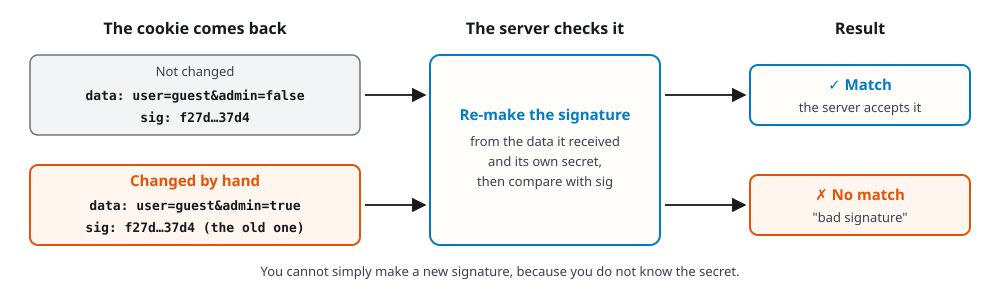
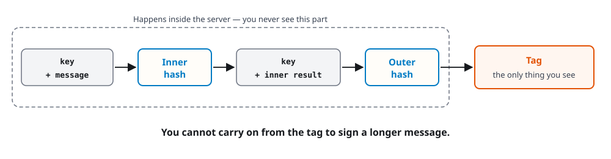

# Worksheet 3 — MACs: Hash-Only Cookies and Length-Extension

> **Course:** Cryptography and Network Security (KOSEN69) · **{{ slot_label }}**
> **Kind:** Docker lab, step by step. No programming and no maths.

> **Ethics note:** Only work on the 2 containers on your own computer that this lab starts (ports 8092 and 8093).
> Forging a cookie or token of a system that is not yours, without permission, is illegal. Keep the flag inside this lab.

## Read this first

**What you will do today:** a website "signs" its cookie so that nobody can change it. We will try to change it ourselves and see that the server catches us. Then we will run a script prepared by the instructor to see that this way of signing can still be forged, and see that the correct way to sign (HMAC) stops it.

**Every step is written the same way:**

| Heading | Meaning |
|---|---|
| **What to do** | Says what this step does |
| **Type** | Copy the whole line, paste it into the Terminal, and press Enter |
| **You should see** | The screen should look roughly like this |
| **Means** | What the result means |
| **Write in the answer sheet** | What to copy or write in your answer sheet |

**Marks**

- Everyone does **Part A (60 marks)**, which is the same for both forms.
- Then do **only your own form (40 marks)**. Look at the last digit of your student ID: **odd = Conventional (Part 2)**, **even = AIR-Sec (Parts 3–4)**. Write your form in the Group box.
- You may answer in English or Thai. Short and clear is enough.
- **Answer sheet:** in Classroom → Week 03, open the file for your form (`Wk03_Answer_Sheet_Conventional_odd_ID` or `Wk03_Answer_Sheet_AIR-Sec_even_ID`), choose Open with → Google Docs, type in the grey boxes, then choose File → Download → PDF.
- Submit one file named with your student ID, for example `Wk03_66990000.pdf` (do not type the `<` `>` signs), at `learn.zcr.ai/submit` with your Week 3 submission code from your KMITL email, by **Sunday 22 Nov, 23:59**.
- Items marked *optional* have no marks. You can skip them.

| Part A | Marks | Steps to write in the answer sheet |
|---|---:|---|
| A1 — Try editing the cookie by hand | 20 | Steps 1, 3, 5, 6 |
| A2 — Run the forgery and get the flag | 20 | Steps 8, 10, 11 |
| A3 — See that HMAC stops it | 20 | Steps 12, 13, 14, 15, 16 |

**Words you need to know**

| Word | Simple meaning |
|---|---|
| Terminal | A window where you type commands |
| Docker / container | A program that starts a small "pretend computer" on your computer. If you break it, delete it and start again |
| cookie | Data a website leaves on your computer to remember who you are |
| hash | Turning data into a fixed-size fingerprint (learned in Week 2) |
| secret | A secret code that only the server knows |
| signature (`sig`) | A value the server creates from the secret to check whether the data was changed |
| hex | Writing data with the digits 0–9 and the letters a–f |
| flag | A reward text of the form `FLAG{...}`, proof that you succeeded |
| key | A secret code; the same meaning as secret |
| MAC | A value that proves data was not changed, made from a key |
| tag | The output of a MAC; the same meaning as the signature `sig` in this lab |
| HMAC | The correct and widely used way to make a MAC |
| SHA-256, SHA-3 | Names of two different hashes |
| `\|\|` | Join data together; `A \|\| B` means A followed by B |
| replay | Sending the same data again |
| counter, timestamp, nonce | A count, a time, and a random value used once; they tell you whether data is new or old |
| length-extension | Writing more after an existing hash value to get the hash of longer data |

**Questions people often ask**

- *Do I need to be good at maths?* No. There is no calculation today.
- *Do I need to write programs?* No. Copy the commands and paste them.
- *If I make a mistake, will my computer break?* No. Everything is inside containers. If you get confused, type `docker compose down` and start again from Prep step 5.
- *Do I need to understand every character on the screen?* No. Look only at the lines the worksheet tells you to.
- *Is it wrong if my values are the same as my friend's?* No. This lab uses the same secret for everyone, but you must run it on your own computer.
- *How do I paste a command into the Terminal?* Copy the command from the worksheet, then Windows: press Ctrl+V or right-click · Mac: press Cmd+V, then press Enter.
- *How do I copy results from the Terminal?* Select the text with the mouse first, then Windows: press Ctrl+Shift+C · Mac: press Cmd+C. Or take a screenshot.

**If you see a message like this**

| Message on screen | Cause | Fix |
|---|---|---|
| `Cannot connect to the Docker daemon` or `error during connect` | Docker is not open | Open Docker Desktop and wait until it says Engine running |
| `no configuration file provided: not found` | The Terminal is not in the lab folder | Repeat Prep step 4 |
| `service "vulnerable" is not running` | The lab is not started | Do Prep steps 5 and 6 |
| `Failed to connect` or `Connection reset by peer` | The server is not ready yet | Wait a moment, then repeat Prep step 6 |
| Windows asks for `Uri`, or red text appears when you use `curl` | Windows has a different `curl` command | Change the first word to `curl.exe` |
| `FAIL: fixed app never came up` (after waiting about 30 seconds) | You forgot `-e FIXED_HOST=fixed` | Copy the Step 8 command again, the whole line |

If you still cannot do it, ask a friend or your instructor.

---

## Before you start: set up your computer (at home, once)

If you already did Week 2, you have Docker and the ZIP file. Start at **Prep step 4**. The old ZIP file can be reused. If you cannot find the `week03-macs` folder, download the ZIP again as in Prep step 2.

**If you turned your computer off and came back:** repeat Prep steps 1, 4, 5 and 6.

#### Prep step 1 — Open Docker Desktop

**What to do:** If you do not have it yet, install it from <https://www.docker.com/products/docker-desktop/> and leave the program open.

**You should see:** the Docker Desktop window says **Engine running**.

#### Prep step 2 — Download the lab files

**What to do:** Open <https://github.com/nutthakorn7/security-cryptography>, click the green **Code** button, and choose **Download ZIP**.

You do not need a GitHub account and you do not need to fork.

#### Prep step 3 — Unzip the ZIP file

**What to do:** Windows: right-click the ZIP file and choose **Extract All** · Mac: double-click the ZIP file. Put it somewhere easy to find, such as the Desktop.

**You should see:** a folder called `security-cryptography-master`. Some computers make a folder with the same name inside it; open it until you can see the `labs` folder.

#### Prep step 4 — Open a Terminal inside the lab folder

**What to do:** In `security-cryptography-master`, go to `labs`, then `week03-macs`.

- **Windows:** open the `week03-macs` folder in File Explorer, right-click an empty spot, and choose **Open in Terminal** (if you do not see it, hold Shift, right-click, and choose **Open PowerShell window here**).
- **Mac:** open the Terminal app, type `cd` and one space, drag the `week03-macs` folder into the window, then press Enter.

Check that you are in the right place with this command:

```bash
ls
```

**You should see:** `docker-compose.yml` and `exploit.py` in the list.

#### Prep step 5 — Start the lab

**Type:**

```bash
docker compose up -d
```

**You should see:** two lines ending in `Started`. The first time you need the internet and it may take several minutes. Do not close the window while you wait.

#### Prep step 6 — Check that the lab is ready

**Type:**

```bash
docker compose logs
```

**You should see:** a very long output, with the container name at the start of every line. That is normal. Scroll to find these two lines. You must see **both lines**:

```
vulnerable-1  |  * Running on http://127.0.0.1:8092
fixed-1       |  * Running on http://127.0.0.1:8093
```

Other `Running on` lines may appear between them. Ignore them. You only need to see `127.0.0.1:8092` and `127.0.0.1:8093`. If one is missing, wait a moment and type this command again.

---

## Part A — The lab (both forms, 60 marks)

A website remembers us with a **cookie**, but the cookie lives on *our computer*, so we can change it ourselves. The server therefore adds a signature `sig`, made from a secret that only the server knows. This site comes in two versions that are the same in every way except how they sign:

| Version | Port | How `sig` is made | Can it be forged? |
|---|---|---|---|
| `vulnerable_app.py` | `:8092` | `SHA256(secret + data)` | **Yes** |
| `fixed_app.py` | `:8093` | `HMAC-SHA256(secret, data)` | **No** |

> **If you really cannot use Docker:** tell your instructor, then open **<https://learn.zcr.ai/sim/mac-extend>**, choose *Admin cookie*, click **Compute the forged cookie**, and take a screenshot of both result boxes instead of Steps 8 and 12. Verifier A is the version on port 8092 and Verifier B is the nested-hash version, similar to HMAC, on port 8093 (this page uses a small pretend hash, not the real SHA-256). For Steps 1, 3, 5 and 13, copy the examples in the worksheet and write "from the worksheet example" next to them. The other steps can be answered by reading the worksheet.

### A1 — Try editing the cookie by hand (20 marks)



#### Step 1 — Log in as guest

**What to do:** Ask the server for a cookie as the user `guest`.

**Type** (Windows: change the first word `curl` to `curl.exe`):

```bash
curl -i "localhost:8092/login?user=guest"
```

**You should see:** several lines. Find these three lines:

```
Set-Cookie: data=757365723d67756573742661646d696e3d66616c7365; Path=/
Set-Cookie: sig=f27d2af10d667e1a70cc928912fd7494c3e29c575af355df66083faf890637d4; Path=/
logged in as guest
```

**Means:** the server gave us two cookie values, `data` and `sig`.

**✍️ Write in the answer sheet (Step 1):** copy the `data` and `sig` lines from your own screen.

#### Step 2 — Meet the two values

**What to do:** Just read. You do not need to type anything.

- `data` is our information, written in hex, so it is not readable yet.
- `sig` is the server's signature, used to check whether `data` was changed.

#### Step 3 — Turn the hex into readable text

**What to do:** Convert `data` back into text.

**Type:**

```bash
docker compose exec vulnerable python -c "print(bytes.fromhex('757365723d67756573742661646d696e3d66616c7365'))"
```

**You should see:**

```
b'user=guest&admin=false'
```

**Means:** the cookie says our name is `guest` and `admin=false`, so we are not an administrator. The `b` and the `'` marks are only how Python displays the result. Ignore them.

**✍️ Write in the answer sheet (Step 3):** copy the text you got.

#### Step 4 — Try the admin page with the real cookie

**What to do:** Send the real cookie to the `/admin` page, which is for administrators.

**Type** (Windows: change the first word to `curl.exe`):

```bash
curl --cookie "data=757365723d67756573742661646d696e3d66616c7365;sig=f27d2af10d667e1a70cc928912fd7494c3e29c575af355df66083faf890637d4" localhost:8092/admin
```

**You should see:**

```
{"error":"not admin"}
```

**Means:** the signature is valid, but the cookie says we are not an admin, so we cannot enter. That is correct.

#### Step 5 — Try to cheat: change `false` to `true`

**What to do:** The long hex value in this command is the text `user=guest&admin=true`. We changed it to `true` but still use the old `sig`.

**Type** (Windows: change the first word to `curl.exe`):

```bash
curl --cookie "data=757365723d67756573742661646d696e3d74727565;sig=f27d2af10d667e1a70cc928912fd7494c3e29c575af355df66083faf890637d4" localhost:8092/admin
```

**You should see:**

```
{"error":"bad signature"}
```

**Means:** the server caught that the data was changed.

**✍️ Write in the answer sheet (Step 5):** copy the answer the server gave.

#### Step 6 — Summarise in your own words

**What to do:** Fill in the blanks.

> The server rejects the cookie because the old `sig` does not match the ________ we changed, and we cannot create a new `sig` ourselves because we do not know the ________. (Choose: `data` / `secret`)

**✍️ Write in the answer sheet (Step 6):** write the full sentence.

### A2 — Run the forgery and get the flag (20 marks)

#### Step 7 — Why is this way of signing a problem?

**What to do:** Just read. You do not need to type anything.

SHA-256 splits the data into equal-sized blocks and reads them one block at a time, remembering how far it has read. In Week 2 we called the result of a hash a fingerprint. That is true, but the fingerprint is also exactly what the hash remembered when it finished the last block. So the `sig` we see is "the place where it stopped reading".

Think of a notebook where the owner signs at the bottom of the last page. Someone else could keep writing after that point without knowing what the first pages say. For `SHA256(secret + data)`, the first pages are the secret. This attack is called **length-extension**.

The `exploit.py` script prepared by the instructor does this. It starts from one ordinary cookie and knows only **how long** the secret is, but not what the secret is.

#### Step 8 — Run the script

**What to do:** Let the script try to forge a cookie against both websites. The script runs inside a container, so you do not need to install Python on your computer.

**Type** (copy the whole line; do not cut off `-e FIXED_HOST=fixed`):

```bash
docker compose exec -e FIXED_HOST=fixed vulnerable python exploit.py
```

**You should see:** lines that start with `[*]` are the script telling you what it is doing. You do not need to read them all. Look only at the last two lines:

```
PASS: forged cookie accepted by vulnerable app (:8092) -- flag = FLAG{...}
PASS: forged cookie correctly REJECTED by fixed/HMAC app (:8093) -- status=403, no flag
```

**Means:** `PASS` means the result is what it should be. The first line means the forged cookie was accepted and gave a flag. The second line means the website that uses HMAC did not accept it.

**Careful:** do not close or clear the Terminal until you finish Step 12. If you cannot find the lines, you can type the Step 8 command again.

**✍️ Write in the answer sheet (Step 8):** copy the **first PASS line** (the one with the flag).

#### Step 9 — Find the flag

**What to do:** In the first PASS line, look for the text after `flag =`, in the form `FLAG{...}`.

**Means:** we reached the admin page without knowing the secret at all.

#### Step 10 — Answer question a

**What to do:** Fill in the blanks (hint: read Step 7).

> The script (knows / does not know) the value of the secret. At the start it has one ordinary cookie and the ________ of the secret. (Choose: `value` / `length`)

**✍️ Write in the answer sheet (Step 10):** write the full sentence.

#### Step 11 — Answer question b

**What to do:** Fill in the blanks. The script did not guess the secret. It created a new `sig` with the extension method in Step 7.

> In Step 5 the server rejected the cookie because the `sig` did not match the edited `data`. This time it accepts because the `sig` the script made ________ the new `data`. (Choose: `matches` / `does not match`)

**✍️ Write in the answer sheet (Step 11):** write the full sentence.

### A3 — See that HMAC stops it (20 marks)

#### Step 12 — See the result for the website that uses HMAC

**What to do:** Go back and look at the **second PASS line** from Step 8. You do not need to type a new command.

**Means:** it is the same script, but the website that uses HMAC answered `403`, which means it did not accept the cookie and gave no flag.

**✍️ Write in the answer sheet (Step 12):** copy the second PASS line.

#### Step 13 — Find the lines that differ

**What to do:** Look at the code that creates `sig` in both files.

**Type:**

```bash
docker compose exec vulnerable grep -A1 "def make_cookie" vulnerable_app.py fixed_app.py
```

**You should see:**

```
vulnerable_app.py:def make_cookie(data: bytes) -> dict:
vulnerable_app.py-    sig = hashlib.sha256(MAC_SECRET.encode() + data).hexdigest()
--
fixed_app.py:def make_cookie(data: bytes) -> dict:
fixed_app.py-    sig = hmac_module.new(MAC_SECRET.encode(), data, hashlib.sha256).hexdigest()
```

**Means:** the line that contains `sig =` is the line that creates the signature. The vulnerable file uses plain SHA-256, and the fixed file uses HMAC (notice the word `hmac`). The `--` is only a separator between the two files.

**✍️ Write in the answer sheet (Step 13):** copy both `sig =` lines.

#### Step 14 — Answer question a

**What to do:** Look at the two lines from Step 13 and fill in the blanks (hint: which line contains the word `hmac`).

> The vulnerable file makes `sig` with ________ and the fixed file makes `sig` with ________. (Choose: `plain SHA-256` / `HMAC`)

**✍️ Write in the answer sheet (Step 14):** write the full sentence.

#### Step 15 — Why does HMAC stop it? (question b)

**What to do:** Read, then answer.



HMAC hashes **twice** and mixes the secret into both rounds. The first round is called the inner hash and the second round is called the outer hash. We only see the result of the last round (the Tag in the picture). The first round stays inside the server and we never see it. To extend a message you must continue from the first round, which we cannot see.

> Fill in the blanks, then add 1 more sentence in your own words: the `sig` we see is the result of the ________ round, but extending the message needs the result of the ________ round, which we cannot see. (Choose: `first` / `last`)

**✍️ Write in the answer sheet (Step 15):** write your answer.

#### Step 16 — What HMAC does not fix (question c)

**What to do:** Read, then answer.

Both files check the signature with `if sig != expected`. The `!=` operator compares one character at a time and stops at the first difference, so the time it takes can hint at how many characters were right. `hmac.compare_digest()` always takes the same time. The `==` operator has the same problem as `!=`.

> Fill in the blanks: you should check the signature with ________ because it takes ________ time, so it does not hint at how many characters were right. (Choose: `!=` / `hmac.compare_digest()` and `always the same` / `different`)

**✍️ Write in the answer sheet (Step 16):** write your answer.

#### Step 17 — Shut down the lab

**What to do:** Do this after you have copied all your results.

**Type:**

```bash
docker compose down
```

**You should see:** a line ending in `Removed`.

#### Step 18 — Check before you go on

**What to do:** See whether your answer sheet has everything:

- Steps 1, 3, 5, 6 (A1)
- Steps 8, 10, 11 (A2)
- Steps 12, 13, 14, 15, 16 (A3)

Then do your own form: odd IDs do Part 2; even IDs do Parts 3 and 4.

---

## Part 1 — Student Information
| Name | Student ID | Date | Group (your form) | AI tools used (which, for what) |
|---|---|---|---|---|
| | | | | |

---

## Part 2 — Conventional form (40 marks; only if Conventional is your assigned form)

Answer each in 2–3 sentences. You may answer in Thai. In this part you must **answer yourself** and not use AI. The question numbers come from the original question bank, so some numbers are skipped.

**Q1 (10). A cookie with no secret.** The server stores the cookie as `cookie = username || SHA-3(username)`, that is, the username followed by a hash of that username.

Answer both of these:

- If an attacker changes `bob` to `admin` and works out the new hash by themselves, will the server notice? Why?
- What is missing from this design? (Hint: something that only the server knows)

**Q3 (10). Replay.** A system sends `tag = MAC(k, message)` with no counter, timestamp or nonce. An attacker secretly records the message "Transfer 1000 THB" with its tag, then sends exactly the same message and tag again later.

Answer both of these:

- Why does the server still accept it? (Hint: were the message and the tag changed?)
- To prevent this, what should be added? Pick one.

**Q5 (10). Secret in front is not enough.** A developer uses `MAC = SHA-256(key || message)` with `message = "user=bob"`.

Answer both of these (no need for deep detail):

- What can an attacker who does not know the key do? (Hint: what you saw in Step 8)
- Why does HMAC not have this problem? (Hint: Step 15)

**Q6 (10). Design a safe cookie.** Design a safe cookie. Short points are fine:

- What goes into the cookie? (Hint: the username, the role, and an expiry time)
- What do you use to create the tag? (Hint: Step 14) And what kind of key should it be? (Hint: known only to the server, and hard to guess)
- What do you use to check the tag? (Hint: Step 16)
- How do you prevent replay? (Hint: Q3)

### Going further (optional — no marks)

- **Q2 — Short tags.** Why is a 64-bit tag on an IoT device riskier than a 256-bit one?
- **Q4 — Timing.** A server checks `if received_tag == computed_tag`. Why can a comparison that stops
  at the first wrong byte leak information?
- **Q7 — HMAC or KMAC?** Which would you pick for an old SHA-2 system, and which if you want
  variable-length output?
- **Q8 — Key rotation.** What are the trade-offs of rotating a MAC key every hour, every 1000
  messages, or never?
- **Q9 — A messaging protocol.** How would you use a MAC so A can send B messages that can't be
  changed or replayed, even when B is offline for a while?
- **Q10 — MACs and hash tables.** How does storing a MAC next to each value protect it from
  tampering, and can a hash collision get past that check?

---

## Part 3 — AIR-Sec Arm: Audit the AI (AIR-Sec version only, 20 points)

AI is a power tool you must **distrust** — you are graded on your *critique*, not the AI's answer.

Below is an AI assistant's answer to **Q6** (design a secure cookie using a MAC). It looks
professional and uses correct terminology, but it has **at least one subtly serious flaw**.
Your job: find it.

> **AI's answer to Q6:**
>
> "Design: the cookie stores three fields, joined with `|`: `user_id`, `issued_at` (Unix
> timestamp), and `role`. The server computes
> `tag = HMAC-SHA256(server_key, f"{user_id}|{issued_at}|{role}")` and sends the client
> `cookie = f"{user_id}|{issued_at}|{role}|{tag}"`.
>
> Verification: on each request, the server splits the cookie on `|`, recomputes
> `HMAC-SHA256(server_key, f"{user_id}|{issued_at}|{role}")`, and compares it to the received
> `tag` using Python's `==` operator. If they match, the request is accepted as authentic and
> the timestamp is logged for audit purposes.
>
> Replay prevention: because `issued_at` is embedded in the MAC'd data, any attempt to change
> it invalidates the tag, so an attacker cannot forge a *new* timestamp. This closes the replay
> window described in Q3, since old cookies are cryptographically bound to their original
> issue time.
>
> Why this is safer than hashing `key || message`: HMAC's nested construction means the
> internal hash state is never directly exposed to the attacker the way a naive
> `SHA256(key || message)` construction is, so length-extension does not apply. Additionally,
> since `issued_at` is part of the signed data, the server can always tell precisely when a
> cookie was issued."
>
> — end of AI answer —

The AI's answer above is in English, so you do not need to translate every word. Follow these steps one by one:

In this task, find **2 problems**.

**P3-1 Skim it:** there are four paragraphs. They start with Design, Verification, Replay prevention and Why this is safer.

**P3-2 Find the first problem:** read the *Verification* paragraph and look for the operator used to compare the tag. Think back to Step 16 in Part A.

**P3-3 Find the second problem:** read the *Replay prevention* paragraph and ask yourself: does the server use `issued_at` to check whether the cookie is too old? If an attacker sends the same cookie again, will it be caught?

The HMAC in this answer is correct, so do not look for a mistake there.

1. **Find what's wrong or risky.** Copy the sentences that have a problem, for **both of the 2 problems**, and write briefly what is wrong with each.
2. **Write the corrected version yourself.** Fix only those 2 problems. You do not need to rewrite everything. Say what should be used to compare the tag and what else the server should check, then write 2 sentences on why this answer looks correct if you only check that the tag matches, yet can still be attacked.

> Disclose any other AI use in the Part 1 table. This task counts toward the **Audit the AI** row.

---

## Part 4 — Comprehension & Prompt (AIR-Sec version only: EiPE 10 + Prompt 10)

**A. Explain in Plain English (EiPE, 10).** A developer friend says *"We put the secret in front of the message before hashing it, so nobody can change the message."*

Explain to your friend in 2–4 sentences, **without difficult words** (you may use the word hash). Answer both of these (hint: read Step 7 and use your own words):

- What can an attacker do?
- Why does putting the secret in front not protect the message? Explain with the idea that "a hash reads the data one block at a time and remembers how far it has read".

**B. Prompt Problem (10).** Use any AI you like and follow these steps:

1. Write **one** prompt that asks the AI *why HMAC stops this attack but `SHA256(key||message)` does not*. Ask the AI to explain it simply.
2. Copy the AI's answer into your answer sheet.
3. Check the AI's answer against what you learned, one point at a time:

- Does it explain that HMAC hashes **twice** with the key mixed in (an *inner* and an *outer* hash)?
- Does it say the real problem is *how the secret is used*, not that SHA-256 is "broken"?
- Does it make anything up (a wrong RFC number — HMAC is RFC 2104 — or a claim that SHA-3 has this
  same weakness; it does not)?

4. Write a critique of 3–5 sentences saying which points passed and which did not.

Submit the **prompt + the AI's answer + your own critique**.

---

## 🎤 Viva spot-check (formative/authenticity check; no separate points)

An instructor may ask any of these live, at random, to confirm you did the work yourself:

1. "In Step 5 the server rejected the cookie we edited ourselves, but in Step 8 it accepted the cookie from the script. What is the difference?"
2. "The script only knows how long the secret is. If the instructor makes the secret longer without telling the script, what do you think will happen?"
3. "Point to the `sig =` lines that differ in the two files, and say how that line stops the forgery."

---

## Grading rubric — assigned version totals 100

| Criterion | Conventional | AIR-Sec |
|---|---:|---:|
| A1 — get a signed cookie and try to change it | 20 | 20 |
| A2 — run the forgery and get the flag | 20 | 20 |
| A3 — show HMAC stops it + reasoning | 20 | 20 |
| Conventional written questions (Q1, Q3, Q5, Q6) | 40 | — |
| AIR-Sec Audit the AI | — | 20 |
| AIR-Sec Explain in Plain English (EiPE) | — | 10 |
| AIR-Sec Prompt Problem | — | 10 |
| **Total for the assigned version** | **100** | **100** |

## Evidence & Integrity (required)

- Put your name, student ID and the date in the answer sheet, and copy the commands and results from **your own** computer. The flag may be the same as your friends'. There is no per-student flag this week, but you must not submit a friend's results as your own.
- **Explain in your own words** (marks are given for the reasoning): why the forgery works on `:8092`, and why the website that uses HMAC on `:8093` does not accept it.

**Deadline and late work:** submit by 23:59 (Thai time) on **Sunday 22 Nov**. Late work loses 10% of this worksheet's marks per day (a part day counts as a day), down to 0. Uploading or replacing a file after the deadline counts as late for the whole submission. Submit the common 60 marks and **one** form of your own only; doing both forms gives no extra marks. The viva checks your understanding and has no separate marks.
