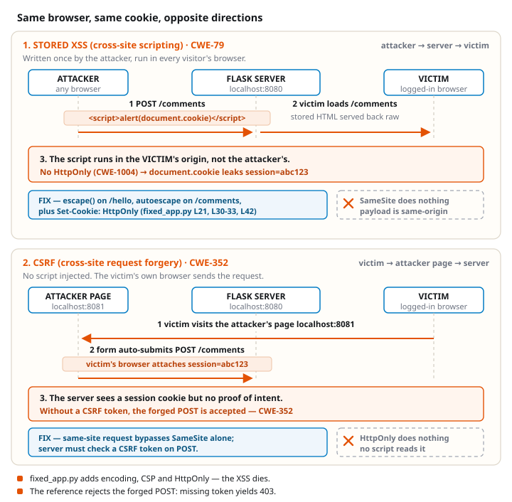

# Worksheet 5 — XSS and browser request controls

> Software Security 2 · KOSEN69 · Week 5 · OWASP 2025 **A05 Injection / CWE-79** (XSS) and **A01 Broken Access Control / CWE-352** (CSRF).

## Class contract

**150 minutes:** quiz/review 10, mechanism demo 15, common practical 100, debrief 20, save evidence 5. The task times below are planning budgets, not a student timing measurement. Prepare the lecture questions before class. Submit the common practical (60 points) and **one assigned format** (40 points): odd final student-ID digit = Conventional; even final digit, including 0 = AIR-Sec. Complete the assigned written format after class as needed. The other format and the extensions are optional reference practice. Check the live assignment for the exact deadline.

| Name | Student ID | Assigned format | Date |
|---|---|---|---|
| | | | |

**Authorized sandbox only.** Use the local lab and your own browser. `session=abc123` is a teaching value, never a real credential.

## Before class — concepts

1. Locate the reflected and stored XSS sinks in `vulnerable_app.py`. How is DOM XSS different?
2. Why does HTML text encoding stop `<script>`? Why would the same encoder be insufficient inside a JavaScript string or an untrusted URL?
3. What does CSP `script-src 'self'` add after output encoding?
4. What do `HttpOnly`, `SameSite`, and `Secure` control? Which protects a cookie from injected JavaScript, and which affects cookie attachment?
5. What does the same-origin policy stop an attacker page from **reading**? Does it stop that page from **submitting** an HTML form? Why can two localhost ports be different origins but the same site?

## Common practical — 100 minutes, 60 points

Build the image once while online, then the class can run without a package download:

```bash
cd labs/week05-xss-client-side
docker compose build
docker compose up --no-build --pull never
```

Open `http://localhost:8080/` first to set the sandbox session cookie. The app is bound to loopback only. Capture your own browser, terminal, and student ID together for evidence. In a second terminal, run `python3 -m http.server 8081 --bind 127.0.0.1` from this lab directory for Task 3. Both ports must be free.



```sim
xss-context
```

| Task | Minutes | Work and evidence |
|---|---:|---|
| 0. Baseline | 5 | Visit `/`, then `/hello?name=Alice` and `/comments`. Record the session cookie and a normal comment. |
| 1. Reflected XSS | 15 | In `/hello?name=`, try `<script>alert(1)</script>` and ``. Capture one execution and identify the HTML text sink. Count characters if you want the optional golf score. |
| 2. Stored XSS | 15 | Post `<script>alert(document.cookie)</script>` through the comment form; reload. Capture the script reading only the sandbox cookie. Explain why stored content can affect later visitors. |
| 3. Authenticated CSRF | 20 | While logged in at port 8080, visit `http://localhost:8081/csrf.html`. The page on a **different origin but the same site** submits a form to port 8080. Confirm the forged comment appears. Repeat in a fresh browser profile without first visiting port 8080: the POST must return 401 and add nothing. Record the request's Cookie header in DevTools, the response, and why missing-token validation permits the first request. |
| 4. Student patch and controls | 45 | Edit only `student_patch.py`: encode `render_name` and `render_comment` for an HTML text node; make `allow_post` require the sandbox session plus a nonempty token matching the server value. Run `docker compose run --rm xss-lab python student_checks.py`. Then restart with `docker compose run --rm --service-ports xss-lab python student_app.py`; repeat normal text, an XSS payload, a normal form POST, and `csrf.html`. The legitimate POST must work, scripts must render as text, and the forged POST must return 403. Show your changed lines and the browser results. |

The two localhost ports are **cross-origin** because port is part of origin, but **same-site** because site ignores port. Thus a SameSite cookie can accompany Task 3. The server must validate a token tied to the session. A cross-site `file://` attack page is **not** this exercise: modern browsers may withhold a default-Lax cookie from that POST.

To inspect the reference after your own patch, stop the current process and run:

```bash
docker compose run --rm --service-ports xss-lab python fixed_app.py
```

The reference uses output encoding, CSP and an unpredictable server token. It uses a hard-coded **sandbox** session and HTTP loopback; it is not a production login example. On HTTPS deployments set `Secure` on the cookie. CSP is defense in depth: once output is escaped, no script remains to trigger a CSP violation.

### Common practical scoring (60)

| Evidence | Points |
|---|---:|
| Baseline plus reflected/stored payloads, effect and sink explanation | 20 |
| Same-site, cross-origin forgery with cookie and no-session control | 15 |
| Student patch, normal and attack controls, explanation of encoding and token check | 25 |
| **Total** | **60** |

## Assigned Conventional format — 40 points

Answer in your own words using evidence from the common practical:

1. **XSS contexts (10):** Compare reflected, stored and DOM XSS; identify which two routes this app implements. Explain why escaping for HTML text is not a general URL or JavaScript string sanitizer.
2. **Browser boundaries (10):** Explain origin versus site using ports 8080/8081; distinguish same-origin policy, SameSite, HttpOnly and Secure.
3. **CSRF mechanism (10):** Explain why the request succeeds with a cookie and fails without one; why the token check stops it; and why an `Origin` check can add protection.
4. **Defense review (10):** Cite your patch lines and test output. Give one legitimate behavior that still works and one attack that fails. State the local sandbox's production limits.

## Assigned AIR-Sec format — 40 points

**Audit the AI (20):** Ask an AI assistant for an XSS and CSRF fix for this lab. Include its answer. Quote one incorrect or incomplete line, correct it, and verify the correction with your normal and attack controls. If its answer appears correct, quote one specific line, test it against an edge case, and explain the result and any remaining limit instead; a correct, independently verified answer can earn full credit. A claim that SameSite alone solves every CSRF case is a suitable flaw to investigate.

**Explain in plain English (10):** In 3–5 sentences explain why a comment can run as code and why a page on port 8081 can submit a request with the port-8080 session cookie.

**Prompt problem (10):** Write one precise prompt requesting an encoding and CSRF-token fix. Include your final prompt, the resulting code excerpt, and a before/after control result. Explain one limit of the generated answer.

## Optional extensions, no extra required points

- XSS Golf: minimize a payload while explaining its HTML context. A shorter string alone does not earn marks.
- Explore DOM XSS in an **optional** local target; this app has no DOM XSS sink.
- Show how `HttpOnly` changes `document.cookie` and why it does not stop page defacement by an injected script.
- Compare a cross-site attack page with the same-site port-8081 attack. Do not infer cookie attachment from a successful POST; inspect the Cookie request header.

## Evidence and submission

Submit the worksheet PDF on `learn.zcr.ai/submit` and your `student_patch.py` code link. Put a terminal showing your student ID and current date beside the browser in each screenshot. Include the exact payload, request/response or visible effect, and a short explanation of why the control works. Your instructor may ask you to reproduce a result. The live assignment states the due time and late policy.
# Worksheet 5 — Cross-Site Scripting & Client-Side Risks

> **Course:** Software Security (KOSEN69) · **{{ slot_label }}**
> **Aligned:** OWASP 2025 **A05 Injection / CWE-79** (XSS); **A01 Broken Access Control / CWE-352** (CSRF), **CWE-1004** (cookie without HttpOnly)
> **Signature game:** ⛳ **XSS Golf** — fire `alert(1)` in the fewest characters possible. Lower payload length = lower score = better. Par for reflected is the `` vector; can you go under par?

> ⚠️ **Ethics note:** Use only the provided `vulnerable_app.py` sandbox and your own Juice Shop container. Stealing real users' cookies or sessions is illegal. All "session theft" steps here target the sandbox cookie `session=abc123` only.

## Part 1 — Student Information

| Name | Student ID | Date | Group |
|------|-----------|------|-------|
|      |           |      |       |

## Part 2 — Lecture Questions

Answer in 2–4 sentences each.

1. Distinguish **reflected**, **stored**, and **DOM-based** XSS by *where* the untrusted data is injected and *when* it executes. Which two does our `vulnerable_app.py` implement, and at which routes?
2. How does **contextual output encoding** (`markupsafe.escape`) stop `<script>` from executing? Why is HTML-context encoding different from JavaScript- or URL-context encoding?
3. Explain how a strict **Content-Security-Policy** (`script-src 'self'`) defeats an *injected* inline script even when encoding is missing.
4. What do the cookie flags **HttpOnly**, **SameSite**, and **Secure** each protect against? Map each to a concrete attack (cookie theft via XSS, CSRF, network sniffing).
5. Why does **CSRF** (CWE-352) work without script injection? Why can different localhost ports be cross-origin but same-site, so a CSRF token is still needed?

## Part 3 — Hands-on Lab (125 min in class + 25 min homework)

> **In class or homework.** Tasks marked *in class* are done during the lab, where the instructor
> checks your evidence and reasoning. Tasks marked *homework* are finished after class and submitted
> with the rest of this worksheet, before the next class. Every task keeps its time and its marks.
> Answer Part 2 before class, from this week's slides; Part 4, *Audit the AI* and *Comprehension &
> Prompt* are homework.
>
> **In class (125 min):** Tasks 0, 1, 2, 4 and 5 · **Homework (25 min):** Task 3


**Learning goals:** land reflected + stored XSS, abuse a JS-readable cookie, build a same-site, cross-origin CSRF PoC against the comment board, then prove `fixed_app.py` blocks it with a token check.

**Prerequisites:** Docker + Docker Compose, a browser with DevTools, a text editor. Working dir: `{{ labpath }}/`.

### Environment setup

```bash
cd {{ labpath }}
docker compose build         # once while online
docker compose up --no-build --pull never  # vulnerable_app.py
# vulnerable app -> http://localhost:8080   (service name: xss-lab, port 8080)
```
Optional secondary target (for DOM XSS, which our app does not expose):
```bash
docker run --rm -p 127.0.0.1:3000:3000 bkimminich/juice-shop  # -> http://localhost:3000
```

**What to submit per task:** the exact **payload**, a **screenshot** of the alert/effect, and a **2–3 sentence mitigation**.

---

**Task 0 — Onboarding (5 min, in class).** Browse `http://localhost:8080/`. Open DevTools → Application → Cookies and confirm `session=abc123` is set with **no HttpOnly and no explicit SameSite**. Screenshot it. *Deliverable: screenshot.*

**Task 1 — Reflected XSS + XSS Golf (30 min, in class) ⛳.**
- *Goal:* execute JS via `/hello`, then minimize the payload.
- *Steps:* visit `/hello?name=<script>alert(1)</script>`, then the alternate `/hello?name=` (useful when `<script>` tags specifically are filtered — note it's actually 3 characters longer, not shorter). Record each payload's character count for your golf score.
- *Deliverable:* both payloads + char counts + screenshot of `alert(1)` + your lowest score.

**Task 2 — Stored XSS (30 min, in class) ⛳.**
- *Goal:* persist a script that runs for every visitor of `/comments`.
- *Steps:* POST a comment with body `<script>alert(document.cookie)</script>` (use the form or `curl -d 'body=...'`). Reload `/comments` and watch the cookie pop.
- *Deliverable:* payload + screenshot of the alert showing `session=abc123` + why stored XSS is more dangerous than reflected.

**Task 3 — Cookie theft via XSS (25 min, homework).**
- *Goal:* show the cookie is readable by injected JS because **HttpOnly is missing** (CWE-1004).
- *Steps:* store `<script>new Image().src='http://localhost:8080/hello?name='+document.cookie</script>` (a beacon), or simply ``. Observe the cookie value being exfiltrated/displayed.
- *Deliverable:* payload + screenshot + 2–3 sentences on how HttpOnly would have stopped this.

**Task 4 — CSRF PoC (30 min, in class).**
- *Goal:* use a page on a different origin but the same site to forge an authenticated comment POST.
- *Steps:* after opening `http://localhost:8080/` to set the sandbox cookie, run `python3 -m http.server 8081 --bind 127.0.0.1` in this lab folder and visit `http://localhost:8081/csrf.html`. Port 8081 is a different origin; localhost is the same site, so the session cookie accompanies the POST. Confirm the comment appears. In a fresh browser profile without a session, the same POST returns 401.
- *Deliverable:* the supplied `csrf.html`, screenshot of the forged comment, Cookie request header, and the fresh-profile 401 control. Explain that the vulnerable endpoint checks the cookie but not a CSRF token. `file://` is cross-site and modern default-Lax cookie behavior may block that POST; do not use it as this task's proof.

```sim
xss-context
```

**Task 5 — Defend / fix it (30 min, in class) 🛡️.**
- *Goal:* prove the reference blocks XSS and rejects the same-site forged POST while allowing a normal comment.
- *Steps:* stop the vulnerable container, then run `docker compose run --rm --service-ports xss-lab python fixed_app.py`. Reload `http://localhost:8080/` to set the hardened sandbox cookie. Re-fire Tasks 1–2: output renders as text, and the response has a CSP header. Submit a normal comment through the form; it succeeds with the server token. Re-run `http://localhost:8081/csrf.html`; the forged POST returns **403** because its token is missing, even though the SameSite=Strict cookie is attached. On loopback HTTP the example omits the `Secure` flag; production HTTPS requires it.
- *Deliverable:* XSS before/after, CSP and HttpOnly/SameSite response headers, normal comment, forged 403, and 2–3 sentences explaining the token check.

## Part 4 — Reflection

1. **CWE/OWASP mapping:** map your reflected/stored XSS to **CWE-79** and your CSRF PoC to **CWE-352**, under OWASP 2025 **A05 Injection** (XSS) and **A01 Broken Access Control** (CSRF), respectively.
2. **Real breach:** the **2018 British Airways breach** (~380k payment records) used malicious JavaScript (Magecart) injected into the site to skim card data — a client-side script-injection failure. In 3–4 sentences relate it to this lab's XSS and CSP lessons.
3. **Best mitigation:** between output encoding, a strict CSP, and HttpOnly+SameSite cookies, which gives the broadest defense-in-depth, and why is "encoding alone" still risky?

## Grading rubric (100)

| Criterion | Points |
|-----------|-------:|
| Part 2 — Lecture questions (conceptual accuracy) | 20 |
| Part 3 — Exploitation + evidence (payloads + screenshots, Tasks 1–4) | 40 |
| Part 3 — Defense (Task 5: fixes proven, lines cited) | 25 |
| Part 4 — Reflection (CWE/OWASP mapping, breach, mitigation) | 15 |
| **Total** | **100** |

**Due:** 23:59 (Thai time) the night before next week's class (exact time on learn.zcr.ai/submit). **Late:** −10% per started day; 0 after 10 days.

---

## Evidence & Integrity (required)

- **Identity proof:** every screenshot/diagram must show a terminal running `printf '%s | %s | ' "$(whoami)" '<YOUR-STUDENT-ID>'; date '+%F %T %Z'` **in the
  same image as the evidence**. When the evidence is a browser page, a DevTools panel or a
  rendered response, put that terminal **beside the browser and capture the whole screen** — a
  cropped window carries nothing that identifies you, and the lab's own output is
  byte-identical for the whole cohort *by design*, so the stamp is the only thing that makes
  the shot yours. Generic or borrowed evidence is not accepted.
- **Personalized flag (if this lab issues one):** ____________________
  *Flags are unique per student — submitting another student's flag is a violation. How to submit: **learn.zcr.ai/submit** (full guide: [SUBMISSION.md](../../SUBMISSION.md)).*
- **Explain in your own words** *(graded on your reasoning, not copied text):*
  1. What did you do, and **why did the vulnerability work**?
  2. **Why does your fix actually stop it** — and what could still break it?

---

## 🤖 Audit the AI (required)

AI is a power tool you must **distrust** — you are graded on your *critique*, not the AI's answer.

1. Ask an AI assistant to exploit **or** fix this week's vulnerability. Paste its full answer.
2. **Find what's wrong or risky** in it — insecure code, a subtly incomplete fix, a hallucinated API/function/CVE, a missed edge case, or wrong reasoning. Quote the exact line(s).
3. Produce the **correct, verified** version yourself and explain in 2–3 sentences why the AI's output was insufficient.

> Disclose your AI use in the Part 1 table. This task counts toward your **Defense + Reflection** score.

---

## 🧠 Comprehension & Prompt (required)

**A. Explain in Plain English (EiPE).** In 2–3 sentences, in your own words, describe what this week's vulnerable code/endpoint actually *does* and *why it is exploitable* — explain the mechanism, don't dump jargon.

**B. Prompt Problem.** Write a **single prompt** that makes an AI produce a *correct, secure* fix for one finding. Run it: does the exploit now fail? If not, refine the prompt and try again. Submit the **final prompt + the verified result**.
*Graded on the prompt's precision and your verification — this trains problem decomposition and AI literacy (Denny et al. 2024).*
